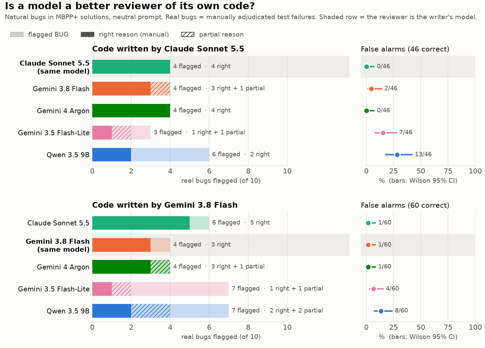
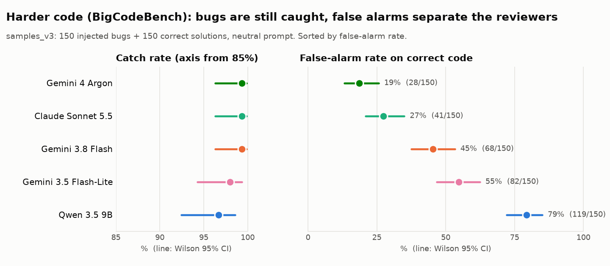
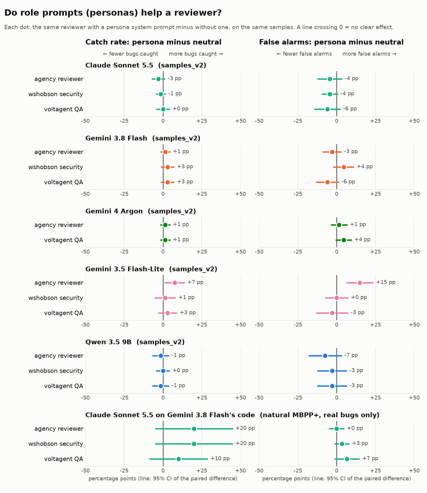

# review-bench

A benchmark that measures **how well LLMs review code written by another (or the same) LLM**.

Many "second opinion" tools ask a second model to review the first model's code. None of them measures
whether that second opinion is any good. review-bench does: it feeds reviewers code with known bugs and
known-correct code, and scores what they say.

**Research question:** is a different-model reviewer better than a same-model reviewer, and can a free
local model replace a paid one?

## Key findings

1. **No same-model effect.** Claude Sonnet 5.5 and Gemini 3.8 Flash each wrote solutions to the same 377
   MBPP+ tasks. Neither model is a better reviewer of its own code: Claude finds 4 of its own 10 real bugs
   for the right reason and 5 of Gemini's, Gemini Flash 3 of Claude's and 3 of its own. Which model
   reviews matters more than who wrote the code (counts on 10 bugs each, not significant).
2. **The free local model does not replace the paid ones.** Qwen 3.5 9B catches about as many bugs, but
   flags 12–79% of correct code depending on the set (significantly more than Claude, Gemini Flash and
   Argon on the synthetic sets and on Claude's MBPP+ code under the neutral prompt) and names the actual
   defect in only 3 of its 14 `BUG` verdicts on real Claude bugs and 2 of its 7 on real Gemini bugs.
3. **Strong reviewers hit a ceiling on injected bugs** (100% on HumanEval mutants, 91–97% on subtle MBPP+
   mutants, 99% on longer BigCodeBench code), and Claude, Gemini Flash and Gemini Argon are statistically
   indistinguishable on catches. False alarms
   are what separate reviewers, and many of them are real defects in the reference solutions (11 of the 12
   most-flagged MBPP+ references).
4. **Failing tests are a poor label for model-written code.** Of 46 failing Claude solutions and 60
   failing Gemini solutions, only 10 each are real writer bugs on manual review; the rest are oracle bugs
   or behaviour the one-sentence task never states. Strong reviewers flag 4–6 of each writer's 10 real bugs.
5. **Prompt tricks do not help reliably.** An adversarial prompt, a "list edge cases first" prompt and 7
   role prompts (personas) from popular Claude Code agent collections never improved a reviewer
   significantly overall; personas make Claude more suspicious on real code (+1–2 real bugs, more false
   alarms), and The Agency's code reviewer makes Flash-Lite flag more correct code on all four sets
   where it was tested (significant on two).
6. **Two reviewers are not significantly better than the better one**, and verdicts are not fully
   repeatable (3–10% flip between identical runs), so differences of a few samples are noise.
7. **Cost:** Gemini Flash costs $0.0014–0.0022 per review here, Argon $0.0055 at today's price on the
   longer BigCodeBench code, Claude $0.007–0.011 at API list price; Flash-Lite is 4–7× cheaper than Flash
   but raises more false alarms on every set (28–55% vs Flash's 13–45% on the synthetic sets).

## Results at a glance

Neutral prompt. Synthetic sets: F1 and false-alarm rate. Model-written code (MBPP+ solutions that fail
the tests): real bugs flagged **for the right reason** out of the 10 confirmed per writer (+ partial),
and the false-alarm rate on that writer's passing code. Details, intervals and tests are in
[docs/results.md](docs/results.md).

| reviewer | HumanEval mutants (`samples_v1`) | subtle MBPP+ mutants (`samples_v2`) | BigCodeBench mutants (`samples_v3`) | Claude-written code | Gemini-written code | cost per call (`samples_v2` · `samples_v3`) |
|---|---|---|---|---|---|---|
| Claude Sonnet 5.5 | F1 0.952 · FA 10% | F1 0.841 · FA 25% | F1 0.876 · FA 27% | 4 right · FA 0% | 5 right · FA 2% | $0.0072 · $0.0109 (list-price equivalent; subscription) |
| Gemini 3.8 Flash | F1 0.939 · FA 13% | F1 0.840 · FA 30% | F1 0.812 · FA 45% | 3 (+1) · FA 4% | 3 · FA 2% | $0.0019 · $0.0022 |
| Gemini 4 Argon | F1 0.952 · FA 10% | F1 0.887 · FA 18% | F1 0.911 · FA 19% | 4 · FA 0% | 3 (+1) · FA 2% | $0.0013 (intro price, half of today's) · $0.0055 |
| Gemini 3.5 Flash-Lite | F1 0.857 · FA 28% | F1 0.764 · FA 45% | F1 0.776 · FA 55% | 1 (+1) · FA 15% | 1 (+1) · FA 7% | $0.0003 · $0.0005 |
| Qwen 3.5 9B (local) | F1 0.816 · FA 35% | F1 0.744 · FA 61% | F1 0.700 · FA 79% | 2 · FA 28% | 2 (+2) · FA 13% | $0 · $0 |

FA = false alarm (correct code flagged as buggy). Some "false alarms" are real defects in the reference
solutions (11 of the 12 most-flagged on `samples_v2`, 9 of the 15 most-flagged on `samples_v3`).

## Results in detail

All numbers come from 16,215 logged reviewer calls in 15 run directories; every call is in
`results/<run>/calls.jsonl` and every dataset in `data/`, so the tables can be rebuilt without new API
calls (`python -m reviewbench report <run dirs...>`). Rates carry Wilson 95% intervals; differences are
tested with exact McNemar on the same samples, Holm-adjusted. The full tables, per-set findings and
manual reviews are in **[docs/results.md](docs/results.md)**:

- [Synthetic bugs, HumanEval (`samples_v1`)](docs/results.md#synthetic-bugs-samples_v1-100-buggy--100-correct)
- [Subtle synthetic bugs, MBPP+ (`samples_v2`)](docs/results.md#subtle-synthetic-bugs-samples_v2-67-buggy--67-correct-mbpp)
- [Harder tasks, BigCodeBench (`samples_v3`)](docs/results.md#harder-tasks-samples_v3-150-buggy--150-correct-bigcodebench)
- [Natural bugs in Claude's code (HumanEval+, MBPP+)](docs/results.md#natural-bugs-natural_plus_v1-claude-written-solutions-humaneval-tests)
- [Writer × reviewer: Gemini-written code](docs/results.md#writer--reviewer-gemini-written-code-natural_mbpp_gemini_v1-mbpp-tests)
- [Prompt variants, repeatability, right reasons, ensembles](docs/results.md#a-third-prompt-list-edge-cases-first-edgecases_v1-claude-and-qwen-samples_v2)
- [Persona results](docs/results.md#persona-results-role-prompts-from-popular-claude-code-agents)

**Same-model question.** Real bugs flagged and named for the right reason, by writer and reviewer:



**Harder code raises false alarms, not misses** (`samples_v3`, BigCodeBench):



**Personas** (role prompts from popular Claude Code agent collections) do not make strong reviewers better:



## What is measured

For every reviewer and prompt variant:

| metric | definition |
|---|---|
| catch rate (recall) | buggy samples flagged `BUG` / buggy samples |
| localization | caught bugs whose reported line is within ±1 of the real bug line |
| false-alarm rate | correct samples flagged `BUG` / correct samples |
| precision, F1 | from the above |
| parse-failure rate | answers that are not valid JSON; counted as "not flagged", never as `OK` |
| cost, latency | per call, logged |

Every rate is reported with a **Wilson 95% confidence interval**. Reviewers are compared on the **same
samples** with an **exact McNemar test** (Holm-adjusted across all comparisons in a report). All metrics
are broken down by bug type and by prompt.

## How it works

1. **Dataset** (`data/samples_v1.jsonl`, 200 samples). 100 HumanEval tasks, each giving one
   **correct** sample (the canonical solution, verified against its tests) and one **buggy** sample: a
   single AST mutation of the solution that makes the tests fail. Six mutation operators, balanced:
   `off_by_one`, `comparison_flip`, `arith_op`, `bool_op`, `wrong_return`, `remove_branch`. Mutants that
   still pass the tests (equivalent mutants) are discarded. The edit is spliced into the original source,
   so a buggy sample differs from the correct one only on the bug line. Two more sets are built the same
   way: `samples_v2` (MBPP+; a mutant is kept only if it passes the task's own examples and fails the
   stricter MBPP+ tests, so the bug hides from the example) and `samples_v3` (150 BigCodeBench tasks with
   imports, longer docstrings and numpy/pandas code).
2. **Natural bugs** (`data/natural_plus_v1.jsonl`, `data/natural_mbpp_v1.jsonl`,
   `data/natural_mbpp_gemini_v1.jsonl`). Claude (and, for MBPP+, Gemini Flash) writes solutions to
   HumanEval and MBPP+ tasks; solutions that fail the stricter HumanEval+ / MBPP+ tests become
   buggy samples, passing ones correct samples (for MBPP+, as many as there are bugs). This is the
   realistic "review the model's code" setting. Failing solutions are reviewed by hand, because a failing
   test is not always a bug in the solution.
3. **Reviewers** see only the task description and the line-numbered code — never the tests or the bug
   type — and answer `{"verdict": "BUG"|"OK", "line": int|null, "explanation": str}`. Two main prompts:
   `neutral_v1` ("is it correct?") and `adversarial_v1` ("this code may contain a bug, try hard to find it");
   also `edgecases_v1` and persona system prompts (`prompts/personas/*.md`) on some sets.
4. **Runner** logs one JSON line per call to `results/<run_id>/calls.jsonl`, resumes interrupted runs
   without repeating finished calls, retries transient errors with backoff, and stops a reviewer that hits
   a quota or its budget cap.
5. **Sandbox:** all generated or mutated code runs in a separate Python process with a timeout, never
   in the main process.

| reviewer | model (see `config.yaml`) | access |
|---|---|---|
| `ollama` | `qwen3.5:9b`, local, thinking off | free |
| `gemini` | `gemini-3.8-flash`, thinking `low` | paid API (prepaid credits, budget cap) |
| `gemini-lite` | `gemini-3.5-flash-lite`, thinking `minimal` (same adapter as `gemini`) | paid API |
| `gemini-argon` | `gemini-4-argon`, thinking `low` (same adapter as `gemini`) | paid API |
| `claude` | `claude-sonnet-5-5` via `claude -p`, effort `low` | Claude subscription |

## Setup (Windows, PowerShell)

```powershell
py -3.11 -m venv .venv
.venv\Scripts\Activate.ps1
pip install -r requirements.txt
```

Optional, per reviewer:
- **ollama:** install Ollama and run `ollama pull qwen3.5:9b`.
- **gemini:** put `GEMINI_API_KEY=...` in `.env` (gitignored).
- **claude:** the `claude` CLI, signed in.

A reviewer whose auth is missing is skipped with a message.

## Usage

```powershell
python -m pytest -q
python -m reviewbench build-dataset                      # -> data/samples_v1.jsonl (refuses to overwrite without --force)
python -m reviewbench build-dataset --version v2         # -> data/samples_v2.jsonl (subtle MBPP+ mutants)
python -m reviewbench build-dataset --version v3         # -> data/samples_v3.jsonl (BigCodeBench, needs faker + pyfakefs)
python -m reviewbench build-natural                      # -> data/natural_plus_v1.jsonl (Claude as writer, HumanEval+ tests)
python -m reviewbench build-natural --source mbpp        # -> data/natural_mbpp_v1.jsonl (MBPP+ tasks and tests, balanced)
python -m reviewbench build-natural --source mbpp-gemini # -> data/natural_mbpp_gemini_v1.jsonl (Gemini Flash as writer)
python -m reviewbench run --reviewers ollama --limit 5   # smoke run
python -m reviewbench run --reviewers ollama,gemini,claude --run-id my-run
python -m reviewbench run --reviewers claude --dataset data/natural_plus_v1.jsonl --run-id natural
python -m reviewbench report results/my-run              # terminal table + report.md + plots
python -m reviewbench report results/natural-mbpp-v1 --adjudication docs/natural_mbpp_v1_adjudication.json
python -m reviewbench figures                            # README figures: writer x reviewer, persona effect, samples_v3
python -m reviewbench compare-runs results/samples-v2 results/samples-v2-repeat   # repeatability
```

Re-running `run` with the same `--run-id` continues where it stopped.

### Reviewing your own code

```powershell
python -m reviewbench review path\to\file.py
python -m reviewbench review path\to\file.py --reviewer gemini --task "Return the median of a non-empty list"
```

`review` sends one whole file (numbered lines) and prints the verdict, the reported line and the
explanation. Without `--reviewer` it prints the benchmark ranking (F1 and cost per call in the runs listed
under `review.results` in `config.yaml`, counting only calls with the same prompt, `neutral_v1` by default,
and the model now in config). Reviewers within `review.f1_tolerance` (0.02) of the best F1 count as tied,
and the cheapest per call among the available ones is used; if no results match, it uses the
`review.fallback` order. Cost per call is the logged API list-price equivalent, so a price change after
the runs is not reflected (Argon was logged at its introductory price, half the current one). Without
`--task` the reviewer is told to infer the intent from the code. One reviewer, one verdict, one line:
a file with several bugs gets only the first one the reviewer reports.

## Known limitations

- Injected bugs are small and synthetic; HumanEval functions are short.
- HumanEval may be in the models' training data.
- Few prompt variants: neutral and adversarial for every reviewer, an edge-case prompt and 7 personas
  for some. Results can depend on prompt wording; the personas are other people's texts, used as written.
- Persona stage 2 does not cover every reviewer and set: Argon ran two personas on `samples_v2`,
  the natural-bug sets were reviewed with personas by Claude, Qwen and Flash-Lite only
  (API credit; see [Persona results](docs/results.md#persona-results-role-prompts-from-popular-claude-code-agents)).
- Small samples (92–300 per set); see the confidence intervals next to every rate.
- "Correct" means "passes the dataset's tests" (HumanEval, MBPP+, BigCodeBench). Some reference solutions
  disagree with their task text, so some false alarms are real findings (see the manual reviews).
- Reviewers do not run under identical settings: thinking cannot be fully turned off for Gemini or
  Claude (each uses its lowest level, logged per call), and `claude -p` has no temperature control.
- Natural bugs have no known bug line, so localization is not scored for them.
- Test labels for natural bugs are noisy: of 53 failing Claude solutions (7 HumanEval+, 46 MBPP+), only
  12 are clear Claude bugs on manual review; of 60 failing Gemini solutions, 10. MBPP tasks are one
  sentence plus one example, so many expected behaviours are never stated. The manual classes and the
  right-reason grades are one person's judgement.
- Real natural bugs are few (10 per writer on MBPP+, 2 on HumanEval+), so the writer × reviewer and
  right-reason findings are counts, not rates with tight intervals.
- `samples_v3` (BigCodeBench) uses only tasks that need the standard library, numpy and pandas, and its
  canonical solutions were verified on Windows only (48 of 515 excluded here; another OS would exclude a
  different set). Its bugs are injected mutations, not model-written; only the 15 false alarms shared by
  the three strong reviewers were checked by hand.
- Only two writers (Claude Sonnet 5.5, Gemini 3.8 Flash), both strong models; the same-model question is
  not tested for weak writers.

## Project layout

```
reviewbench/
  dataset.py    HumanEval, MBPP+ and BigCodeBench loading, canonical verification, build-dataset
  mutate.py     AST mutation operators
  sandbox.py    run code + tests in a subprocess with a timeout
  writer.py     natural bugs: Claude or Gemini as writer
  reviewers/    base.py (interface, prompts, parsing), ollama.py, gemini.py, claude.py
  runner.py     resume, retries, per-reviewer concurrency, budget cap, JSONL logging
  scoring.py    metrics, Wilson CI, McNemar, Holm
  report.py     report.md + plots
  figures.py    cross-run README figures (writer x reviewer, persona effect, samples_v3)
  review.py     review command: rank reviewers by benchmark F1, pick the best available
prompts/        neutral_v1, adversarial_v1, edgecases_v1, writer_v1, writer_mbpp_v1
  personas/     7 persona system prompts (MIT, sources in each file header) + LICENSES.md
docs/           results.md (full result tables), manual reviews (adjudication, right-reason grading), images
config.yaml     models, prices, budgets, concurrency
tests/          pytest
```

## License

MIT, see [LICENSE](LICENSE). The persona prompts in `prompts/personas/` are third-party texts under their own
MIT licenses ([LICENSES.md](prompts/personas/LICENSES.md)). HumanEval, MBPP+ and BigCodeBench samples in
`data/` come from their public datasets and keep those datasets' licenses.
