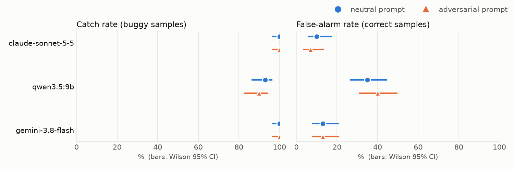
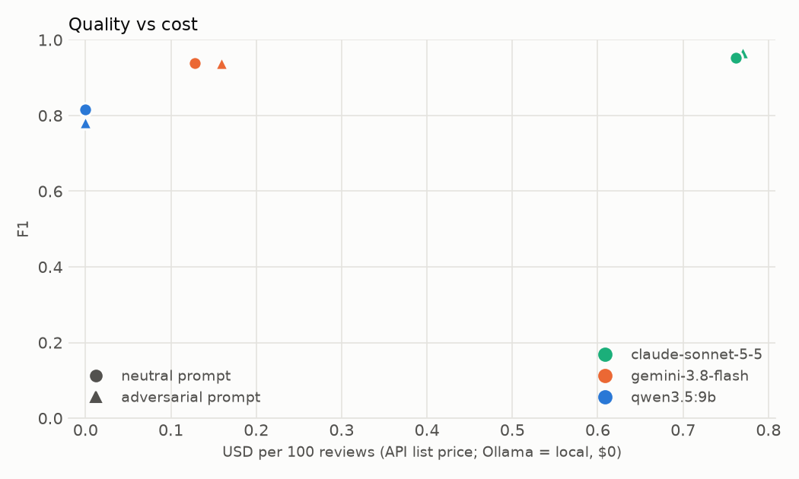
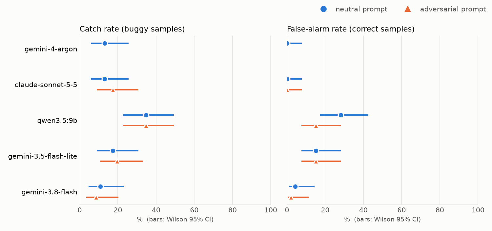

# review-bench

A benchmark that measures **how well LLMs review code written by another (or the same) LLM**.

Many "second opinion" tools ask a second model to review the first model's code. None of them measures
whether that second opinion is any good. review-bench does: it feeds reviewers code with known bugs and
known-correct code, and scores what they say.

**Research question:** is a different-model reviewer better than a same-model reviewer, and can a free
local model replace a paid one?

## Results

All numbers come from logged calls (runs `ollama-full-v1`, `gemini-full-v1`, `claude-full-v1`,
`gemini-lite-full-v1`, `gemini-argon-full-v1`, `natural-plus-v1`, `natural-mbpp-v1`; 4,095 calls, 0 API
errors). Brackets are Wilson 95% CIs. Significance = exact McNemar on the same samples, Holm-adjusted
across the 40 comparisons in each report (adding reviewers adds comparisons, so the adjustment gets
stricter). Gemini 4 Argon ran with the neutral prompt only, to fit the remaining API credit. Reproduce with
`python -m reviewbench report <run dirs...>`.

### Synthetic bugs (`samples_v1`: 100 buggy + 100 correct)

| reviewer | prompt | catch rate | localization (±1 line) | false alarm | F1 | parse fail | mean latency |
|---|---|---|---|---|---|---|---|
| Claude Sonnet 5.5 | neutral | 100% [96–100] | 95% [89–98] | 10% [6–17] | 0.952 | 0% | 6.4 s |
| Claude Sonnet 5.5 | adversarial | 100% [96–100] | 94% [88–97] | 7% [3–14] | 0.966 | 0% | 6.6 s |
| Gemini 3.8 Flash | neutral | 100% [96–100] | 97% [92–99] | 13% [8–21] | 0.939 | 0% | 3.7 s |
| Gemini 3.8 Flash | adversarial | 100% [96–100] | 96% [90–98] | 13% [8–21] | 0.939 | 0% | 4.5 s |
| Gemini 4 Argon | neutral | 100% [96–100] | 97% [92–99] | 10% [6–17] | 0.952 | 0% | 7.0 s |
| Gemini 3.5 Flash-Lite | neutral | 96% [90–98] | 96% [90–98] | 28% [20–37] | 0.857 | 0.5% | 0.7 s |
| Gemini 3.5 Flash-Lite | adversarial | 98% [93–99] | 96% [90–98] | 29% [21–39] | 0.863 | 0% | 0.7 s |
| Qwen 3.5 9B (local) | neutral | 93% [86–97] | 91% [84–96] | 35% [26–45] | 0.816 | 2.5% | 11.1 s |
| Qwen 3.5 9B (local) | adversarial | 90% [83–94] | 91% [83–95] | 40% [31–50] | 0.783 | 2.0% | 11.9 s |

Cost for the 400 calls per reviewer: Gemini Flash $0.57 (billed), Claude $3.06 API list-price equivalent
(run on a subscription, not billed per call), Qwen $0 (local), Flash-Lite $0.13 (billed). Argon: $0.35 for
200 calls at its introductory price (it doubles on 2026-12-01).





- **The free local model does not replace the paid ones.** Qwen's false-alarm rate is significantly higher
  than Claude's and Gemini Flash's under both prompts (all four comparisons p ≤ 0.002). It also catches
  fewer bugs (90–93% vs 100%), but that difference is not significant after Holm adjustment.
- **Claude, Gemini Flash and Gemini Argon are indistinguishable here.** All catch every injected bug; no
  false-alarm difference between them is significant. The larger Argon model gives no gain over Flash.
- **The small cheap model sits between the strong ones and Qwen.** Flash-Lite is the fastest (0.7 s) and
  cheapest paid reviewer and catches 96–98% of bugs, but raises false alarms on 28–29% of correct code:
  significantly more than Claude, Flash and Argon (p ≤ 0.046). Its false-alarm rate is not significantly
  different from Qwen's on this set.
- **No prompt effect.** Adversarial vs neutral is not significant for any reviewer, on catches or on false
  alarms. The hypothesis "adversarial raises catches and false alarms" is not supported.
- **Ceiling effect.** Single-mutation bugs are too easy for the strong reviewers, so this set cannot rank
  them on catch rate.
- **Part of the "false alarms" are real defects.** Of the 16 canonical solutions Gemini flagged, 7 have a
  verified defect the HumanEval tests miss (e.g. `valid_date('01-31-2000')` returns `False`). See
  [docs/false_alarm_review.md](docs/false_alarm_review.md).

### Natural bugs (`natural_plus_v1`: Claude-written solutions, HumanEval+ tests)

Claude Sonnet passed 163 of 164 tasks on the original HumanEval tests, so the stricter HumanEval+ tests
are used: 7 solutions fail (labelled buggy), 156 pass. Manual review shows only **2 of the 7 are Claude
bugs**; 3 are bugs in the HumanEval+ reference itself and 2 are arguable
([docs/natural_bugs_review.md](docs/natural_bugs_review.md)).

| reviewer | prompt | false alarm on Claude's correct code (n=156) | flagged the 2 real Claude bugs |
|---|---|---|---|
| Claude Sonnet 5.5 | neutral | 1.3% [0–5] | 0 of 2 |
| Claude Sonnet 5.5 | adversarial | 1.3% [0–5] | 0 of 2 |
| Gemini 3.8 Flash | neutral | 0.6% [0–4] | 1 of 2 (exact cause named) |
| Gemini 3.8 Flash | adversarial | 0.0% [0–2] | 1 of 2 (right region, imprecise reason) |
| Gemini 4 Argon | neutral | 0.0% [0–2] | 0 of 2 |
| Gemini 3.5 Flash-Lite | neutral | 13.5% [9–20] | 2 of 2 (reasons not reviewed by hand) |
| Gemini 3.5 Flash-Lite | adversarial | 11.5% [7–18] | 2 of 2 (reasons not reviewed by hand) |
| Qwen 3.5 9B | neutral | 27.6% [21–35] | 2 of 2 (wrong reasons) |
| Qwen 3.5 9B | adversarial | 16.0% [11–23] | 1 of 2 (wrong reason) |


- **Claude did not find its own bugs; Gemini found one with the right cause.** This pointed toward
  "a different model reviews better", but it rests on 2 bugs, and it does not repeat on the larger MBPP+
  set below.
- **On Claude's correct code, Claude and Gemini Flash/Argon almost never raise false alarms; Flash-Lite and
  Qwen do.** Flash-Lite's 12–14% is significantly higher than Claude, Flash and Argon (p ≤ 0.013) and
  significantly lower than Qwen's neutral 28% (p = 0.014).
- For Qwen, the neutral prompt gives significantly *more* false alarms than the adversarial one
  (p = 0.016), the opposite of the hypothesis.

### Natural bugs (`natural_mbpp_v1`: Claude-written solutions, MBPP+ tests)

To get more than 2 real bugs, Claude Sonnet also solved the 377 MBPP+ tasks (one excluded: its reference
fails its own test). 46 solutions fail the MBPP+ tests; the set holds these 46 plus 46 passing solutions
drawn with seed 42. Manual review shows **10 of the 46 are Claude bugs**, 15 are bugs in the MBPP+
reference (the test oracle), and 21 are not settled by the one-sentence task
([docs/natural_mbpp_review.md](docs/natural_mbpp_review.md)).

| reviewer | prompt | catch rate, test labels (n=46) | flagged the 10 real Claude bugs | flagged the 15 reference bugs | false alarm on correct code (n=46) |
|---|---|---|---|---|---|
| Claude Sonnet 5.5 | neutral | 13% [6–26] | 4 of 10 | 0 of 15 | 0% [0–8] |
| Claude Sonnet 5.5 | adversarial | 17% [9–31] | 5 of 10 | 0 of 15 | 0% [0–8] |
| Gemini 3.8 Flash | neutral | 11% [5–23] | 4 of 10 | 0 of 15 | 4.3% [1–15] |
| Gemini 3.8 Flash | adversarial | 9% [3–20] | 4 of 10 | 0 of 15 | 2.2% [0–11] |
| Gemini 4 Argon | neutral | 13% [6–26] | 4 of 10 | 0 of 15 | 0% [0–8] |
| Gemini 3.5 Flash-Lite | neutral | 17% [9–31] | 3 of 10 | 3 of 15 | 15.2% [8–28] |
| Gemini 3.5 Flash-Lite | adversarial | 20% [11–33] | 4 of 10 | 1 of 15 | 15.2% [8–28] |
| Qwen 3.5 9B | neutral | 35% [23–49] | 6 of 10 | 2 of 15 | 28.3% [17–43] |
| Qwen 3.5 9B | adversarial | 35% [23–49] | 5 of 10 | 5 of 15 | 15.2% [8–28] |

Cost for the 184 calls per reviewer: Gemini Flash $0.35 (billed), Claude $1.27 API list-price equivalent
(subscription), Qwen $0 (local), Flash-Lite $0.04 (billed); Argon $0.09 for 92 calls. Qwen had 3.3% parse
failures, Flash-Lite 2–3%, the others none.



- **Same-model review did about as well as different-model review.** Claude flagged 4–5 of its own 10 real
  bugs, Gemini Flash 4, Gemini Argon 4. No Claude–Gemini difference is significant (catch or false alarm,
  either prompt). A larger different-family model did not beat the same-model reviewer.
- **Low test-label catch rates mostly reflect the test oracle, not the reviewers.** Claude and Gemini
  never flagged a sample where the MBPP+ reference is the one that is wrong; they side with the task.
- **Qwen flags more, but separates buggy from correct code poorly.** Under the neutral prompt it flags 35%
  of buggy and 28% of correct samples; its false-alarm rate is significantly higher than Claude's
  (p = 0.010), Gemini Flash's (p = 0.037) and Argon's (p = 0.010). Under the adversarial prompt the differences are not significant
  after Holm adjustment.
- 10 real bugs are still few: these are qualitative counts, not rates with tight intervals.

### Right verdict, right reason?

Natural bugs have no known bug line, so a `BUG` verdict can be right for the wrong reason. Every `BUG` on
the 12 manually confirmed Claude bugs (2 HumanEval+, 10 MBPP+) was graded by hand against the actual defect
([docs/right_reason_review.md](docs/right_reason_review.md)):

| reviewer | prompt | BUG on the 12 real bugs | right reason | partial | wrong reason |
|---|---|---|---|---|---|
| Claude Sonnet 5.5 | neutral / adversarial | 4 / 5 | 4 / 4 | 0 / 0 | 0 / 1 |
| Gemini 3.8 Flash | neutral / adversarial | 5 / 5 | 4 / 4 | 1 / 0 | 0 / 1 |
| Gemini 4 Argon | neutral | 4 | 4 | 0 | 0 |
| Gemini 3.5 Flash-Lite | neutral / adversarial | 5 / 6 | 2 / 2 | 1 / 2 | 2 / 2 |
| Qwen 3.5 9B | neutral / adversarial | 8 / 6 | 2 / 1 | 0 / 0 | 6 / 5 |

- **Qwen's higher count of "caught" real bugs is mostly luck**: it names the actual defect in 3 of its 14
  `BUG`s. Counted by right reasons, Claude, Gemini Flash and Argon (4 each) lead.
- The strong reviewers flag fewer real bugs, but 20 of their 23 `BUG`s give the actual defect.
- One person's grading of 12 bugs: qualitative, not a rate with a confidence interval.

### Two reviewers together (ensembles, no new calls)

Two reviewers' logged verdicts on the same samples, combined: **AND** = BUG only if both say BUG,
**OR** = BUG if either does. Every pair with the same prompt is in each report's "Two-reviewer
ensembles" section; each ensemble is compared with its better member (McNemar, Holm-adjusted within that
section only).

| set | ensemble | catch | false alarm | F1 | better member alone |
|---|---|---|---|---|---|
| synthetic | Claude AND Argon (neutral) | 100% [96–100] | 4% [2–10] | 0.980 | Claude: 100%, 10%, 0.952 |
| synthetic | Flash-Lite AND Qwen (neutral) | 91% [84–95] | 24% [17–33] | 0.847 | Flash-Lite: 96%, 28%, 0.857 |
| synthetic | Claude OR Qwen (neutral) | 100% [96–100] | 38% [29–48] | 0.840 | Claude: 100%, 10%, 0.952 |

On the MBPP+ natural bugs, counted against the 10 manually confirmed Claude bugs:

| ensemble (OR) | prompt | real Claude bugs flagged | false alarm on correct code (n=46) |
|---|---|---|---|
| Claude alone | neutral / adversarial | 4 / 5 of 10 | 0% / 0% |
| Claude OR Gemini Flash | neutral / adversarial | 5 / 6 of 10 | 4.3% / 2.2% |
| Claude OR Gemini Argon | neutral | 5 of 10 | 0% |
| Claude OR Qwen | neutral / adversarial | 7 / 7 of 10 | 28.3% / 15.2% |

- **No ensemble is significantly better than its better member** on any set. AND removes some false
  alarms (Claude AND Argon: 10% to 4% on synthetic code), but not significantly.
- **Two cheap reviewers do not add up to a strong one.** Flash-Lite AND Qwen keeps 24% false alarms on
  synthetic code, against 7–10% for Claude alone.
- **OR with a strong second reviewer adds a few real bugs at little cost.** On Claude's own MBPP+ code,
  adding Gemini Flash or Argon as a second opinion raises the real bugs flagged from 4–5 to 5–6 of 10, with
  0–4% false alarms. OR with Qwen reaches 7 of 10 but with Qwen's false alarms. With 10 bugs this is a
  qualitative count, not a significant result.

## What is measured

For every reviewer and prompt variant:

| metric | definition |
|---|---|
| catch rate (recall) | buggy samples flagged `BUG` / buggy samples |
| localization | caught bugs whose reported line is within ±1 of the real bug line |
| false-alarm rate | correct samples flagged `BUG` / correct samples |
| precision, F1 | from the above |
| parse-failure rate | answers that are not valid JSON; counted as "not flagged", never as `OK` |
| cost, latency | per call, logged |

Every rate is reported with a **Wilson 95% confidence interval**. Reviewers are compared on the **same
samples** with an **exact McNemar test** (Holm-adjusted across all comparisons in a report). All metrics
are broken down by bug type and by prompt.

## How it works

1. **Dataset** (`data/samples_v1.jsonl`, 200 samples). 100 HumanEval tasks, each giving one
   **correct** sample (the canonical solution, verified against its tests) and one **buggy** sample: a
   single AST mutation of the solution that makes the tests fail. Six mutation operators, balanced:
   `off_by_one`, `comparison_flip`, `arith_op`, `bool_op`, `wrong_return`, `remove_branch`. Mutants that
   still pass the tests (equivalent mutants) are discarded. The edit is spliced into the original source,
   so a buggy sample differs from the correct one only on the bug line.
2. **Natural bugs** (`data/natural_plus_v1.jsonl`, `data/natural_mbpp_v1.jsonl`). Claude writes
   solutions to HumanEval and MBPP+ tasks; solutions that fail the stricter HumanEval+ / MBPP+ tests become
   buggy samples, passing ones correct samples (for MBPP+, as many as there are bugs). This is the
   realistic "review Claude's code" setting. Failing solutions are reviewed by hand, because a failing
   test is not always a bug in the solution.
3. **Reviewers** see only the task description and the line-numbered code — never the tests or the bug
   type — and answer `{"verdict": "BUG"|"OK", "line": int|null, "explanation": str}`. Two prompts:
   `neutral_v1` ("is it correct?") and `adversarial_v1` ("this code may contain a bug, try hard to find it").
4. **Runner** logs one JSON line per call to `results/<run_id>/calls.jsonl`, resumes interrupted runs
   without repeating finished calls, retries transient errors with backoff, and stops a reviewer that hits
   a quota or its budget cap.
5. **Sandbox:** all generated or mutated code runs in a separate Python process with a timeout, never
   in the main process.

| reviewer | model (see `config.yaml`) | access |
|---|---|---|
| `ollama` | `qwen3.5:9b`, local, thinking off | free |
| `gemini` | `gemini-3.8-flash`, thinking `low` | paid API (prepaid credits, budget cap) |
| `gemini-lite` | `gemini-3.5-flash-lite`, thinking `minimal` (same adapter as `gemini`) | paid API |
| `gemini-argon` | `gemini-4-argon`, thinking `low` (same adapter as `gemini`) | paid API |
| `claude` | `claude-sonnet-5-5` via `claude -p`, effort `low` | Claude subscription |

## Setup (Windows, PowerShell)

```powershell
py -3.11 -m venv .venv
.venv\Scripts\Activate.ps1
pip install -r requirements.txt
```

Optional, per reviewer:
- **ollama:** install Ollama and run `ollama pull qwen3.5:9b`.
- **gemini:** put `GEMINI_API_KEY=...` in `.env` (gitignored).
- **claude:** the `claude` CLI, signed in.

A reviewer whose auth is missing is skipped with a message.

## Usage

```powershell
python -m pytest -q
python -m reviewbench build-dataset                      # -> data/samples_v1.jsonl (refuses to overwrite without --force)
python -m reviewbench build-natural                      # -> data/natural_plus_v1.jsonl (Claude as writer, HumanEval+ tests)
python -m reviewbench build-natural --source mbpp        # -> data/natural_mbpp_v1.jsonl (MBPP+ tasks and tests, balanced)
python -m reviewbench run --reviewers ollama --limit 5   # smoke run
python -m reviewbench run --reviewers ollama,gemini,claude --run-id my-run
python -m reviewbench run --reviewers claude --dataset data/natural_plus_v1.jsonl --run-id natural
python -m reviewbench report results/my-run              # terminal table + report.md + plots
python -m reviewbench report results/natural-mbpp-v1 --adjudication docs/natural_mbpp_v1_adjudication.json
```

Re-running `run` with the same `--run-id` continues where it stopped.

### Reviewing your own code

```powershell
python -m reviewbench review path	oile.py
python -m reviewbench review path	oile.py --reviewer gemini --task "Return the median of a non-empty list"
```

`review` sends one whole file (numbered lines) and prints the verdict, the reported line and the
explanation. Without `--reviewer` it prints the benchmark ranking (F1 and cost per call in the runs listed
under `review.results` in `config.yaml`, counting only calls with the same prompt, `neutral_v1` by default,
and the model now in config). Reviewers within `review.f1_tolerance` (0.02) of the best F1 count as tied,
and the cheapest per call among the available ones is used; if no results match, it uses the
`review.fallback` order. Cost per call is the logged API list-price equivalent, so a price change after
the runs (Argon's on 2026-12-01) is not reflected. Without
`--task` the reviewer is told to infer the intent from the code. One reviewer, one verdict, one line:
a file with several bugs gets only the first one the reviewer reports.

## Known limitations

- Injected bugs are small and synthetic; HumanEval functions are short.
- HumanEval may be in the models' training data.
- Only two prompt variants; results can depend on prompt wording.
- Small sample (~200); see the confidence intervals next to every rate.
- "Correct" means "passes the HumanEval tests". Some canonical solutions arguably disagree with their
  docstring, so some false alarms may be real findings.
- Reviewers do not run under identical settings: thinking cannot be fully turned off for Gemini or
  Claude (each uses its lowest level, logged per call), and `claude -p` has no temperature control.
- Natural bugs have no known bug line, so localization is not scored for them.
- Test labels for natural bugs are noisy: of 53 failing Claude solutions (7 HumanEval+, 46 MBPP+), only
  12 are clear Claude bugs on manual review. MBPP tasks are one sentence plus one example, so many
  expected behaviours are never stated. The manual classes are one person's judgement.

## Project layout

```
reviewbench/
  dataset.py    HumanEval and MBPP+ loading, canonical verification, build-dataset
  mutate.py     AST mutation operators
  sandbox.py    run code + tests in a subprocess with a timeout
  writer.py     natural bugs: Claude as writer
  reviewers/    base.py (interface, prompts, parsing), ollama.py, gemini.py, claude.py
  runner.py     resume, retries, per-reviewer concurrency, budget cap, JSONL logging
  scoring.py    metrics, Wilson CI, McNemar, Holm
  report.py     report.md + plots
  review.py     review command: rank reviewers by benchmark F1, pick the best available
prompts/        neutral_v1, adversarial_v1, writer_v1, writer_mbpp_v1
config.yaml     models, prices, budgets, concurrency
tests/          pytest
```
