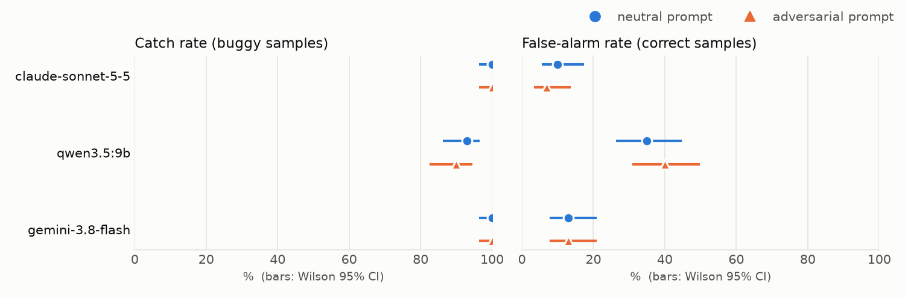
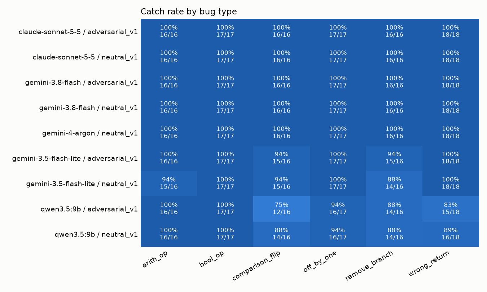
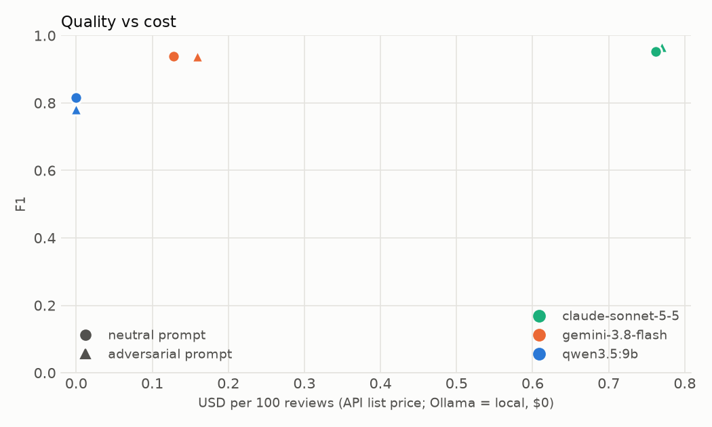
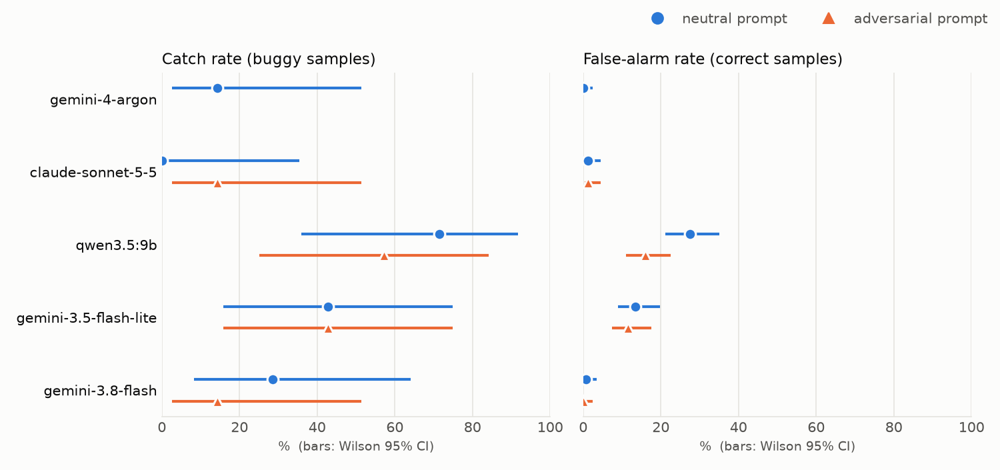
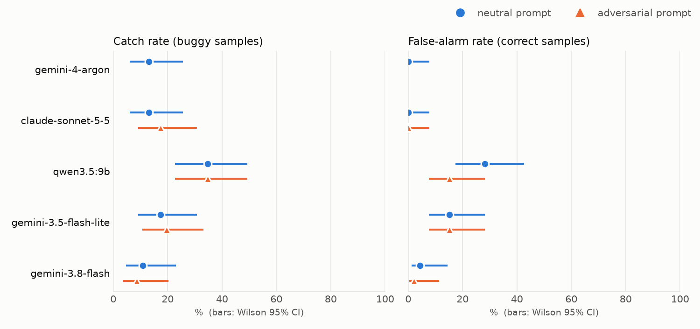
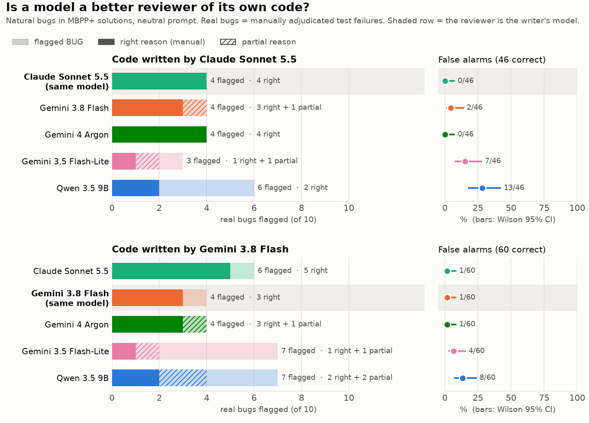
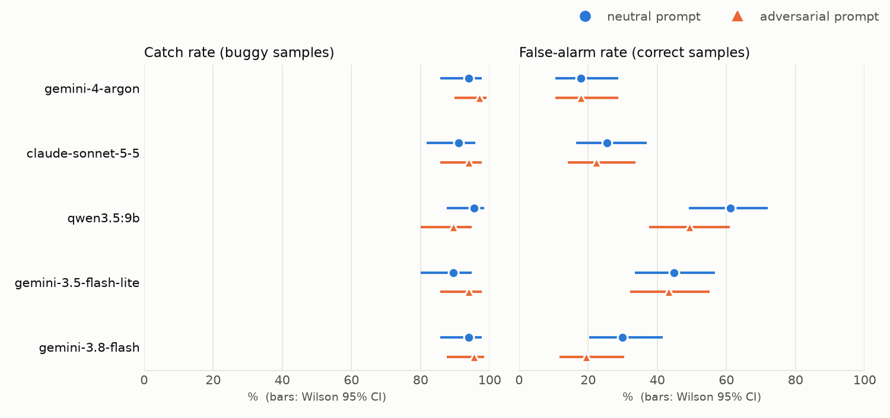
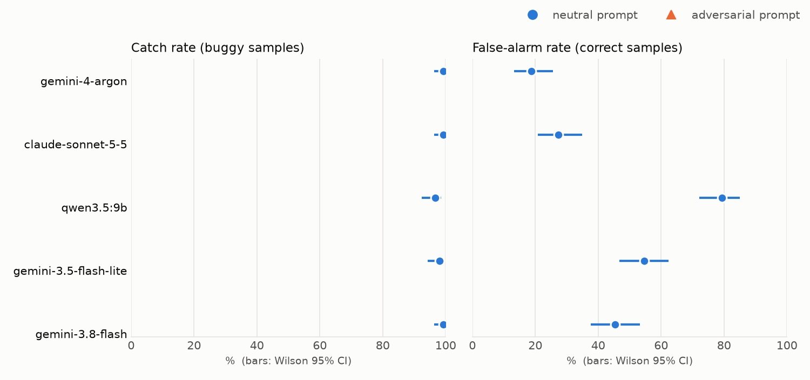
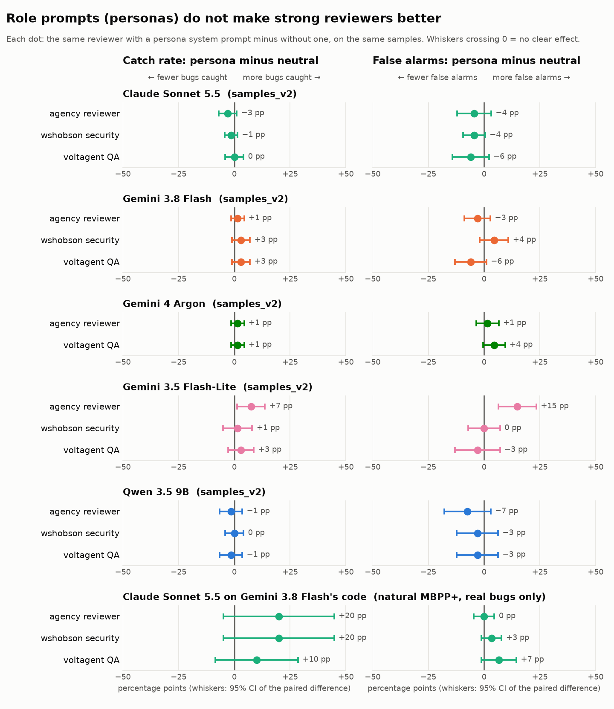

# Detailed results

Back to the [README](../README.md).

All numbers come from logged calls: 16,215 calls in 15 run directories (main sets: `ollama-full-v1`,
`gemini-full-v1`, `claude-full-v1`, `gemini-lite-full-v1`, `gemini-argon-full-v1`, `natural-plus-v1`,
`natural-mbpp-v1`, `samples-v2`; repeat run `samples-v2-repeat`; writer × reviewer `natural-mbpp-gemini-v1`;
personas `personas-v1`, `personas-v2-synth`, `personas-v2-mbpp`, `personas-v2-plus`; BigCodeBench `samples-v3`). 396 calls failed at the
Gemini API spending cap and are excluded from every rate; no other API errors. Brackets are Wilson 95% CIs. Significance = exact McNemar on the same samples, Holm-adjusted
across the 40 comparisons in each report (adding reviewers adds comparisons, so the adjustment gets
stricter). Gemini 4 Argon ran with the neutral prompt only on the `samples_v1` and natural sets, to fit
the API credit; on `samples_v2` it ran both prompts. Every call (verdict, raw response, tokens, cost) is
in `results/<run>/calls.jsonl` and every dataset in `data/`, so the tables can be rebuilt without new API
calls: `python -m reviewbench report <run dirs...>`.

## Synthetic bugs (`samples_v1`: 100 buggy + 100 correct)

| reviewer | prompt | catch rate | localization (±1 line) | false alarm | F1 | parse fail | mean latency |
|---|---|---|---|---|---|---|---|
| Claude Sonnet 5.5 | neutral | 100% [96–100] | 95% [89–98] | 10% [6–17] | 0.952 | 0% | 6.4 s |
| Claude Sonnet 5.5 | adversarial | 100% [96–100] | 94% [88–97] | 7% [3–14] | 0.966 | 0% | 6.6 s |
| Gemini 3.8 Flash | neutral | 100% [96–100] | 97% [92–99] | 13% [8–21] | 0.939 | 0% | 3.7 s |
| Gemini 3.8 Flash | adversarial | 100% [96–100] | 96% [90–98] | 13% [8–21] | 0.939 | 0% | 4.5 s |
| Gemini 4 Argon | neutral | 100% [96–100] | 97% [92–99] | 10% [6–17] | 0.952 | 0% | 7.0 s |
| Gemini 3.5 Flash-Lite | neutral | 96% [90–98] | 96% [90–98] | 28% [20–37] | 0.857 | 0.5% | 0.7 s |
| Gemini 3.5 Flash-Lite | adversarial | 98% [93–99] | 96% [90–98] | 29% [21–39] | 0.863 | 0% | 0.7 s |
| Qwen 3.5 9B (local) | neutral | 93% [86–97] | 91% [84–96] | 35% [26–45] | 0.816 | 2.5% | 11.1 s |
| Qwen 3.5 9B (local) | adversarial | 90% [83–94] | 91% [83–95] | 40% [31–50] | 0.783 | 2.0% | 11.9 s |

Cost for the 400 calls per reviewer: Gemini Flash $0.57 (billed), Claude $3.06 API list-price equivalent
(run on a subscription, not billed per call), Qwen $0 (local), Flash-Lite $0.13 (billed). Argon: $0.35 for
200 calls at its earlier introductory price (half the current list price).

- **The free local model does not replace the paid ones.** Qwen's false-alarm rate is significantly higher
  than Claude's and Gemini Flash's under both prompts (all four comparisons p ≤ 0.002). It also catches
  fewer bugs (90–93% vs 100%), but that difference is not significant after Holm adjustment.
- **Claude, Gemini Flash and Gemini Argon are indistinguishable here.** All catch every injected bug; no
  false-alarm difference between them is significant. The larger Argon model gives no gain over Flash.
- **The small cheap model sits between the strong ones and Qwen.** Flash-Lite is the fastest (0.7 s) and
  cheapest paid reviewer and catches 96–98% of bugs, but raises false alarms on 28–29% of correct code:
  significantly more than Claude, Flash and Argon (p ≤ 0.046). Its false-alarm rate is not significantly
  different from Qwen's on this set.
- **No prompt effect.** Adversarial vs neutral is not significant for any reviewer, on catches or on false
  alarms. The hypothesis "adversarial raises catches and false alarms" is not supported.
- **Ceiling effect.** Single-mutation bugs are too easy for the strong reviewers, so this set cannot rank
  them on catch rate.
- **Part of the "false alarms" are real defects.** Of the 16 canonical solutions Gemini flagged, 7 have a
  verified defect the HumanEval tests miss (e.g. `valid_date('01-31-2000')` returns `False`). See
  [docs/false_alarm_review.md](false_alarm_review.md).

## Natural bugs (`natural_plus_v1`: Claude-written solutions, HumanEval+ tests)

Claude Sonnet passed 163 of 164 tasks on the original HumanEval tests, so the stricter HumanEval+ tests
are used: 7 solutions fail (labelled buggy), 156 pass. Manual review shows only **2 of the 7 are Claude
bugs**; 3 are bugs in the HumanEval+ reference itself and 2 are arguable
([docs/natural_bugs_review.md](natural_bugs_review.md)).

| reviewer | prompt | false alarm on Claude's correct code (n=156) | flagged the 2 real Claude bugs |
|---|---|---|---|
| Claude Sonnet 5.5 | neutral | 1.3% [0–5] | 0 of 2 |
| Claude Sonnet 5.5 | adversarial | 1.3% [0–5] | 0 of 2 |
| Gemini 3.8 Flash | neutral | 0.6% [0–4] | 1 of 2 (exact cause named) |
| Gemini 3.8 Flash | adversarial | 0.0% [0–2] | 1 of 2 (right region, imprecise reason) |
| Gemini 4 Argon | neutral | 0.0% [0–2] | 0 of 2 |
| Gemini 3.5 Flash-Lite | neutral | 13.5% [9–20] | 2 of 2 (reasons not reviewed by hand) |
| Gemini 3.5 Flash-Lite | adversarial | 11.5% [7–18] | 2 of 2 (reasons not reviewed by hand) |
| Qwen 3.5 9B | neutral | 27.6% [21–35] | 2 of 2 (wrong reasons) |
| Qwen 3.5 9B | adversarial | 16.0% [11–23] | 1 of 2 (wrong reason) |

- **Claude did not find its own bugs; Gemini found one with the right cause.** This pointed toward
  "a different model reviews better", but it rests on 2 bugs, and it does not repeat on the larger MBPP+
  set below.
- **On Claude's correct code, Claude and Gemini Flash/Argon almost never raise false alarms; Flash-Lite and
  Qwen do.** Flash-Lite's 12–14% is significantly higher than Claude, Flash and Argon (p ≤ 0.013) and
  significantly lower than Qwen's neutral 28% (p = 0.014).
- For Qwen, the neutral prompt gives significantly *more* false alarms than the adversarial one
  (p = 0.016), the opposite of the hypothesis.

## Natural bugs (`natural_mbpp_v1`: Claude-written solutions, MBPP+ tests)

To get more than 2 real bugs, Claude Sonnet also solved the 377 MBPP+ tasks (one excluded: its reference
fails its own test). 46 solutions fail the MBPP+ tests; the set holds these 46 plus 46 passing solutions
drawn with seed 42. Manual review shows **10 of the 46 are Claude bugs**, 15 are bugs in the MBPP+
reference (the test oracle), and 21 are not settled by the one-sentence task
([docs/natural_mbpp_review.md](natural_mbpp_review.md)).

| reviewer | prompt | catch rate, test labels (n=46) | flagged the 10 real Claude bugs | flagged the 15 reference bugs | false alarm on correct code (n=46) |
|---|---|---|---|---|---|
| Claude Sonnet 5.5 | neutral | 13% [6–26] | 4 of 10 | 0 of 15 | 0% [0–8] |
| Claude Sonnet 5.5 | adversarial | 17% [9–31] | 5 of 10 | 0 of 15 | 0% [0–8] |
| Gemini 3.8 Flash | neutral | 11% [5–23] | 4 of 10 | 0 of 15 | 4.3% [1–15] |
| Gemini 3.8 Flash | adversarial | 9% [3–20] | 4 of 10 | 0 of 15 | 2.2% [0–11] |
| Gemini 4 Argon | neutral | 13% [6–26] | 4 of 10 | 0 of 15 | 0% [0–8] |
| Gemini 3.5 Flash-Lite | neutral | 17% [9–31] | 3 of 10 | 3 of 15 | 15.2% [8–28] |
| Gemini 3.5 Flash-Lite | adversarial | 20% [11–33] | 4 of 10 | 1 of 15 | 15.2% [8–28] |
| Qwen 3.5 9B | neutral | 35% [23–49] | 6 of 10 | 2 of 15 | 28.3% [17–43] |
| Qwen 3.5 9B | adversarial | 35% [23–49] | 5 of 10 | 5 of 15 | 15.2% [8–28] |

Cost for the 184 calls per reviewer: Gemini Flash $0.35 (billed), Claude $1.27 API list-price equivalent
(subscription), Qwen $0 (local), Flash-Lite $0.04 (billed); Argon $0.09 for 92 calls. Qwen had 3.3% parse
failures, Flash-Lite 2–3%, the others none.

- **Same-model review did about as well as different-model review.** Claude flagged 4–5 of its own 10 real
  bugs, Gemini Flash 4, Gemini Argon 4. No Claude–Gemini difference is significant (catch or false alarm,
  either prompt). A larger different-family model did not beat the same-model reviewer.
- **Low test-label catch rates mostly reflect the test oracle, not the reviewers.** Claude and Gemini
  never flagged a sample where the MBPP+ reference is the one that is wrong; they side with the task.
- **Qwen flags more, but separates buggy from correct code poorly.** Under the neutral prompt it flags 35%
  of buggy and 28% of correct samples; its false-alarm rate is significantly higher than Claude's
  (p = 0.010), Gemini Flash's (p = 0.037) and Argon's (p = 0.010). Under the adversarial prompt the differences are not significant
  after Holm adjustment.
- 10 real bugs are still few: these are qualitative counts, not rates with tight intervals.

## Writer × reviewer: Gemini-written code (`natural_mbpp_gemini_v1`, MBPP+ tests)

The other direction of the same-model question: Gemini 3.8 Flash solved the same 377 MBPP+ tasks with the
same writer prompt Claude got. 60 solutions fail the MBPP+ tests (Claude: 46); the set holds these 60 plus
60 passing solutions (seed 42). Manual review: **10 of the 60 are Gemini bugs**, 16 are reference bugs,
34 are not settled by the task ([docs/natural_mbpp_gemini_review.md](natural_mbpp_gemini_review.md)).
Four of Gemini's 10 bugs fail the example assert written in the task itself; none of Claude's do.

| reviewer | prompt | catch rate, test labels (n=60) | flagged the 10 real Gemini bugs (right reason) | flagged the 16 reference bugs | false alarm on correct code (n=60) |
|---|---|---|---|---|---|
| Claude Sonnet 5.5 | neutral | 18% [11–30] | 6 of 10 (5) | 1 of 16 | 1.7% [0–9] |
| Claude Sonnet 5.5 | adversarial | 25% [16–37] | 5 of 10 (5) | 3 of 16 | 0.0% [0–6] |
| Gemini 3.8 Flash (same model) | neutral | 12% [6–22] | 4 of 10 (3) | 0 of 16 | 1.7% [0–9] |
| Gemini 4 Argon | neutral | 20% [12–32] | 4 of 10 (3) | 2 of 16 | 1.7% [0–9] |
| Gemini 3.5 Flash-Lite | neutral | 30% [20–43] | 7 of 10 (1) | 3 of 16 | 6.7% [3–16] |
| Qwen 3.5 9B (local) | neutral | 47% [35–59] | 7 of 10 (2) | 7 of 16 | 13.3% [7–24] |
| Qwen 3.5 9B (local) | adversarial | 33% [23–46] | 5 of 10 (not graded) | 6 of 16 | 11.7% [6–22] |

Gemini cost: writer $0.20 for 377 tasks; reviews $0.18 (Flash), $0.26 (Argon), $0.02 (Flash-Lite) for 120
calls each; Qwen $0 (local).

The 2×2 table, neutral prompt, real bugs flagged **for the right reason** (graded by hand,
[docs/right_reason_review.md](right_reason_review.md)):

| reviewer \ writer | Claude Sonnet 5.5 (10 real bugs) | Gemini 3.8 Flash (10 real bugs) |
|---|---|---|
| Claude Sonnet 5.5 | 4 (same model) | 5 |
| Gemini 3.8 Flash | 3 (+1 partial) | 3 (same model) |
| Qwen 3.5 9B (local) | 2 | 2 (+2 partial) |

- **No same-model effect in either direction.** Claude reviewing its own code finds 4, Gemini Flash 3;
  on Gemini's code Gemini finds 3 of its own bugs and Claude 5. The reviewer that wins is Claude both
  times, whether or not it wrote the code: what matters is which model reviews, not who wrote the code.
- The gaps are 1–2 bugs on 10 (paired test on test labels, Gemini's code: Claude 6 only, Flash 2 only,
  p = 0.29): a direction, not a significant result.
- **Gemini's writer mistakes are more visible**: 4 of its 10 bugs break the task's own example, and every
  strong reviewer catches the missing `return` (Mbpp/769). Claude's bugs all pass the example.
- **Qwen flags much more and explains less.** It flags 47% of the failing solutions (significantly more
  than Claude and Flash, Holm p ≤ 0.033), including 7 of the 16 reference bugs, but gives the right reason
  for only 2 of the 7 real Gemini bugs it flags. Its false alarms on passing code (13%) are not
  significantly above the others' after Holm adjustment.

## Subtle synthetic bugs (`samples_v2`: 67 buggy + 67 correct, MBPP+)

To get past the ceiling of `samples_v1`, a mutant is kept only if it **passes the 3 original MBPP asserts**
(one is the example the reviewer sees) **and fails the MBPP+ tests**: the bug shows only on inputs the
example does not cover. 377 MBPP+ tasks were tried with every mutant; 67 gave one. Each is paired with the
unmodified reference solution. Manual review: 60 of the 67 mutants break behaviour the task text fixes, 6
are arguable, 1 differs only on float overflow ([docs/samples_v2_review.md](samples_v2_review.md)).

| reviewer | prompt | catch rate | localization (±1 line) | false alarm | F1 | parse fail |
|---|---|---|---|---|---|---|
| Claude Sonnet 5.5 | neutral | 91% [82–96] | 93% [84–97] | 25% [16–37] | 0.841 | 0% |
| Claude Sonnet 5.5 | adversarial | 94% [86–98] | 94% [85–98] | 22% [14–34] | 0.869 | 0% |
| Gemini 3.8 Flash | neutral | 94% [86–98] | 95% [87–98] | 30% [20–42] | 0.840 | 0% |
| Gemini 3.8 Flash | adversarial | 96% [88–98] | 98% [92–100] | 19% [12–30] | 0.889 | 0% |
| Gemini 4 Argon | neutral | 94% [86–98] | 97% [89–99] | 18% [11–29] | 0.887 | 0% |
| Gemini 4 Argon | adversarial | 97% [90–99] | 97% [89–99] | 18% [11–29] | 0.903 | 0% |
| Gemini 3.5 Flash-Lite | neutral | 90% [80–95] | 87% [76–93] | 45% [33–57] | 0.764 | 0.7% |
| Gemini 3.5 Flash-Lite | adversarial | 94% [86–98] | 91% [81–96] | 43% [32–55] | 0.792 | 0% |
| Qwen 3.5 9B (local) | neutral | 96% [88–98] | 83% [72–90] | 61% [49–72] | 0.744 | 6.0% |
| Qwen 3.5 9B (local) | adversarial | 90% [80–95] | 85% [74–92] | 49% [38–61] | 0.750 | 3.7% |

Gemini cost for the 268 calls per reviewer: Flash $0.51, Argon $0.34 (earlier introductory price, half the current list price), Flash-Lite
$0.07 (all billed); Claude $1.96 API list-price equivalent (subscription); Qwen $0 (local).

- **Bugs the tests miss are still caught.** Strong reviewers catch 91–97% of these mutants, only a little
  below the 100% on `samples_v1`, and still locate them within ±1 line 93–98% of the time. The catch-rate
  ceiling did not go away, so catch rate still does not rank the strong reviewers.
- **False alarms separate the reviewers.** On the same reference code, Argon (18%), Claude (22–25%) and
  Flash (19–30%) flag significantly fewer correct samples than Qwen (49–61%, p ≤ 0.023 against each of
  them under the matching prompt); Flash-Lite (43–45%) is significantly worse than Argon under both prompts,
  than Flash (adversarial) and than Claude (neutral).
- **Many of these "false alarms" are real reference defects.** Of the 12 reference solutions flagged by
  at least 4 of the 6 strong-reviewer configurations, 11 have a defect the MBPP+ tests do not check
  (e.g. 0 returned for an all-negative list, a subsequence check where the task asks for a sublist).
- **Still no significant prompt effect**, for any reviewer, on catches or false alarms.

## Harder tasks (`samples_v3`: 150 buggy + 150 correct, BigCodeBench)

HumanEval and MBPP functions are short, so v3 uses BigCodeBench (`bigcode/bigcodebench`, split `v0.1.4`):
tasks with imports, longer docstrings and library calls (prompt + solution median ~1,470 characters,
about 5× `samples_v2`). Only tasks that need nothing beyond the standard library, numpy and pandas, and
no network, are used (515 tasks). Their canonical solutions were run against the BigCodeBench unittest
tests on this machine: 467 pass, and the 48 that fail or time out (Windows paths, missing test-only
libraries, timing) are excluded. 150 tasks were drawn (seed 42), each with one test-killing mutation
(paired, like `samples_v1`). The reviewer sees the full BigCodeBench prompt (imports, signature,
docstring) and the code. Neutral prompt only.

| reviewer | catch rate | localization (±1 line) | false alarm | precision | F1 | parse fail | cost |
|---|---|---|---|---|---|---|---|
| Claude Sonnet 5.5 | 99% [96–100] | 95% [91–98] | 27% [21–35] | 78% | 0.876 | 0% | $3.28 (list-price equivalent) |
| Gemini 3.8 Flash | 99% [96–100] | 93% [88–96] | 45% [38–53] | 69% | 0.812 | 0.3% | $0.66 |
| Gemini 4 Argon | 99% [96–100] | 97% [93–99] | 19% [13–26] | 84% | 0.911 | 0% | $1.65 |
| Gemini 3.5 Flash-Lite | 98% [94–99] | 95% [90–97] | 55% [47–62] | 64% | 0.776 | 0% | $0.14 |
| Qwen 3.5 9B (local) | 97% [92–99] | 88% [81–92] | 79% [72–85] | 55% | 0.700 | 3.3% | $0 |

- **The catch-rate ceiling stays on longer code.** Every reviewer catches 97–99% of the mutants and
  the strong reviewers locate 93–97% of their catches within ±1 line. Synthetic one-line mutations stay
  easy to see in longer code with library calls.
- **False alarms rise and spread out.** On the same correct code, Argon (19%) and Claude (27%) are
  significantly below Flash (45%), Flash-Lite (55%) and Qwen (79%) (exact McNemar, Holm-adjusted, every
  pair p < 0.001 except Claude vs Argon, p = 0.56, and Flash vs Flash-Lite, p = 0.71). Compared with
  `samples_v2`, every reviewer flags more correct code, and the gap between the cheap and the strong
  reviewers grows.
- **Many shared "false alarms" are real reference defects.** 129 of the 150 correct samples are flagged
  by at least one reviewer, 34 by at least 4 of the 5, and 15 by all three strong ones (Claude, Flash,
  Argon). Checked by hand against the docstrings, 9 of those 15 are real defects in the BigCodeBench
  reference solutions that the tests do not check (e.g. an "exclusive" bound that `randint` includes, a
  tie rule the code ignores), 5 are arguable and 1 is no defect
  ([docs/samples_v3_false_alarms.md](samples_v3_false_alarms.md)). The other 114 flagged samples were
  not reviewed, so the false-alarm rates above are upper bounds.

## A third prompt: list edge cases first (`edgecases_v1`, Claude and Qwen, `samples_v2`)

`edgecases_v1` keeps the neutral framing but asks the reviewer to list 3–5 edge-case inputs the task
admits, work out what the code returns on each, and only then decide. It targets exactly the kind of bug in
`samples_v2`. Gemini was not run with this prompt (API credit; it gave no gain for Claude or Qwen).

| reviewer | prompt | catch rate | false alarm | F1 |
|---|---|---|---|---|
| Claude Sonnet 5.5 | neutral | 91% [82–96] | 25% [16–37] | 0.841 |
| Claude Sonnet 5.5 | adversarial | 94% [86–98] | 22% [14–34] | 0.869 |
| Claude Sonnet 5.5 | edge cases | 90% [80–95] | 21% [13–32] | 0.851 |
| Qwen 3.5 9B | neutral | 96% [88–98] | 61% [49–72] | 0.744 |
| Qwen 3.5 9B | adversarial | 90% [80–95] | 49% [38–61] | 0.750 |
| Qwen 3.5 9B | edge cases | 84% [73–91] | 43% [32–55] | 0.737 |

- **Listing edge cases does not raise catches.** For Claude no difference is significant. For Qwen it acts
  as a "be careful" prompt: fewer false alarms than neutral (43% vs 61%, unadjusted p = 0.008) but also
  fewer catches (84% vs 96%, p = 0.039); neither survives Holm adjustment.

## Repeatability (same reviewer, same prompt, same samples, run twice)

`samples_v2` was reviewed a second time by Claude and Qwen (run `samples-v2-repeat`, both prompts) and
compared verdict by verdict with `python -m reviewbench compare-runs`.

| reviewer | prompt | same verdict (n=134) | BUG only in run 1 | BUG only in run 2 | F1 run 1 → run 2 |
|---|---|---|---|---|---|
| Claude Sonnet 5.5 | neutral | 95.5% [91–98] | 5 | 1 | 0.841 → 0.851 |
| Claude Sonnet 5.5 | adversarial | 97.0% [93–99] | 2 | 2 | 0.869 → 0.883 |
| Qwen 3.5 9B | neutral | 89.6% [83–94] | 4 | 10 | 0.744 → 0.742 |
| Qwen 3.5 9B | adversarial | 93.3% [88–96] | 6 | 3 | 0.750 → 0.764 |

- **Verdicts are not fully repeatable**, even for Qwen at temperature 0: 3–10% of verdicts flip between
  runs. Claude (no temperature control) flips 3–5%. No run-to-run difference is significant.
- **Differences of a few samples are within run-to-run noise.** A single run of the same reviewer moves F1
  by up to 0.014 here, which is why this README only calls differences significant after the paired test.

## Right verdict, right reason?

Natural bugs have no known bug line, so a `BUG` verdict can be right for the wrong reason. Every `BUG` on
the 12 manually confirmed Claude bugs (2 HumanEval+, 10 MBPP+) was graded by hand against the actual defect
([docs/right_reason_review.md](right_reason_review.md)):

| reviewer | prompt | BUG on the 12 real bugs | right reason | partial | wrong reason |
|---|---|---|---|---|---|
| Claude Sonnet 5.5 | neutral / adversarial | 4 / 5 | 4 / 4 | 0 / 0 | 0 / 1 |
| Gemini 3.8 Flash | neutral / adversarial | 5 / 5 | 4 / 4 | 1 / 0 | 0 / 1 |
| Gemini 4 Argon | neutral | 4 | 4 | 0 | 0 |
| Gemini 3.5 Flash-Lite | neutral / adversarial | 5 / 6 | 2 / 2 | 1 / 2 | 2 / 2 |
| Qwen 3.5 9B | neutral / adversarial | 8 / 6 | 2 / 1 | 0 / 0 | 6 / 5 |

- **Qwen's higher count of "caught" real bugs is mostly luck**: it names the actual defect in 3 of its 14
  `BUG`s. Counted by right reasons, Claude, Gemini Flash and Argon (4 each) lead.
- The strong reviewers flag fewer real bugs, but 20 of their 23 `BUG`s give the actual defect.
- One person's grading of 12 bugs: qualitative, not a rate with a confidence interval.

## Two reviewers together (ensembles, no new calls)

Two reviewers' logged verdicts on the same samples, combined: **AND** = BUG only if both say BUG,
**OR** = BUG if either does. Every pair with the same prompt is in each report's "Two-reviewer
ensembles" section; each ensemble is compared with its better member (McNemar, Holm-adjusted within that
section only).

| set | ensemble | catch | false alarm | F1 | better member alone |
|---|---|---|---|---|---|
| synthetic | Claude AND Argon (neutral) | 100% [96–100] | 4% [2–10] | 0.980 | Claude: 100%, 10%, 0.952 |
| synthetic | Flash-Lite AND Qwen (neutral) | 91% [84–95] | 24% [17–33] | 0.847 | Flash-Lite: 96%, 28%, 0.857 |
| synthetic | Claude OR Qwen (neutral) | 100% [96–100] | 38% [29–48] | 0.840 | Claude: 100%, 10%, 0.952 |

On the MBPP+ natural bugs, counted against the 10 manually confirmed Claude bugs:

| ensemble (OR) | prompt | real Claude bugs flagged | false alarm on correct code (n=46) |
|---|---|---|---|
| Claude alone | neutral / adversarial | 4 / 5 of 10 | 0% / 0% |
| Claude OR Gemini Flash | neutral / adversarial | 5 / 6 of 10 | 4.3% / 2.2% |
| Claude OR Gemini Argon | neutral | 5 of 10 | 0% |
| Claude OR Qwen | neutral / adversarial | 7 / 7 of 10 | 28.3% / 15.2% |

- **No ensemble is significantly better than its better member** on any set. AND removes some false
  alarms (Claude AND Argon: 10% to 4% on synthetic code), but not significantly.
- **Two cheap reviewers do not add up to a strong one.** Flash-Lite AND Qwen keeps 24% false alarms on
  synthetic code, against 7–10% for Claude alone.
- **OR with a strong second reviewer adds a few real bugs at little cost.** On Claude's own MBPP+ code,
  adding Gemini Flash or Argon as a second opinion raises the real bugs flagged from 4–5 to 5–6 of 10, with
  0–4% false alarms. OR with Qwen reaches 7 of 10 but with Qwen's false alarms. With 10 bugs this is a
  qualitative count, not a significant result.

## Persona results (role prompts from popular Claude Code agents)

Does telling the reviewer *who it is* help? Personas come from the three most-starred public Claude Code
agent collections (GitHub, 2026-11-25), all MIT: [The Agency](https://github.com/msitarzewski/agency-agents)
(msitarzewski/agency-agents), [wshobson/agents](https://github.com/wshobson/agents) and
[VoltAgent/awesome-claude-code-subagents](https://github.com/VoltAgent/awesome-claude-code-subagents).
From each: its code-reviewer agent and one security or QA agent; The Agency's software architect is an
off-target control. Files, source commits and full license texts are in
[prompts/personas/](../prompts/personas/) ([LICENSES.md](../prompts/personas/LICENSES.md)). The persona text
goes in the system prompt; the user prompt is `neutral_v1`, byte-identical, so the persona is the only
difference. All personas use the full text (the trimmed fallback was not needed, see below).

**In short:** no persona made a reviewer clearly better; the one significant gain in catches (Claude on
Gemini's code) came with more false alarms. On short synthetic code a persona changes nothing
for the strong reviewers and can make a weak one worse (Flash-Lite: +15 points of false alarms with The
Agency's code reviewer). On real model-written code it makes Claude more suspicious: it flags 1–2 more
real bugs for the right reason out of 10, but also more code that is not buggy. An off-target persona
(software architect) moves Qwen as much as the code-review ones, so the effect is the role framing, not
the expertise in the text.

**Stage 1 (selection): Qwen 3.5 9B on `samples_v1`** (run `personas-v1`, 1,600 calls, neutral re-run in
the same batch). Paired change vs neutral: catches gained/lost, false alarms gained/lost.

| variant | catch rate | false alarm | F1 | parse errors | vs neutral (catch; false alarm) |
|---|---|---|---|---|---|
| neutral (no persona) | 91% [84–95] | 39% [30–49] | 0.791 | 2.5% | |
| agency-code-reviewer | 89% [81–94] | 36% [27–46] | 0.791 | 2.5% | +3/−5; +8/−11 |
| wshobson-security-auditor | 94% [88–97] | 45% [36–55] | 0.787 | 1.0% | +4/−1; +13/−7 |
| voltagent-qa-expert | 90% [83–94] | 39% [30–49] | 0.786 | 1.5% | +2/−3; +8/−8 |
| wshobson-code-reviewer | 91% [84–95] | 41% [32–51] | 0.784 | 4.0% | +3/−3; +13/−11 |
| voltagent-code-reviewer | 90% [83–94] | 42% [33–52] | 0.776 | 1.0% | +3/−4; +8/−5 |
| agency-ai-code-auditor | 77% [68–84] | 23% [16–32] | 0.770 | 2.5% | **+1/−15; +4/−20** |
| agency-software-architect (control) | 90% [83–94] | 44% [35–54] | 0.769 | 1.5% | +4/−5; +13/−8 |

- **No persona beats neutral on F1.** The best ties it (0.791). The off-target control scores about the
  same as the code-review personas, so what changes Qwen's verdicts is not the relevant expertise.
- **The AI-generated-code auditor makes Qwen more cautious**: fewer false alarms (39% to 23%) but fewer
  catches (91% to 77%); both are significant (Holm-adjusted p = 0.02 and 0.007, 14 tests in this table).
  Nothing else is.
- Full text vs trimmed (rule fixed before running): the largest parse-error rate is 4.0% against 2.5% for
  neutral, under the +3 points limit, so every persona uses its full text.
- Selected by F1 for stage 2 (ties: lower false alarm; the control is not eligible):
  **agency-code-reviewer, wshobson-security-auditor, voltagent-qa-expert**.

**Stage 2 (test on other data): `samples_v2`** (run `personas-v2-synth`). Neutral is the earlier
`samples-v2` run of the same model (Qwen: re-run in the same batch), so run-to-run noise (3–10% of verdicts, see Repeatability) is part of
each difference. Argon runs two of the three personas (API credit). The natural-bug sets and Gemini's
code are run with Claude, Qwen and Flash-Lite.

| reviewer | variant | catch rate | false alarm | F1 |
|---|---|---|---|---|
| Claude Sonnet 5.5 | neutral | 91% [82–96] | 25% [16–37] | 0.841 |
| Claude Sonnet 5.5 | agency-code-reviewer | 88% [78–94] | 21% [13–32] | 0.843 |
| Claude Sonnet 5.5 | wshobson-security-auditor | 90% [80–95] | 21% [13–32] | 0.851 |
| Claude Sonnet 5.5 | voltagent-qa-expert | 91% [82–96] | 19% [12–30] | 0.865 |
| Gemini 3.8 Flash | neutral | 94% [86–98] | 30% [20–42] | 0.840 |
| Gemini 3.8 Flash | agency-code-reviewer | 96% [88–98] | 27% [18–39] | 0.859 |
| Gemini 3.8 Flash | wshobson-security-auditor | 97% [90–99] | 34% [24–46] | 0.839 |
| Gemini 3.8 Flash | voltagent-qa-expert | 97% [90–99] | 24% [15–35] | 0.878 |
| Gemini 4 Argon | neutral | 94% [86–98] | 18% [11–29] | 0.887 |
| Gemini 4 Argon | agency-code-reviewer | 96% [88–98] | 19% [12–30] | 0.889 |
| Gemini 4 Argon | voltagent-qa-expert | 96% [88–98] | 22% [14–34] | 0.877 |
| Gemini 3.5 Flash-Lite | neutral | 90% [80–95] | 45% [33–57] | 0.764 |
| Gemini 3.5 Flash-Lite | agency-code-reviewer | 97% [90–99] | 60% [48–71] | 0.756 |
| Gemini 3.5 Flash-Lite | wshobson-security-auditor | 91% [82–96] | 45% [33–57] | 0.772 |
| Gemini 3.5 Flash-Lite | voltagent-qa-expert | 93% [84–97] | 42% [31–54] | 0.790 |
| Qwen 3.5 9B | neutral (same batch) | 96% [88–98] | 66% [54–76] | 0.731 |
| Qwen 3.5 9B | agency-code-reviewer | 94% [86–98] | 58% [46–69] | 0.746 |
| Qwen 3.5 9B | wshobson-security-auditor | 96% [88–98] | 63% [51–73] | 0.740 |
| Qwen 3.5 9B | voltagent-qa-expert | 94% [86–98] | 63% [51–73] | 0.733 |

- **For the strong reviewers, personas change nothing significant.** Claude has slightly fewer false
  alarms with every persona (19–21% vs 25%), within run-to-run noise; Gemini Flash and Argon move by 1–5 samples
  either way (every Holm-adjusted p = 1).
- **On a weak reviewer, a persona can make things worse:** The Agency's code reviewer makes Flash-Lite
  flag 10 more correct references and lose none (45% to 60% false alarms, exact McNemar p = 0.002;
  Holm-adjusted over the 28 tests in this table p = 0.055, just above the threshold), for 5 more catches
  (not significant). The same persona does it again on every natural-bug set (below).
- **Qwen's false alarms stay at 58–63% with any persona** (66% neutral): no difference is significant.

**Stage 2 on Claude's own code: natural MBPP+ bugs** (run `personas-v2-mbpp`; Claude 276 calls with
neutral from `natural-mbpp-v1`, Qwen 368 calls with neutral re-run in the same batch). Catch rate counts all 46 test-failing solutions; "real bugs" are
the 10 manually confirmed Claude bugs.

| Claude Sonnet 5.5 | catch rate | false alarm (n=46) | real Claude bugs flagged |
|---|---|---|---|
| neutral | 13% [6–26] | 0% [0–8] | 4 of 10 |
| agency-code-reviewer | 20% [11–33] | 2% [0–11] | 6 of 10 |
| wshobson-security-auditor | 17% [9–31] | 2% [0–11] | 5 of 10 |
| voltagent-qa-expert | 17% [9–31] | 0% [0–8] | 5 of 10 |

- **Every persona flags 1–2 more real Claude bugs than neutral, at almost no false-alarm cost**, the same
  gain as the adversarial prompt (5 of 10) or a second reviewer. With 10 bugs this is a count, not a
  significant result (paired catch change +2 to +3, p ≥ 0.25).
- **Counted by right reasons, the gain shrinks to at most one bug.** On all 12 confirmed Claude bugs
  (10 MBPP+, 2 HumanEval+), graded by hand ([docs/right_reason_review.md](right_reason_review.md)):
  neutral gives the right reason 4 times, agency-code-reviewer 5 (of 7 flags), wshobson-security-auditor
  4 (of 5), voltagent-qa-expert 5 (of 5).
- **On HumanEval+ (run `personas-v2-plus`, 489 calls)** Claude catches 0–1 of the 7 test-failing
  solutions with any variant and keeps 1–2% false alarms on 156 correct ones; no difference is significant.

Qwen 3.5 9B with the same personas:

| Qwen 3.5 9B, Claude's MBPP+ code | catch rate | false alarm (n=46) | real Claude bugs flagged | reference bugs flagged |
|---|---|---|---|---|
| neutral (same batch) | 41% [28–56] | 33% [21–47] | 7 of 10 | 4 of 15 |
| agency-code-reviewer | 48% [34–62] | 28% [17–43] | 7 of 10 | 5 of 15 |
| wshobson-security-auditor | 43% [30–58] | 35% [23–49] | 6 of 10 | 3 of 15 |
| voltagent-qa-expert | 48% [34–62] | 26% [16–40] | 7 of 10 | 5 of 15 |

| Qwen 3.5 9B, Claude's HumanEval+ code (run `personas-v2-plus`, 652 calls) | test-failing flagged (of 7) | false alarm (n=156) |
|---|---|---|
| neutral (same batch) | 4 | 27% [21–34] |
| agency-code-reviewer | 5 | 22% [16–29] |
| wshobson-security-auditor | 6 | 21% [15–28] |
| voltagent-qa-expert | 2 | 19% [14–26] |

- **For Qwen no persona differs significantly from neutral** on either set (exact McNemar, Holm-adjusted
  over the 6 tests per set, every p ≥ 0.10). On HumanEval+ every persona lowers its false alarms a little
  (27% to 19–22%; voltagent-qa-expert unadjusted p = 0.017, adjusted 0.10).
- Qwen's neutral re-run differs from its first neutral run on the same MBPP+ samples (catch 35% → 41%,
  false alarm 28% → 33%), the same size as the persona effects: run-to-run noise, see Repeatability.
- **Personas do not improve Qwen's reasons.** On Claude's 12 real bugs it gives the right reason 1–3
  times with any variant (neutral 1 of 9 flags, agency-code-reviewer 3 of 9); most flags name a problem
  that is not there ([docs/right_reason_review.md](right_reason_review.md)).

Gemini 3.5 Flash-Lite with the same personas (neutral from `natural-mbpp-v1` and `natural-plus-v1`):

| Flash-Lite, Claude's MBPP+ code | catch rate | false alarm (n=46) | real Claude bugs flagged | reference bugs flagged (of 15) |
|---|---|---|---|---|
| neutral | 17% [9–31] | 15% [8–28] | 3 of 10 | 3 |
| agency-code-reviewer | 41% [28–56] | 30% [19–45] | 5 of 10 | 5 |
| wshobson-security-auditor | 28% [17–43] | 15% [8–28] | 5 of 10 | 2 |
| voltagent-qa-expert | 17% [9–31] | 15% [8–28] | 3 of 10 | 2 |

| Flash-Lite, Claude's HumanEval+ code | test-failing flagged (of 7) | false alarm (n=156) |
|---|---|---|
| neutral | 3 | 13% [9–20] |
| agency-code-reviewer | 6 | 24% [18–32] |
| wshobson-security-auditor | 5 | 19% [13–25] |
| voltagent-qa-expert | 4 | 18% [13–25] |

- **The Agency's code reviewer makes Flash-Lite flag much more of everything.** On Claude's MBPP+ code
  it flags 11 more test-failing solutions and loses none (Holm-adjusted p = 0.006 over the 6 tests), but
  only 2 more real bugs, and 7 more passing solutions (p = 0.078). On HumanEval+ it flags 17 more correct
  solutions net (13% to 24%, Holm-adjusted p = 0.006 over the 6 tests). The other two personas change
  nothing significant.

**Stage 2 on Gemini's code (`natural_mbpp_gemini_v1`, Claude, Qwen and Flash-Lite, 360 calls each).** Neutral is from
the same run directory.

| Claude Sonnet 5.5 | catch rate, test labels (n=60) | real Gemini bugs flagged (right reason) | reference bugs flagged (of 16) | false alarm (n=60) |
|---|---|---|---|---|
| neutral | 18% [11–30] | 6 of 10 (5) | 1 | 1.7% [0–9] |
| agency-code-reviewer | 30% [20–43] | 8 of 10 (7) | 2 | 1.7% [0–9] |
| wshobson-security-auditor | 33% [23–46] | 8 of 10 (7) | 2 | 5.0% [2–14] |
| voltagent-qa-expert | 35% [24–48] | 7 of 10 (6) | 5 | 8.3% [4–18] |

- **Here personas do raise Claude's catches**: +7 to +10 test-failing samples flagged, almost none lost
  (voltagent-qa-expert +10/−0, Holm-adjusted p = 0.012 over the 6 tests of this table; the other two
  p ≈ 0.06). On real bugs the gain is 1–2 more right reasons (5 to 6–7 of 10), e.g. the floor division
  (Mbpp/261) and the broken negative binary (Mbpp/99) that neutral Claude misses.
- **Part of the gain is not real bugs**: voltagent-qa-expert also flags 5 of the 16 reference-bug samples
  (where Gemini's code follows the task) and more correct code (8.3% vs 1.7%, not significant).
- The persona effect differs by set: nil on Claude's HumanEval+ code, +0–1 right reasons on Claude's
  MBPP+ code, +1–2 on Gemini's. Gemini's code fails more MBPP+ edge cases, which a "find problems" persona
  flags more often.

| Qwen 3.5 9B | catch rate, test labels (n=60) | real Gemini bugs flagged | reference bugs flagged (of 16) | false alarm (n=60) |
|---|---|---|---|---|
| neutral | 47% [35–59] | 7 of 10 (2 right, 2 partial) | 7 | 13% [7–24] |
| agency-code-reviewer | 58% [46–70] | 9 of 10 | 9 | 18% [11–30] |
| wshobson-security-auditor | 53% [41–65] | 8 of 10 | 6 | 18% [11–30] |
| voltagent-qa-expert | 55% [42–67] | 8 of 10 | 8 | 23% [14–35] |

- **Qwen moves in the same direction as Claude on Gemini's code** (+4 to +7 flags, +1–2 real bugs, more
  reference bugs and false alarms), but no change is significant (Holm-adjusted p ≥ 0.42 over its 6
  tests). The extra flags do not bring right reasons: 2 of 7 neutral flags on real bugs give the right
  reason, 1–3 of 8–9 with a persona.

| Flash-Lite | catch rate, test labels (n=60) | real Gemini bugs flagged | reference bugs flagged (of 16) | false alarm (n=60) |
|---|---|---|---|---|
| neutral | 30% [20–43] | 7 of 10 | 3 | 7% [3–16] |
| agency-code-reviewer | 50% [38–62] | 8 of 10 | 5 | 23% [14–35] |
| wshobson-security-auditor | 38% [27–51] | 6 of 10 | 5 | 12% [6–22] |
| voltagent-qa-expert | 38% [27–51] | 6 of 10 | 5 | 13% [7–24] |

- **Same pattern for Flash-Lite**: agency-code-reviewer flags 12 more failing solutions net (Holm p = 0.021)
  and 10 more passing ones (7% to 23%, Holm p = 0.012), for one more real bug. Across the four sets, this
  persona raises Flash-Lite's false alarms every time; it makes a weak reviewer more suspicious, not more
  accurate.
- **Right reasons, graded by hand:** with a persona Flash-Lite names 1–2 of Claude's real bugs correctly
  (neutral 1) and 1–3 of Gemini's (neutral 1). wshobson-security-auditor is the only Flash-Lite variant
  that finds the negative shift in Mbpp/239 ([docs/right_reason_review.md](right_reason_review.md)).
