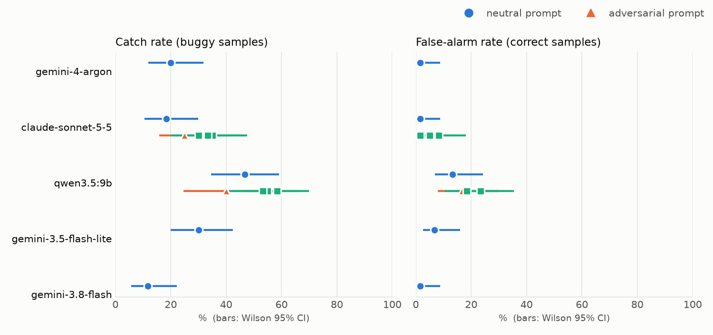
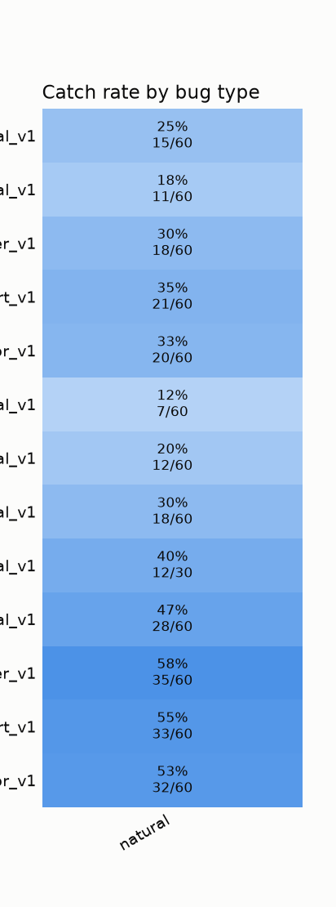
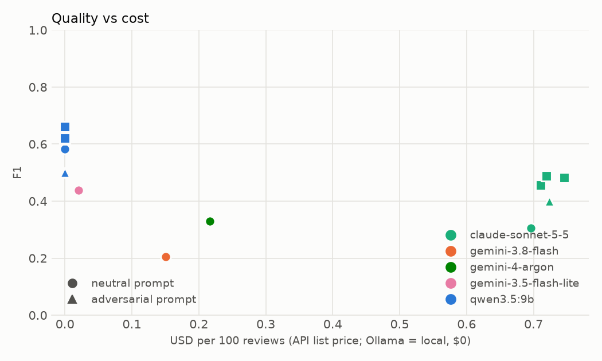

# review-bench report

Generated 2026-11-26 11:03 from 1506 logged calls in: `natural-mbpp-gemini-v1`

Conventions: rates are shown with Wilson 95% CIs. API errors are excluded. PARSE_ERROR counts as "not flagged" and stays in the denominators. Localization = reported line within ±1 of the real bug line, among caught bugs with a known line. Cost = API list-price equivalent (Ollama is local, Claude runs on a subscription, Gemini was billed at list price).

## Headline metrics

| reviewer / prompt | catch rate | localization | false alarm | precision | F1 | parse fail | errors | thinking | mean latency | cost |
|---|---|---|---|---|---|---|---|---|---|---|
| claude-sonnet-5-5 / adversarial_v1 | 25.0% [16%–37%] (15/60) | - | 0.0% [0%–6%] (0/60) | 100.0% [80%–100%] (15/15) | 0.400 | 0.0% [0%–3%] (0/120) | 0 | 55% | 6.2s | $0.87 |
| claude-sonnet-5-5 / neutral_v1 | 18.3% [11%–30%] (11/60) | - | 1.7% [0%–9%] (1/60) | 91.7% [65%–99%] (11/12) | 0.306 | 0.0% [0%–3%] (0/120) | 0 | 42% | 6.2s | $0.84 |
| claude-sonnet-5-5 / persona-agency-code-reviewer_v1 | 30.0% [20%–43%] (18/60) | - | 1.7% [0%–9%] (1/60) | 94.7% [75%–99%] (18/19) | 0.456 | 0.0% [0%–3%] (0/120) | 0 | 35% | 6.1s | $0.85 |
| claude-sonnet-5-5 / persona-voltagent-qa-expert_v1 | 35.0% [24%–48%] (21/60) | - | 8.3% [4%–18%] (5/60) | 80.8% [62%–91%] (21/26) | 0.488 | 0.0% [0%–3%] (0/120) | 0 | 31% | 5.9s | $0.86 |
| claude-sonnet-5-5 / persona-wshobson-security-auditor_v1 | 33.3% [23%–46%] (20/60) | - | 5.0% [2%–14%] (3/60) | 87.0% [68%–95%] (20/23) | 0.482 | 0.0% [0%–3%] (0/120) | 0 | 31% | 6.1s | $0.89 |
| gemini-3.8-flash / neutral_v1 | 11.7% [6%–22%] (7/60) | - | 1.7% [0%–9%] (1/60) | 87.5% [53%–98%] (7/8) | 0.206 | 0.0% [0%–3%] (0/120) | 0 | 90% | 4.9s | $0.18 |
| gemini-4-argon / neutral_v1 | 20.0% [12%–32%] (12/60) | - | 1.7% [0%–9%] (1/60) | 92.3% [67%–99%] (12/13) | 0.329 | 0.0% [0%–3%] (0/120) | 0 | 0% | 6.4s | $0.26 |
| gemini-3.5-flash-lite / neutral_v1 | 30.0% [20%–43%] (18/60) | - | 6.7% [3%–16%] (4/60) | 81.8% [61%–93%] (18/22) | 0.439 | 1.7% [0%–6%] (2/120) | 0 | 0% | 0.7s | $0.02 |
| qwen3.5:9b / adversarial_v1 | 40.0% [25%–58%] (12/30) | - | 16.7% [8%–32%] (6/36) | 66.7% [44%–84%] (12/18) | 0.500 | 4.5% [2%–13%] (3/66) | 0 | 0% | 18.8s | $0.00 |
| qwen3.5:9b / neutral_v1 | 46.7% [35%–59%] (28/60) | - | 13.3% [7%–24%] (8/60) | 77.8% [62%–88%] (28/36) | 0.583 | 5.0% [2%–10%] (6/120) | 0 | 0% | 11.8s | $0.00 |
| qwen3.5:9b / persona-agency-code-reviewer_v1 | 58.3% [46%–70%] (35/60) | - | 18.3% [11%–30%] (11/60) | 76.1% [62%–86%] (35/46) | 0.660 | 0.8% [0%–5%] (1/120) | 0 | 0% | 11.0s | $0.00 |
| qwen3.5:9b / persona-voltagent-qa-expert_v1 | 55.0% [42%–67%] (33/60) | - | 23.3% [14%–35%] (14/60) | 70.2% [56%–81%] (33/47) | 0.617 | 3.3% [1%–8%] (4/120) | 0 | 0% | 13.8s | $0.00 |
| qwen3.5:9b / persona-wshobson-security-auditor_v1 | 53.3% [41%–65%] (32/60) | - | 18.3% [11%–30%] (11/60) | 74.4% [60%–85%] (32/43) | 0.621 | 5.0% [2%–10%] (6/120) | 0 | 0% | 10.3s | $0.00 |

## Catch rate by bug type

| reviewer / prompt | natural |
|---|---|
| claude-sonnet-5-5 / adversarial_v1 | 25.0% [16%–37%] (15/60) |
| claude-sonnet-5-5 / neutral_v1 | 18.3% [11%–30%] (11/60) |
| claude-sonnet-5-5 / persona-agency-code-reviewer_v1 | 30.0% [20%–43%] (18/60) |
| claude-sonnet-5-5 / persona-voltagent-qa-expert_v1 | 35.0% [24%–48%] (21/60) |
| claude-sonnet-5-5 / persona-wshobson-security-auditor_v1 | 33.3% [23%–46%] (20/60) |
| gemini-3.8-flash / neutral_v1 | 11.7% [6%–22%] (7/60) |
| gemini-4-argon / neutral_v1 | 20.0% [12%–32%] (12/60) |
| gemini-3.5-flash-lite / neutral_v1 | 30.0% [20%–43%] (18/60) |
| qwen3.5:9b / adversarial_v1 | 40.0% [25%–58%] (12/30) |
| qwen3.5:9b / neutral_v1 | 46.7% [35%–59%] (28/60) |
| qwen3.5:9b / persona-agency-code-reviewer_v1 | 58.3% [46%–70%] (35/60) |
| qwen3.5:9b / persona-voltagent-qa-expert_v1 | 55.0% [42%–67%] (33/60) |
| qwen3.5:9b / persona-wshobson-security-auditor_v1 | 53.3% [41%–65%] (32/60) |

## Paired comparisons (exact McNemar, same samples)

`A only` / `B only` = samples where only A / only B flagged BUG. For *catch*, more is better; for *false alarm*, fewer is better. p-values are Holm-adjusted across all 68 tests in this table.

| A | B | metric | n pairs | A only | B only | p | p (Holm) |
|---|---|---|---|---|---|---|---|
| claude-sonnet-5-5 / adversarial_v1 | claude-sonnet-5-5 / neutral_v1 | catch | 60 | 7 | 3 | 0.344 | 1 |
| claude-sonnet-5-5 / adversarial_v1 | claude-sonnet-5-5 / neutral_v1 | false alarm | 60 | 0 | 1 | 1 | 1 |
| claude-sonnet-5-5 / adversarial_v1 | claude-sonnet-5-5 / persona-agency-code-reviewer_v1 | catch | 60 | 3 | 6 | 0.508 | 1 |
| claude-sonnet-5-5 / adversarial_v1 | claude-sonnet-5-5 / persona-agency-code-reviewer_v1 | false alarm | 60 | 0 | 1 | 1 | 1 |
| claude-sonnet-5-5 / adversarial_v1 | claude-sonnet-5-5 / persona-voltagent-qa-expert_v1 | catch | 60 | 3 | 9 | 0.146 | 1 |
| claude-sonnet-5-5 / adversarial_v1 | claude-sonnet-5-5 / persona-voltagent-qa-expert_v1 | false alarm | 60 | 0 | 5 | 0.0625 | 1 |
| claude-sonnet-5-5 / adversarial_v1 | claude-sonnet-5-5 / persona-wshobson-security-auditor_v1 | catch | 60 | 2 | 7 | 0.18 | 1 |
| claude-sonnet-5-5 / adversarial_v1 | claude-sonnet-5-5 / persona-wshobson-security-auditor_v1 | false alarm | 60 | 0 | 3 | 0.25 | 1 |
| claude-sonnet-5-5 / adversarial_v1 | qwen3.5:9b / adversarial_v1 | catch | 30 | 3 | 7 | 0.344 | 1 |
| claude-sonnet-5-5 / adversarial_v1 | qwen3.5:9b / adversarial_v1 | false alarm | 36 | 0 | 6 | 0.0312 | 1 |
| claude-sonnet-5-5 / neutral_v1 | claude-sonnet-5-5 / persona-agency-code-reviewer_v1 | catch | 60 | 0 | 7 | 0.0156 | 0.938 |
| claude-sonnet-5-5 / neutral_v1 | claude-sonnet-5-5 / persona-agency-code-reviewer_v1 | false alarm | 60 | 1 | 1 | 1 | 1 |
| claude-sonnet-5-5 / neutral_v1 | claude-sonnet-5-5 / persona-voltagent-qa-expert_v1 | catch | 60 | 0 | 10 | 0.00195 | 0.125 |
| claude-sonnet-5-5 / neutral_v1 | claude-sonnet-5-5 / persona-voltagent-qa-expert_v1 | false alarm | 60 | 1 | 5 | 0.219 | 1 |
| claude-sonnet-5-5 / neutral_v1 | claude-sonnet-5-5 / persona-wshobson-security-auditor_v1 | catch | 60 | 1 | 10 | 0.0117 | 0.727 |
| claude-sonnet-5-5 / neutral_v1 | claude-sonnet-5-5 / persona-wshobson-security-auditor_v1 | false alarm | 60 | 0 | 2 | 0.5 | 1 |
| claude-sonnet-5-5 / neutral_v1 | gemini-3.8-flash / neutral_v1 | catch | 60 | 6 | 2 | 0.289 | 1 |
| claude-sonnet-5-5 / neutral_v1 | gemini-3.8-flash / neutral_v1 | false alarm | 60 | 1 | 1 | 1 | 1 |
| claude-sonnet-5-5 / neutral_v1 | gemini-4-argon / neutral_v1 | catch | 60 | 5 | 6 | 1 | 1 |
| claude-sonnet-5-5 / neutral_v1 | gemini-4-argon / neutral_v1 | false alarm | 60 | 1 | 1 | 1 | 1 |
| claude-sonnet-5-5 / neutral_v1 | gemini-3.5-flash-lite / neutral_v1 | catch | 60 | 6 | 13 | 0.167 | 1 |
| claude-sonnet-5-5 / neutral_v1 | gemini-3.5-flash-lite / neutral_v1 | false alarm | 60 | 1 | 4 | 0.375 | 1 |
| claude-sonnet-5-5 / neutral_v1 | qwen3.5:9b / neutral_v1 | catch | 60 | 3 | 20 | 0.000488 | 0.0327 **\*** |
| claude-sonnet-5-5 / neutral_v1 | qwen3.5:9b / neutral_v1 | false alarm | 60 | 0 | 7 | 0.0156 | 0.938 |
| claude-sonnet-5-5 / persona-agency-code-reviewer_v1 | claude-sonnet-5-5 / persona-voltagent-qa-expert_v1 | catch | 60 | 2 | 5 | 0.453 | 1 |
| claude-sonnet-5-5 / persona-agency-code-reviewer_v1 | claude-sonnet-5-5 / persona-voltagent-qa-expert_v1 | false alarm | 60 | 0 | 4 | 0.125 | 1 |
| claude-sonnet-5-5 / persona-agency-code-reviewer_v1 | claude-sonnet-5-5 / persona-wshobson-security-auditor_v1 | catch | 60 | 2 | 4 | 0.688 | 1 |
| claude-sonnet-5-5 / persona-agency-code-reviewer_v1 | claude-sonnet-5-5 / persona-wshobson-security-auditor_v1 | false alarm | 60 | 0 | 2 | 0.5 | 1 |
| claude-sonnet-5-5 / persona-agency-code-reviewer_v1 | qwen3.5:9b / persona-agency-code-reviewer_v1 | catch | 60 | 4 | 21 | 0.000911 | 0.0601 |
| claude-sonnet-5-5 / persona-agency-code-reviewer_v1 | qwen3.5:9b / persona-agency-code-reviewer_v1 | false alarm | 60 | 0 | 10 | 0.00195 | 0.125 |
| claude-sonnet-5-5 / persona-voltagent-qa-expert_v1 | claude-sonnet-5-5 / persona-wshobson-security-auditor_v1 | catch | 60 | 5 | 4 | 1 | 1 |
| claude-sonnet-5-5 / persona-voltagent-qa-expert_v1 | claude-sonnet-5-5 / persona-wshobson-security-auditor_v1 | false alarm | 60 | 4 | 2 | 0.688 | 1 |
| claude-sonnet-5-5 / persona-voltagent-qa-expert_v1 | qwen3.5:9b / persona-voltagent-qa-expert_v1 | catch | 60 | 6 | 18 | 0.0227 | 1 |
| claude-sonnet-5-5 / persona-voltagent-qa-expert_v1 | qwen3.5:9b / persona-voltagent-qa-expert_v1 | false alarm | 60 | 2 | 11 | 0.0225 | 1 |
| claude-sonnet-5-5 / persona-wshobson-security-auditor_v1 | qwen3.5:9b / persona-wshobson-security-auditor_v1 | catch | 60 | 7 | 19 | 0.029 | 1 |
| claude-sonnet-5-5 / persona-wshobson-security-auditor_v1 | qwen3.5:9b / persona-wshobson-security-auditor_v1 | false alarm | 60 | 1 | 9 | 0.0215 | 1 |
| gemini-3.8-flash / neutral_v1 | gemini-4-argon / neutral_v1 | catch | 60 | 1 | 6 | 0.125 | 1 |
| gemini-3.8-flash / neutral_v1 | gemini-4-argon / neutral_v1 | false alarm | 60 | 1 | 1 | 1 | 1 |
| gemini-3.8-flash / neutral_v1 | gemini-3.5-flash-lite / neutral_v1 | catch | 60 | 3 | 14 | 0.0127 | 0.776 |
| gemini-3.8-flash / neutral_v1 | gemini-3.5-flash-lite / neutral_v1 | false alarm | 60 | 1 | 4 | 0.375 | 1 |
| gemini-3.8-flash / neutral_v1 | qwen3.5:9b / neutral_v1 | catch | 60 | 0 | 21 | 9.54e-07 | 6.48e-05 **\*** |
| gemini-3.8-flash / neutral_v1 | qwen3.5:9b / neutral_v1 | false alarm | 60 | 1 | 8 | 0.0391 | 1 |
| gemini-4-argon / neutral_v1 | gemini-3.5-flash-lite / neutral_v1 | catch | 60 | 7 | 13 | 0.263 | 1 |
| gemini-4-argon / neutral_v1 | gemini-3.5-flash-lite / neutral_v1 | false alarm | 60 | 1 | 4 | 0.375 | 1 |
| gemini-4-argon / neutral_v1 | qwen3.5:9b / neutral_v1 | catch | 60 | 4 | 20 | 0.00154 | 0.1 |
| gemini-4-argon / neutral_v1 | qwen3.5:9b / neutral_v1 | false alarm | 60 | 1 | 8 | 0.0391 | 1 |
| gemini-3.5-flash-lite / neutral_v1 | qwen3.5:9b / neutral_v1 | catch | 60 | 5 | 15 | 0.0414 | 1 |
| gemini-3.5-flash-lite / neutral_v1 | qwen3.5:9b / neutral_v1 | false alarm | 60 | 3 | 7 | 0.344 | 1 |
| qwen3.5:9b / adversarial_v1 | qwen3.5:9b / neutral_v1 | catch | 30 | 1 | 6 | 0.125 | 1 |
| qwen3.5:9b / adversarial_v1 | qwen3.5:9b / neutral_v1 | false alarm | 36 | 3 | 2 | 1 | 1 |
| qwen3.5:9b / adversarial_v1 | qwen3.5:9b / persona-agency-code-reviewer_v1 | catch | 30 | 1 | 7 | 0.0703 | 1 |
| qwen3.5:9b / adversarial_v1 | qwen3.5:9b / persona-agency-code-reviewer_v1 | false alarm | 36 | 1 | 3 | 0.625 | 1 |
| qwen3.5:9b / adversarial_v1 | qwen3.5:9b / persona-voltagent-qa-expert_v1 | catch | 30 | 2 | 7 | 0.18 | 1 |
| qwen3.5:9b / adversarial_v1 | qwen3.5:9b / persona-voltagent-qa-expert_v1 | false alarm | 36 | 4 | 5 | 1 | 1 |
| qwen3.5:9b / adversarial_v1 | qwen3.5:9b / persona-wshobson-security-auditor_v1 | catch | 30 | 1 | 6 | 0.125 | 1 |
| qwen3.5:9b / adversarial_v1 | qwen3.5:9b / persona-wshobson-security-auditor_v1 | false alarm | 36 | 2 | 2 | 1 | 1 |
| qwen3.5:9b / neutral_v1 | qwen3.5:9b / persona-agency-code-reviewer_v1 | catch | 60 | 3 | 10 | 0.0923 | 1 |
| qwen3.5:9b / neutral_v1 | qwen3.5:9b / persona-agency-code-reviewer_v1 | false alarm | 60 | 3 | 6 | 0.508 | 1 |
| qwen3.5:9b / neutral_v1 | qwen3.5:9b / persona-voltagent-qa-expert_v1 | catch | 60 | 1 | 6 | 0.125 | 1 |
| qwen3.5:9b / neutral_v1 | qwen3.5:9b / persona-voltagent-qa-expert_v1 | false alarm | 60 | 1 | 7 | 0.0703 | 1 |
| qwen3.5:9b / neutral_v1 | qwen3.5:9b / persona-wshobson-security-auditor_v1 | catch | 60 | 4 | 8 | 0.388 | 1 |
| qwen3.5:9b / neutral_v1 | qwen3.5:9b / persona-wshobson-security-auditor_v1 | false alarm | 60 | 4 | 7 | 0.549 | 1 |
| qwen3.5:9b / persona-agency-code-reviewer_v1 | qwen3.5:9b / persona-voltagent-qa-expert_v1 | catch | 60 | 9 | 7 | 0.804 | 1 |
| qwen3.5:9b / persona-agency-code-reviewer_v1 | qwen3.5:9b / persona-voltagent-qa-expert_v1 | false alarm | 60 | 4 | 7 | 0.549 | 1 |
| qwen3.5:9b / persona-agency-code-reviewer_v1 | qwen3.5:9b / persona-wshobson-security-auditor_v1 | catch | 60 | 7 | 4 | 0.549 | 1 |
| qwen3.5:9b / persona-agency-code-reviewer_v1 | qwen3.5:9b / persona-wshobson-security-auditor_v1 | false alarm | 60 | 2 | 2 | 1 | 1 |
| qwen3.5:9b / persona-voltagent-qa-expert_v1 | qwen3.5:9b / persona-wshobson-security-auditor_v1 | catch | 60 | 7 | 6 | 1 | 1 |
| qwen3.5:9b / persona-voltagent-qa-expert_v1 | qwen3.5:9b / persona-wshobson-security-auditor_v1 | false alarm | 60 | 6 | 3 | 0.508 | 1 |

\* = significant at 0.05 after Holm adjustment.

## Two-reviewer ensembles

Two reviewers on the same samples and prompt, combined: **AND** = BUG only if both say BUG, **OR** = BUG if either does. Cost is the sum of both. Each ensemble is compared with its better member (higher F1) by exact McNemar; `+`/`-` = ensemble-only / member-only flags. p-values are Holm-adjusted across the 56 tests in this section only.

| ensemble | rule | catch rate | false alarm | F1 | cost | better member (F1) | catch +/- (p Holm) | false alarm +/- (p Holm) |
|---|---|---|---|---|---|---|---|---|
| claude-sonnet-5-5 / adversarial_v1 + qwen3.5:9b | AND | 16.7% [7%–34%] (5/30) | 0.0% [0%–10%] (0/36) | 0.286 | $0.48 | qwen3.5:9b (0.500) | +0/-7 (0.641) | +0/-6 (1) |
| claude-sonnet-5-5 / adversarial_v1 + qwen3.5:9b | OR | 50.0% [33%–67%] (15/30) | 16.7% [8%–32%] (6/36) | 0.588 | $0.48 | qwen3.5:9b (0.500) | +3/-0 (1) | +0/-0 (1) |
| claude-sonnet-5-5 / neutral_v1 + gemini-3.8-flash | AND | 8.3% [4%–18%] (5/60) | 0.0% [0%–6%] (0/60) | 0.154 | $1.02 | claude-sonnet-5-5 (0.306) | +0/-6 (1) | +0/-1 (1) |
| claude-sonnet-5-5 / neutral_v1 + gemini-3.8-flash | OR | 21.7% [13%–34%] (13/60) | 3.3% [1%–11%] (2/60) | 0.347 | $1.02 | claude-sonnet-5-5 (0.306) | +2/-0 (1) | +1/-0 (1) |
| claude-sonnet-5-5 / neutral_v1 + gemini-4-argon | AND | 10.0% [5%–20%] (6/60) | 0.0% [0%–6%] (0/60) | 0.182 | $1.10 | gemini-4-argon (0.329) | +0/-6 (1) | +0/-1 (1) |
| claude-sonnet-5-5 / neutral_v1 + gemini-4-argon | OR | 28.3% [19%–41%] (17/60) | 3.3% [1%–11%] (2/60) | 0.430 | $1.10 | gemini-4-argon (0.329) | +5/-0 (1) | +1/-0 (1) |
| claude-sonnet-5-5 / neutral_v1 + gemini-3.5-flash-lite | AND | 8.3% [4%–18%] (5/60) | 0.0% [0%–6%] (0/60) | 0.154 | $0.86 | gemini-3.5-flash-lite (0.439) | +0/-13 (0.0117) * | +0/-4 (1) |
| claude-sonnet-5-5 / neutral_v1 + gemini-3.5-flash-lite | OR | 40.0% [29%–53%] (24/60) | 8.3% [4%–18%] (5/60) | 0.539 | $0.86 | gemini-3.5-flash-lite (0.439) | +6/-0 (1) | +1/-0 (1) |
| claude-sonnet-5-5 / neutral_v1 + qwen3.5:9b | AND | 13.3% [7%–24%] (8/60) | 1.7% [0%–9%] (1/60) | 0.232 | $0.84 | qwen3.5:9b (0.583) | +0/-20 (0.000103) * | +0/-7 (0.641) |
| claude-sonnet-5-5 / neutral_v1 + qwen3.5:9b | OR | 51.7% [39%–64%] (31/60) | 13.3% [7%–24%] (8/60) | 0.626 | $0.84 | qwen3.5:9b (0.583) | +3/-0 (1) | +0/-0 (1) |
| claude-sonnet-5-5 / persona-agency-code-reviewer_v1 + qwen3.5:9b | AND | 23.3% [14%–35%] (14/60) | 1.7% [0%–9%] (1/60) | 0.373 | $0.85 | qwen3.5:9b (0.660) | +0/-21 (5.34e-05) * | +0/-10 (0.0879) |
| claude-sonnet-5-5 / persona-agency-code-reviewer_v1 + qwen3.5:9b | OR | 65.0% [52%–76%] (39/60) | 18.3% [11%–30%] (11/60) | 0.709 | $0.85 | qwen3.5:9b (0.660) | +4/-0 (1) | +0/-0 (1) |
| claude-sonnet-5-5 / persona-voltagent-qa-expert_v1 + qwen3.5:9b | AND | 25.0% [16%–37%] (15/60) | 5.0% [2%–14%] (3/60) | 0.385 | $0.86 | qwen3.5:9b (0.617) | +0/-18 (0.000389) * | +0/-11 (0.0449) * |
| claude-sonnet-5-5 / persona-voltagent-qa-expert_v1 + qwen3.5:9b | OR | 65.0% [52%–76%] (39/60) | 26.7% [17%–39%] (16/60) | 0.678 | $0.86 | qwen3.5:9b (0.617) | +6/-0 (1) | +2/-0 (1) |
| claude-sonnet-5-5 / persona-wshobson-security-auditor_v1 + qwen3.5:9b | AND | 21.7% [13%–34%] (13/60) | 3.3% [1%–11%] (2/60) | 0.347 | $0.89 | qwen3.5:9b (0.621) | +0/-19 (0.000198) * | +0/-9 (0.172) |
| claude-sonnet-5-5 / persona-wshobson-security-auditor_v1 + qwen3.5:9b | OR | 65.0% [52%–76%] (39/60) | 20.0% [12%–32%] (12/60) | 0.703 | $0.89 | qwen3.5:9b (0.621) | +7/-0 (0.641) | +1/-0 (1) |
| gemini-3.8-flash / neutral_v1 + gemini-4-argon | AND | 10.0% [5%–20%] (6/60) | 0.0% [0%–6%] (0/60) | 0.182 | $0.44 | gemini-4-argon (0.329) | +0/-6 (1) | +0/-1 (1) |
| gemini-3.8-flash / neutral_v1 + gemini-4-argon | OR | 21.7% [13%–34%] (13/60) | 3.3% [1%–11%] (2/60) | 0.347 | $0.44 | gemini-4-argon (0.329) | +1/-0 (1) | +1/-0 (1) |
| gemini-3.8-flash / neutral_v1 + gemini-3.5-flash-lite | AND | 6.7% [3%–16%] (4/60) | 0.0% [0%–6%] (0/60) | 0.125 | $0.20 | gemini-3.5-flash-lite (0.439) | +0/-14 (0.00598) * | +0/-4 (1) |
| gemini-3.8-flash / neutral_v1 + gemini-3.5-flash-lite | OR | 35.0% [24%–48%] (21/60) | 8.3% [4%–18%] (5/60) | 0.488 | $0.20 | gemini-3.5-flash-lite (0.439) | +3/-0 (1) | +1/-0 (1) |
| gemini-3.8-flash / neutral_v1 + qwen3.5:9b | AND | 11.7% [6%–22%] (7/60) | 0.0% [0%–6%] (0/60) | 0.209 | $0.18 | qwen3.5:9b (0.583) | +0/-21 (5.34e-05) * | +0/-8 (0.336) |
| gemini-3.8-flash / neutral_v1 + qwen3.5:9b | OR | 46.7% [35%–59%] (28/60) | 15.0% [8%–26%] (9/60) | 0.577 | $0.18 | qwen3.5:9b (0.583) | +0/-0 (1) | +1/-0 (1) |
| gemini-4-argon / neutral_v1 + gemini-3.5-flash-lite | AND | 8.3% [4%–18%] (5/60) | 0.0% [0%–6%] (0/60) | 0.154 | $0.28 | gemini-3.5-flash-lite (0.439) | +0/-13 (0.0117) * | +0/-4 (1) |
| gemini-4-argon / neutral_v1 + gemini-3.5-flash-lite | OR | 41.7% [30%–54%] (25/60) | 8.3% [4%–18%] (5/60) | 0.556 | $0.28 | gemini-3.5-flash-lite (0.439) | +7/-0 (0.641) | +1/-0 (1) |
| gemini-4-argon / neutral_v1 + qwen3.5:9b | AND | 13.3% [7%–24%] (8/60) | 0.0% [0%–6%] (0/60) | 0.235 | $0.26 | qwen3.5:9b (0.583) | +0/-20 (0.000103) * | +0/-8 (0.336) |
| gemini-4-argon / neutral_v1 + qwen3.5:9b | OR | 53.3% [41%–65%] (32/60) | 15.0% [8%–26%] (9/60) | 0.634 | $0.26 | qwen3.5:9b (0.583) | +4/-0 (1) | +1/-0 (1) |
| gemini-3.5-flash-lite / neutral_v1 + qwen3.5:9b | AND | 21.7% [13%–34%] (13/60) | 1.7% [0%–9%] (1/60) | 0.351 | $0.02 | qwen3.5:9b (0.583) | +0/-15 (0.00305) * | +0/-7 (0.641) |
| gemini-3.5-flash-lite / neutral_v1 + qwen3.5:9b | OR | 55.0% [42%–67%] (33/60) | 18.3% [11%–30%] (11/60) | 0.635 | $0.02 | qwen3.5:9b (0.583) | +5/-0 (1) | +3/-0 (1) |

* = significant at 0.05 after Holm adjustment (within this section).

## Adjudicated view (manual, qualitative)

The labels above come from the tests. Here each labelled-buggy sample is also shown with my manual class. Manual adjudication of the buggy samples in data/natural_mbpp_gemini_v1.jsonl (see natural_mbpp_gemini_review.md). Judgement, not ground truth; used only for the separate 'adjudicated view' in reports. `B` = reviewer said BUG, `.` = OK, `?` = parse error, blank = no call.

- **gemini_bug**: the writer's (Gemini's) output contradicts the task: `BUG` is right
- **reference_bug**: the writer follows the docstring, the test oracle does not: `OK` is right
- **arguable**: the docstring does not settle it

| sample | class | claude-sonnet-5-5 / adversarial_v1 | claude-sonnet-5-5 / neutral_v1 | claude-sonnet-5-5 / persona-agency-code-reviewer_v1 | claude-sonnet-5-5 / persona-voltagent-qa-expert_v1 | claude-sonnet-5-5 / persona-wshobson-security-auditor_v1 | gemini-3.8-flash / neutral_v1 | gemini-4-argon / neutral_v1 | gemini-3.5-flash-lite / neutral_v1 | qwen3.5:9b / adversarial_v1 | qwen3.5:9b / neutral_v1 | qwen3.5:9b / persona-agency-code-reviewer_v1 | qwen3.5:9b / persona-voltagent-qa-expert_v1 | qwen3.5:9b / persona-wshobson-security-auditor_v1 |
|---|---|---|---|---|---|---|---|---|---|---|---|---|---|---|
| Mbpp/124#natural | gemini_bug | B | B | B | B | B | . | . | B | . | B | B | B | B |
| Mbpp/138#natural | gemini_bug | . | . | . | . | . | . | . | B | B | B | B | B | B |
| Mbpp/239#natural | gemini_bug | B | B | B | B | B | B | B | . | B | B | B | B | B |
| Mbpp/244#natural | gemini_bug | . | B | B | B | B | . | . | . | . | . | B | B | B |
| Mbpp/260#natural | gemini_bug | B | B | B | B | B | B | B | B | B | B | B | B | ? |
| Mbpp/261#natural | gemini_bug | . | . | B | . | B | . | . | . | B | B | B | B | B |
| Mbpp/765#natural | gemini_bug | B | B | B | B | B | B | B | B |  | B | B | B | B |
| Mbpp/769#natural | gemini_bug | B | B | B | B | B | B | B | B |  | B | B | B | B |
| Mbpp/780#natural | gemini_bug | . | . | . | . | . | . | . | B |  | . | B | ? | B |
| Mbpp/99#natural | gemini_bug | . | . | B | B | B | . | . | B | . | . | . | . | . |
| Mbpp/113#natural | reference_bug | B | . | B | B | B | . | . | . | . | . | . | . | . |
| Mbpp/160#natural | reference_bug | B | . | . | . | . | . | . | B | B | B | B | B | B |
| Mbpp/294#natural | reference_bug | . | . | . | B | . | . | . | . | . | B | B | B | B |
| Mbpp/410#natural | reference_bug | . | . | . | B | . | . | . | . | B | B | B | B | B |
| Mbpp/451#natural | reference_bug | . | . | . | . | . | . | . | . |  | . | . | . | . |
| Mbpp/459#natural | reference_bug | . | . | . | . | . | . | . | B |  | . | . | B | . |
| Mbpp/593#natural | reference_bug | . | . | . | . | . | . | B | B |  | B | B | B | B |
| Mbpp/620#natural | reference_bug | . | . | . | . | . | . | . | . |  | B | B | B | B |
| Mbpp/639#natural | reference_bug | . | . | . | . | . | . | . | . |  | . | B | . | . |
| Mbpp/739#natural | reference_bug | . | . | . | . | . | . | B | . |  | B | B | B | B |
| Mbpp/74#natural | reference_bug | . | . | . | . | . | . | . | . | . | . | B | . | . |
| Mbpp/759#natural | reference_bug | B | B | B | B | B | . | . | . |  | B | B | B | ? |
| Mbpp/771#natural | reference_bug | . | . | . | . | . | . | . | . |  | . | . | . | . |
| Mbpp/790#natural | reference_bug | . | . | . | B | . | . | . | . |  | . | . | . | . |
| Mbpp/800#natural | reference_bug | . | . | . | . | . | . | . | . |  | . | . | . | . |
| Mbpp/806#natural | reference_bug | . | . | . | . | . | . | . | . |  | . | . | . | . |
| Mbpp/102#natural | arguable | . | . | . | . | . | . | . | . | . | B | . | B | B |
| Mbpp/119#natural | arguable | . | . | . | . | . | . | . | ? | B | B | B | . | B |
| Mbpp/125#natural | arguable | B | . | B | B | B | . | . | B | B | B | B | B | B |
| Mbpp/137#natural | arguable | . | . | . | . | . | . | . | . | . | . | . | . | . |
| Mbpp/16#natural | arguable | B | B | B | B | B | B | B | . | ? | B | B | B | ? |
| Mbpp/161#natural | arguable | . | B | B | B | . | . | . | . | . | . | . | . | . |
| Mbpp/223#natural | arguable | . | . | . | . | . | . | . | B | B | B | B | B | B |
| Mbpp/278#natural | arguable | . | . | . | . | . | . | . | . | . | . | . | . | . |
| Mbpp/300#natural | arguable | . | . | . | . | . | . | . | . | . | B | . | B | ? |
| Mbpp/305#natural | arguable | . | . | . | B | . | . | . | . | . | . | B | ? | B |
| Mbpp/310#natural | arguable | . | B | B | B | B | . | . | B | B | B | B | B | B |
| Mbpp/311#natural | arguable | B | B | B | B | B | . | B | . | B | ? | . | . | B |
| Mbpp/398#natural | arguable | . | . | . | . | . | . | . | . | . | . | . | . | . |
| Mbpp/406#natural | arguable | . | . | . | . | . | . | . | B | . | . | . | . | . |
| Mbpp/415#natural | arguable | . | . | B | B | B | . | . | . | ? | B | B | B | B |
| Mbpp/427#natural | arguable | . | . | . | . | . | . | . | . | . | . | . | . | . |
| Mbpp/446#natural | arguable | . | . | . | . | . | . | . | . | . | . | . | . | . |
| Mbpp/448#natural | arguable | . | . | . | . | . | . | . | B |  | B | B | B | B |
| Mbpp/468#natural | arguable | B | . | B | B | B | B | . | . |  | B | B | B | B |
| Mbpp/473#natural | arguable | B | . | . | . | B | B | B | B |  | B | B | B | B |
| Mbpp/556#natural | arguable | . | . | . | . | . | . | . | . |  | . | . | . | . |
| Mbpp/558#natural | arguable | . | . | . | . | B | . | B | . |  | . | . | . | . |
| Mbpp/559#natural | arguable | . | . | . | . | . | . | . | . |  | . | B | . | . |
| Mbpp/564#natural | arguable | . | . | . | . | . | . | . | . |  | . | B | . | B |
| Mbpp/576#natural | arguable | . | . | . | . | . | . | . | . |  | . | . | . | . |
| Mbpp/577#natural | arguable | . | . | . | . | B | . | . | B |  | B | . | B | B |
| Mbpp/589#natural | arguable | . | . | . | . | . | . | . | B |  | ? | B | B | B |
| Mbpp/597#natural | arguable | . | . | . | . | . | . | . | . |  | B | B | B | B |
| Mbpp/602#natural | arguable | . | . | . | . | . | . | B | . |  | . | . | B | B |
| Mbpp/604#natural | arguable | B | . | B | . | . | . | . | . |  | . | B | ? | B |
| Mbpp/630#natural | arguable | . | . | . | . | . | . | B | . |  | . | B | . | . |
| Mbpp/735#natural | arguable | . | . | . | . | . | . | . | . |  | . | . | B | ? |
| Mbpp/785#natural | arguable | B | . | . | B | B | . | . | . |  | . | . | B | . |
| Mbpp/92#natural | arguable | . | . | . | . | . | . | . | . | B | B | B | B | B |
