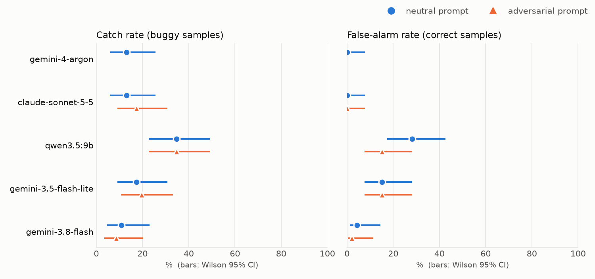
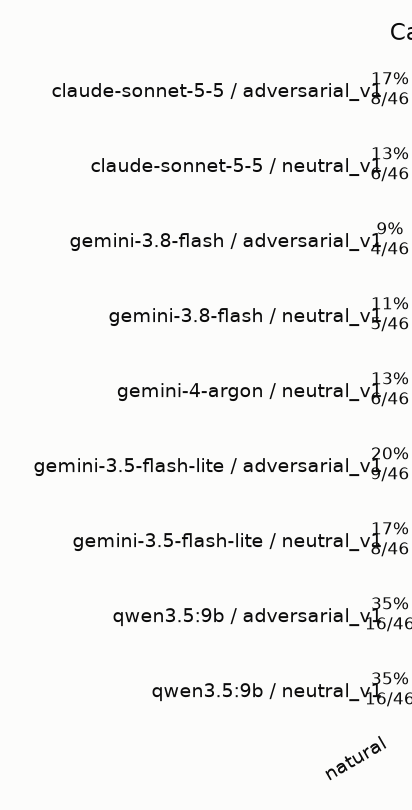
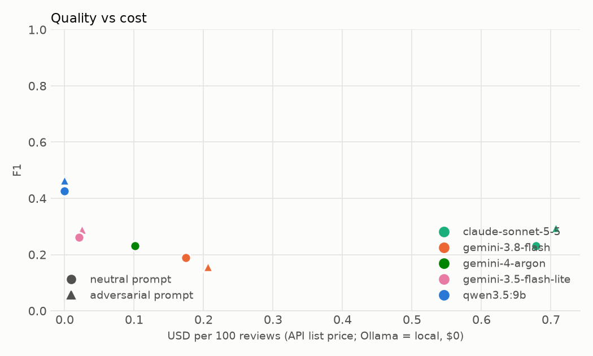

# review-bench report

Generated 2026-11-25 04:38 from 828 logged calls in: `natural-mbpp-v1`

Conventions: rates are shown with Wilson 95% CIs. API errors are excluded. PARSE_ERROR counts as "not flagged" and stays in the denominators. Localization = reported line within ±1 of the real bug line, among caught bugs with a known line. Cost = API list-price equivalent (Ollama is local, Claude runs on a subscription, Gemini was billed at list price).

## Headline metrics

| reviewer / prompt | catch rate | localization | false alarm | precision | F1 | parse fail | errors | thinking | mean latency | cost |
|---|---|---|---|---|---|---|---|---|---|---|
| claude-sonnet-5-5 / adversarial_v1 | 17.4% [9%–31%] (8/46) | - | 0.0% [0%–8%] (0/46) | 100.0% [68%–100%] (8/8) | 0.296 | 0.0% [0%–4%] (0/92) | 0 | 52% | 6.1s | $0.65 |
| claude-sonnet-5-5 / neutral_v1 | 13.0% [6%–26%] (6/46) | - | 0.0% [0%–8%] (0/46) | 100.0% [61%–100%] (6/6) | 0.231 | 0.0% [0%–4%] (0/92) | 0 | 37% | 5.9s | $0.62 |
| gemini-3.8-flash / adversarial_v1 | 8.7% [3%–20%] (4/46) | - | 2.2% [0%–11%] (1/46) | 80.0% [38%–96%] (4/5) | 0.157 | 0.0% [0%–4%] (0/92) | 0 | 96% | 5.7s | $0.19 |
| gemini-3.8-flash / neutral_v1 | 10.9% [5%–23%] (5/46) | - | 4.3% [1%–15%] (2/46) | 71.4% [36%–92%] (5/7) | 0.189 | 0.0% [0%–4%] (0/92) | 0 | 95% | 5.1s | $0.16 |
| gemini-4-argon / neutral_v1 | 13.0% [6%–26%] (6/46) | - | 0.0% [0%–8%] (0/46) | 100.0% [61%–100%] (6/6) | 0.231 | 0.0% [0%–4%] (0/92) | 0 | 0% | 6.8s | $0.09 |
| gemini-3.5-flash-lite / adversarial_v1 | 19.6% [11%–33%] (9/46) | - | 15.2% [8%–28%] (7/46) | 56.2% [33%–77%] (9/16) | 0.290 | 2.2% [1%–8%] (2/92) | 0 | 0% | 0.7s | $0.02 |
| gemini-3.5-flash-lite / neutral_v1 | 17.4% [9%–31%] (8/46) | - | 15.2% [8%–28%] (7/46) | 53.3% [30%–75%] (8/15) | 0.262 | 3.3% [1%–9%] (3/92) | 0 | 0% | 0.6s | $0.02 |
| qwen3.5:9b / adversarial_v1 | 34.8% [23%–49%] (16/46) | - | 15.2% [8%–28%] (7/46) | 69.6% [49%–84%] (16/23) | 0.464 | 3.3% [1%–9%] (3/92) | 0 | 0% | 9.8s | $0.00 |
| qwen3.5:9b / neutral_v1 | 34.8% [23%–49%] (16/46) | - | 28.3% [17%–43%] (13/46) | 55.2% [38%–72%] (16/29) | 0.427 | 3.3% [1%–9%] (3/92) | 0 | 0% | 8.5s | $0.00 |

## Catch rate by bug type

| reviewer / prompt | natural |
|---|---|
| claude-sonnet-5-5 / adversarial_v1 | 17.4% [9%–31%] (8/46) |
| claude-sonnet-5-5 / neutral_v1 | 13.0% [6%–26%] (6/46) |
| gemini-3.8-flash / adversarial_v1 | 8.7% [3%–20%] (4/46) |
| gemini-3.8-flash / neutral_v1 | 10.9% [5%–23%] (5/46) |
| gemini-4-argon / neutral_v1 | 13.0% [6%–26%] (6/46) |
| gemini-3.5-flash-lite / adversarial_v1 | 19.6% [11%–33%] (9/46) |
| gemini-3.5-flash-lite / neutral_v1 | 17.4% [9%–31%] (8/46) |
| qwen3.5:9b / adversarial_v1 | 34.8% [23%–49%] (16/46) |
| qwen3.5:9b / neutral_v1 | 34.8% [23%–49%] (16/46) |

## Paired comparisons (exact McNemar, same samples)

`A only` / `B only` = samples where only A / only B flagged BUG. For *catch*, more is better; for *false alarm*, fewer is better. p-values are Holm-adjusted across all 40 tests in this table.

| A | B | metric | n pairs | A only | B only | p | p (Holm) |
|---|---|---|---|---|---|---|---|
| claude-sonnet-5-5 / adversarial_v1 | claude-sonnet-5-5 / neutral_v1 | catch | 46 | 3 | 1 | 0.625 | 1 |
| claude-sonnet-5-5 / adversarial_v1 | claude-sonnet-5-5 / neutral_v1 | false alarm | 46 | 0 | 0 | 1 | 1 |
| claude-sonnet-5-5 / adversarial_v1 | gemini-3.8-flash / adversarial_v1 | catch | 46 | 5 | 1 | 0.219 | 1 |
| claude-sonnet-5-5 / adversarial_v1 | gemini-3.8-flash / adversarial_v1 | false alarm | 46 | 0 | 1 | 1 | 1 |
| claude-sonnet-5-5 / adversarial_v1 | gemini-3.5-flash-lite / adversarial_v1 | catch | 46 | 6 | 7 | 1 | 1 |
| claude-sonnet-5-5 / adversarial_v1 | gemini-3.5-flash-lite / adversarial_v1 | false alarm | 46 | 0 | 7 | 0.0156 | 0.531 |
| claude-sonnet-5-5 / adversarial_v1 | qwen3.5:9b / adversarial_v1 | catch | 46 | 3 | 11 | 0.0574 | 1 |
| claude-sonnet-5-5 / adversarial_v1 | qwen3.5:9b / adversarial_v1 | false alarm | 46 | 0 | 7 | 0.0156 | 0.531 |
| claude-sonnet-5-5 / neutral_v1 | gemini-3.8-flash / neutral_v1 | catch | 46 | 2 | 1 | 1 | 1 |
| claude-sonnet-5-5 / neutral_v1 | gemini-3.8-flash / neutral_v1 | false alarm | 46 | 0 | 2 | 0.5 | 1 |
| claude-sonnet-5-5 / neutral_v1 | gemini-4-argon / neutral_v1 | catch | 46 | 3 | 3 | 1 | 1 |
| claude-sonnet-5-5 / neutral_v1 | gemini-4-argon / neutral_v1 | false alarm | 46 | 0 | 0 | 1 | 1 |
| claude-sonnet-5-5 / neutral_v1 | gemini-3.5-flash-lite / neutral_v1 | catch | 46 | 3 | 5 | 0.727 | 1 |
| claude-sonnet-5-5 / neutral_v1 | gemini-3.5-flash-lite / neutral_v1 | false alarm | 46 | 0 | 7 | 0.0156 | 0.531 |
| claude-sonnet-5-5 / neutral_v1 | qwen3.5:9b / neutral_v1 | catch | 46 | 2 | 12 | 0.0129 | 0.453 |
| claude-sonnet-5-5 / neutral_v1 | qwen3.5:9b / neutral_v1 | false alarm | 46 | 0 | 13 | 0.000244 | 0.00977 **\*** |
| gemini-3.8-flash / adversarial_v1 | gemini-3.8-flash / neutral_v1 | catch | 46 | 1 | 2 | 1 | 1 |
| gemini-3.8-flash / adversarial_v1 | gemini-3.8-flash / neutral_v1 | false alarm | 46 | 0 | 1 | 1 | 1 |
| gemini-3.8-flash / adversarial_v1 | gemini-3.5-flash-lite / adversarial_v1 | catch | 46 | 2 | 7 | 0.18 | 1 |
| gemini-3.8-flash / adversarial_v1 | gemini-3.5-flash-lite / adversarial_v1 | false alarm | 46 | 0 | 6 | 0.0312 | 0.906 |
| gemini-3.8-flash / adversarial_v1 | qwen3.5:9b / adversarial_v1 | catch | 46 | 2 | 14 | 0.00418 | 0.151 |
| gemini-3.8-flash / adversarial_v1 | qwen3.5:9b / adversarial_v1 | false alarm | 46 | 0 | 6 | 0.0312 | 0.906 |
| gemini-3.8-flash / neutral_v1 | gemini-4-argon / neutral_v1 | catch | 46 | 3 | 4 | 1 | 1 |
| gemini-3.8-flash / neutral_v1 | gemini-4-argon / neutral_v1 | false alarm | 46 | 2 | 0 | 0.5 | 1 |
| gemini-3.8-flash / neutral_v1 | gemini-3.5-flash-lite / neutral_v1 | catch | 46 | 1 | 4 | 0.375 | 1 |
| gemini-3.8-flash / neutral_v1 | gemini-3.5-flash-lite / neutral_v1 | false alarm | 46 | 1 | 6 | 0.125 | 1 |
| gemini-3.8-flash / neutral_v1 | qwen3.5:9b / neutral_v1 | catch | 46 | 1 | 12 | 0.00342 | 0.126 |
| gemini-3.8-flash / neutral_v1 | qwen3.5:9b / neutral_v1 | false alarm | 46 | 0 | 11 | 0.000977 | 0.0371 **\*** |
| gemini-4-argon / neutral_v1 | gemini-3.5-flash-lite / neutral_v1 | catch | 46 | 5 | 7 | 0.774 | 1 |
| gemini-4-argon / neutral_v1 | gemini-3.5-flash-lite / neutral_v1 | false alarm | 46 | 0 | 7 | 0.0156 | 0.531 |
| gemini-4-argon / neutral_v1 | qwen3.5:9b / neutral_v1 | catch | 46 | 3 | 13 | 0.0213 | 0.638 |
| gemini-4-argon / neutral_v1 | qwen3.5:9b / neutral_v1 | false alarm | 46 | 0 | 13 | 0.000244 | 0.00977 **\*** |
| gemini-3.5-flash-lite / adversarial_v1 | gemini-3.5-flash-lite / neutral_v1 | catch | 46 | 4 | 3 | 1 | 1 |
| gemini-3.5-flash-lite / adversarial_v1 | gemini-3.5-flash-lite / neutral_v1 | false alarm | 46 | 1 | 1 | 1 | 1 |
| gemini-3.5-flash-lite / adversarial_v1 | qwen3.5:9b / adversarial_v1 | catch | 46 | 4 | 11 | 0.118 | 1 |
| gemini-3.5-flash-lite / adversarial_v1 | qwen3.5:9b / adversarial_v1 | false alarm | 46 | 3 | 3 | 1 | 1 |
| gemini-3.5-flash-lite / neutral_v1 | qwen3.5:9b / neutral_v1 | catch | 46 | 3 | 11 | 0.0574 | 1 |
| gemini-3.5-flash-lite / neutral_v1 | qwen3.5:9b / neutral_v1 | false alarm | 46 | 1 | 7 | 0.0703 | 1 |
| qwen3.5:9b / adversarial_v1 | qwen3.5:9b / neutral_v1 | catch | 46 | 5 | 5 | 1 | 1 |
| qwen3.5:9b / adversarial_v1 | qwen3.5:9b / neutral_v1 | false alarm | 46 | 1 | 7 | 0.0703 | 1 |

\* = significant at 0.05 after Holm adjustment.

## Two-reviewer ensembles

Two reviewers on the same samples and prompt, combined: **AND** = BUG only if both say BUG, **OR** = BUG if either does. Cost is the sum of both. Each ensemble is compared with its better member (higher F1) by exact McNemar; `+`/`-` = ensemble-only / member-only flags. p-values are Holm-adjusted across the 64 tests in this section only.

| ensemble | rule | catch rate | false alarm | F1 | cost | better member (F1) | catch +/- (p Holm) | false alarm +/- (p Holm) |
|---|---|---|---|---|---|---|---|---|
| claude-sonnet-5-5 / adversarial_v1 + gemini-3.8-flash | AND | 6.5% [2%–18%] (3/46) | 0.0% [0%–8%] (0/46) | 0.122 | $0.84 | claude-sonnet-5-5 (0.296) | +0/-5 (1) | +0/-0 (1) |
| claude-sonnet-5-5 / adversarial_v1 + gemini-3.8-flash | OR | 19.6% [11%–33%] (9/46) | 2.2% [0%–11%] (1/46) | 0.321 | $0.84 | claude-sonnet-5-5 (0.296) | +1/-0 (1) | +1/-0 (1) |
| claude-sonnet-5-5 / adversarial_v1 + gemini-3.5-flash-lite | AND | 4.3% [1%–15%] (2/46) | 0.0% [0%–8%] (0/46) | 0.083 | $0.67 | claude-sonnet-5-5 (0.296) | +0/-6 (1) | +0/-0 (1) |
| claude-sonnet-5-5 / adversarial_v1 + gemini-3.5-flash-lite | OR | 32.6% [21%–47%] (15/46) | 15.2% [8%–28%] (7/46) | 0.441 | $0.67 | claude-sonnet-5-5 (0.296) | +7/-0 (0.844) | +7/-0 (0.844) |
| claude-sonnet-5-5 / adversarial_v1 + qwen3.5:9b | AND | 10.9% [5%–23%] (5/46) | 0.0% [0%–8%] (0/46) | 0.196 | $0.65 | qwen3.5:9b (0.464) | +0/-11 (0.0566) | +0/-7 (0.844) |
| claude-sonnet-5-5 / adversarial_v1 + qwen3.5:9b | OR | 41.3% [28%–56%] (19/46) | 15.2% [8%–28%] (7/46) | 0.528 | $0.65 | qwen3.5:9b (0.464) | +3/-0 (1) | +0/-0 (1) |
| claude-sonnet-5-5 / neutral_v1 + gemini-3.8-flash | AND | 8.7% [3%–20%] (4/46) | 0.0% [0%–8%] (0/46) | 0.160 | $0.78 | claude-sonnet-5-5 (0.231) | +0/-2 (1) | +0/-0 (1) |
| claude-sonnet-5-5 / neutral_v1 + gemini-3.8-flash | OR | 15.2% [8%–28%] (7/46) | 4.3% [1%–15%] (2/46) | 0.255 | $0.78 | claude-sonnet-5-5 (0.231) | +1/-0 (1) | +2/-0 (1) |
| claude-sonnet-5-5 / neutral_v1 + gemini-4-argon | AND | 6.5% [2%–18%] (3/46) | 0.0% [0%–8%] (0/46) | 0.122 | $0.72 | claude-sonnet-5-5 (0.231) | +0/-3 (1) | +0/-0 (1) |
| claude-sonnet-5-5 / neutral_v1 + gemini-4-argon | OR | 19.6% [11%–33%] (9/46) | 0.0% [0%–8%] (0/46) | 0.327 | $0.72 | claude-sonnet-5-5 (0.231) | +3/-0 (1) | +0/-0 (1) |
| claude-sonnet-5-5 / neutral_v1 + gemini-3.5-flash-lite | AND | 6.5% [2%–18%] (3/46) | 0.0% [0%–8%] (0/46) | 0.122 | $0.64 | gemini-3.5-flash-lite (0.262) | +0/-5 (1) | +0/-7 (0.844) |
| claude-sonnet-5-5 / neutral_v1 + gemini-3.5-flash-lite | OR | 23.9% [14%–38%] (11/46) | 15.2% [8%–28%] (7/46) | 0.344 | $0.64 | gemini-3.5-flash-lite (0.262) | +3/-0 (1) | +0/-0 (1) |
| claude-sonnet-5-5 / neutral_v1 + qwen3.5:9b | AND | 8.7% [3%–20%] (4/46) | 0.0% [0%–8%] (0/46) | 0.160 | $0.62 | qwen3.5:9b (0.427) | +0/-12 (0.0293) * | +0/-13 (0.0154) * |
| claude-sonnet-5-5 / neutral_v1 + qwen3.5:9b | OR | 39.1% [26%–54%] (18/46) | 28.3% [17%–43%] (13/46) | 0.468 | $0.62 | qwen3.5:9b (0.427) | +2/-0 (1) | +0/-0 (1) |
| gemini-3.8-flash / adversarial_v1 + gemini-3.5-flash-lite | AND | 4.3% [1%–15%] (2/46) | 2.2% [0%–11%] (1/46) | 0.082 | $0.21 | gemini-3.5-flash-lite (0.290) | +0/-7 (0.844) | +0/-6 (1) |
| gemini-3.8-flash / adversarial_v1 + gemini-3.5-flash-lite | OR | 23.9% [14%–38%] (11/46) | 15.2% [8%–28%] (7/46) | 0.344 | $0.21 | gemini-3.5-flash-lite (0.290) | +2/-0 (1) | +0/-0 (1) |
| gemini-3.8-flash / adversarial_v1 + qwen3.5:9b | AND | 4.3% [1%–15%] (2/46) | 2.2% [0%–11%] (1/46) | 0.082 | $0.19 | qwen3.5:9b (0.464) | +0/-14 (0.00781) * | +0/-6 (1) |
| gemini-3.8-flash / adversarial_v1 + qwen3.5:9b | OR | 39.1% [26%–54%] (18/46) | 15.2% [8%–28%] (7/46) | 0.507 | $0.19 | qwen3.5:9b (0.464) | +2/-0 (1) | +0/-0 (1) |
| gemini-3.8-flash / neutral_v1 + gemini-4-argon | AND | 4.3% [1%–15%] (2/46) | 0.0% [0%–8%] (0/46) | 0.083 | $0.25 | gemini-4-argon (0.231) | +0/-4 (1) | +0/-0 (1) |
| gemini-3.8-flash / neutral_v1 + gemini-4-argon | OR | 19.6% [11%–33%] (9/46) | 4.3% [1%–15%] (2/46) | 0.316 | $0.25 | gemini-4-argon (0.231) | +3/-0 (1) | +2/-0 (1) |
| gemini-3.8-flash / neutral_v1 + gemini-3.5-flash-lite | AND | 8.7% [3%–20%] (4/46) | 2.2% [0%–11%] (1/46) | 0.157 | $0.18 | gemini-3.5-flash-lite (0.262) | +0/-4 (1) | +0/-6 (1) |
| gemini-3.8-flash / neutral_v1 + gemini-3.5-flash-lite | OR | 19.6% [11%–33%] (9/46) | 17.4% [9%–31%] (8/46) | 0.286 | $0.18 | gemini-3.5-flash-lite (0.262) | +1/-0 (1) | +1/-0 (1) |
| gemini-3.8-flash / neutral_v1 + qwen3.5:9b | AND | 8.7% [3%–20%] (4/46) | 4.3% [1%–15%] (2/46) | 0.154 | $0.16 | qwen3.5:9b (0.427) | +0/-12 (0.0293) * | +0/-11 (0.0566) |
| gemini-3.8-flash / neutral_v1 + qwen3.5:9b | OR | 37.0% [25%–51%] (17/46) | 28.3% [17%–43%] (13/46) | 0.447 | $0.16 | qwen3.5:9b (0.427) | +1/-0 (1) | +0/-0 (1) |
| gemini-4-argon / neutral_v1 + gemini-3.5-flash-lite | AND | 2.2% [0%–11%] (1/46) | 0.0% [0%–8%] (0/46) | 0.043 | $0.11 | gemini-3.5-flash-lite (0.262) | +0/-7 (0.844) | +0/-7 (0.844) |
| gemini-4-argon / neutral_v1 + gemini-3.5-flash-lite | OR | 28.3% [17%–43%] (13/46) | 15.2% [8%–28%] (7/46) | 0.394 | $0.11 | gemini-3.5-flash-lite (0.262) | +5/-0 (1) | +0/-0 (1) |
| gemini-4-argon / neutral_v1 + qwen3.5:9b | AND | 6.5% [2%–18%] (3/46) | 0.0% [0%–8%] (0/46) | 0.122 | $0.09 | qwen3.5:9b (0.427) | +0/-13 (0.0154) * | +0/-13 (0.0154) * |
| gemini-4-argon / neutral_v1 + qwen3.5:9b | OR | 41.3% [28%–56%] (19/46) | 28.3% [17%–43%] (13/46) | 0.487 | $0.09 | qwen3.5:9b (0.427) | +3/-0 (1) | +0/-0 (1) |
| gemini-3.5-flash-lite / adversarial_v1 + qwen3.5:9b | AND | 10.9% [5%–23%] (5/46) | 8.7% [3%–20%] (4/46) | 0.182 | $0.02 | qwen3.5:9b (0.464) | +0/-11 (0.0566) | +0/-3 (1) |
| gemini-3.5-flash-lite / adversarial_v1 + qwen3.5:9b | OR | 43.5% [30%–58%] (20/46) | 21.7% [12%–36%] (10/46) | 0.526 | $0.02 | qwen3.5:9b (0.464) | +4/-0 (1) | +3/-0 (1) |
| gemini-3.5-flash-lite / neutral_v1 + qwen3.5:9b | AND | 10.9% [5%–23%] (5/46) | 13.0% [6%–26%] (6/46) | 0.175 | $0.02 | qwen3.5:9b (0.427) | +0/-11 (0.0566) | +0/-7 (0.844) |
| gemini-3.5-flash-lite / neutral_v1 + qwen3.5:9b | OR | 41.3% [28%–56%] (19/46) | 30.4% [19%–45%] (14/46) | 0.481 | $0.02 | qwen3.5:9b (0.427) | +3/-0 (1) | +1/-0 (1) |

* = significant at 0.05 after Holm adjustment (within this section).

## Adjudicated view (manual, qualitative)

The labels above come from the tests. Here each labelled-buggy sample is also shown with my manual class. Manual adjudication of the buggy samples in data/natural_mbpp_v1.jsonl (see natural_mbpp_review.md). Judgement, not ground truth; used only for the separate 'adjudicated view' in reports. `B` = reviewer said BUG, `.` = OK, `?` = parse error, blank = no call.

- **claude_bug**: the writer's output contradicts the docstring: `BUG` is right
- **reference_bug**: the writer follows the docstring, the test oracle does not: `OK` is right
- **arguable**: the docstring does not settle it

| sample | class | claude-sonnet-5-5 / adversarial_v1 | claude-sonnet-5-5 / neutral_v1 | gemini-3.8-flash / adversarial_v1 | gemini-3.8-flash / neutral_v1 | gemini-4-argon / neutral_v1 | gemini-3.5-flash-lite / adversarial_v1 | gemini-3.5-flash-lite / neutral_v1 | qwen3.5:9b / adversarial_v1 | qwen3.5:9b / neutral_v1 |
|---|---|---|---|---|---|---|---|---|---|---|
| Mbpp/109#natural | claude_bug | B | B | B | B | B | B | B | B | B |
| Mbpp/138#natural | claude_bug | . | . | . | . | . | B | ? | B | B |
| Mbpp/16#natural | claude_bug | . | . | . | B | . | B | B | B | B |
| Mbpp/244#natural | claude_bug | B | B | . | . | B | . | . | . | B |
| Mbpp/261#natural | claude_bug | B | . | . | . | . | . | . | B | B |
| Mbpp/409#natural | claude_bug | B | B | B | B | . | B | B | . | . |
| Mbpp/589#natural | claude_bug | . | . | B | . | B | . | . | . | . |
| Mbpp/757#natural | claude_bug | B | B | B | B | B | . | . | B | B |
| Mbpp/780#natural | claude_bug | . | . | . | . | . | . | . | . | . |
| Mbpp/792#natural | claude_bug | . | . | . | . | . | . | . | . | . |
| Mbpp/113#natural | reference_bug | . | . | . | . | . | . | . | B | ? |
| Mbpp/160#natural | reference_bug | . | . | . | . | . | B | B | B | B |
| Mbpp/294#natural | reference_bug | . | . | . | . | . | . | B | B | . |
| Mbpp/410#natural | reference_bug | . | . | . | . | . | . | . | B | . |
| Mbpp/451#natural | reference_bug | . | . | . | . | . | . | . | . | . |
| Mbpp/459#natural | reference_bug | . | . | . | . | . | . | B | . | . |
| Mbpp/593#natural | reference_bug | . | . | . | . | . | . | . | . | . |
| Mbpp/620#natural | reference_bug | . | . | . | . | . | . | . | B | B |
| Mbpp/639#natural | reference_bug | . | . | . | . | . | . | . | . | . |
| Mbpp/739#natural | reference_bug | . | . | . | . | . | . | . | ? | ? |
| Mbpp/74#natural | reference_bug | . | . | . | . | . | . | . | . | . |
| Mbpp/771#natural | reference_bug | . | . | . | . | . | . | . | . | . |
| Mbpp/790#natural | reference_bug | . | . | . | . | . | . | . | . | . |
| Mbpp/800#natural | reference_bug | . | . | . | . | . | . | . | . | . |
| Mbpp/806#natural | reference_bug | . | . | . | . | . | . | . | . | . |
| Mbpp/102#natural | arguable | B | . | . | . | . | . | . | . | B |
| Mbpp/119#natural | arguable | . | . | . | . | . | ? | . | B | B |
| Mbpp/223#natural | arguable | . | . | . | . | . | . | ? | . | . |
| Mbpp/278#natural | arguable | . | . | . | . | . | . | . | . | . |
| Mbpp/300#natural | arguable | . | . | . | . | . | . | . | B | B |
| Mbpp/305#natural | arguable | . | B | . | . | . | B | . | B | . |
| Mbpp/398#natural | arguable | . | . | . | . | . | . | . | . | B |
| Mbpp/406#natural | arguable | . | . | . | . | . | . | . | . | . |
| Mbpp/415#natural | arguable | B | . | . | . | . | . | . | B | B |
| Mbpp/427#natural | arguable | . | . | . | . | . | . | . | . | . |
| Mbpp/446#natural | arguable | . | . | . | . | . | B | . | . | . |
| Mbpp/468#natural | arguable | B | B | . | B | . | . | B | B | B |
| Mbpp/556#natural | arguable | . | . | . | . | . | . | . | . | . |
| Mbpp/558#natural | arguable | . | . | . | . | B | . | . | . | . |
| Mbpp/559#natural | arguable | . | . | . | . | . | . | . | B | . |
| Mbpp/576#natural | arguable | . | . | . | . | . | . | . | . | . |
| Mbpp/577#natural | arguable | . | . | . | . | . | . | . | . | . |
| Mbpp/597#natural | arguable | . | . | . | . | . | B | . | . | B |
| Mbpp/630#natural | arguable | . | . | . | . | B | . | . | . | . |
| Mbpp/735#natural | arguable | . | . | . | . | . | B | B | ? | B |
| Mbpp/92#natural | arguable | . | . | . | . | . | . | . | . | . |
