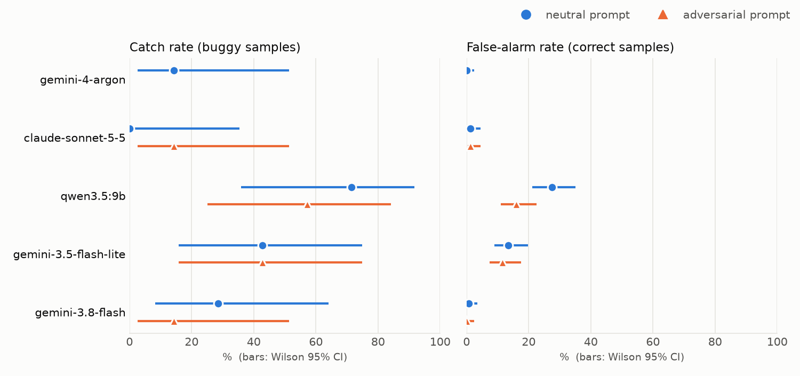
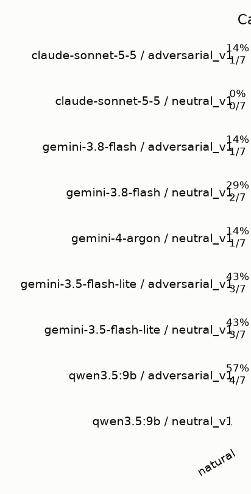
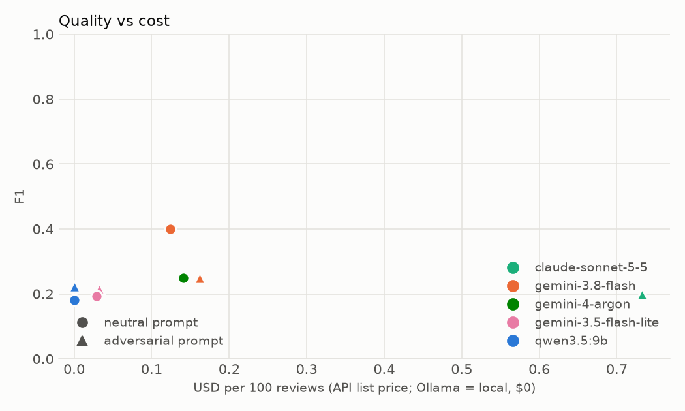

# review-bench report

Generated 2026-11-25 04:38 from 1467 logged calls in: `natural-plus-v1`

Conventions: rates are shown with Wilson 95% CIs. API errors are excluded. PARSE_ERROR counts as "not flagged" and stays in the denominators. Localization = reported line within ±1 of the real bug line, among caught bugs with a known line. Cost = API list-price equivalent (Ollama is local, Claude runs on a subscription, Gemini was billed at list price).

## Headline metrics

| reviewer / prompt | catch rate | localization | false alarm | precision | F1 | parse fail | errors | thinking | mean latency | cost |
|---|---|---|---|---|---|---|---|---|---|---|
| claude-sonnet-5-5 / adversarial_v1 | 14.3% [3%–51%] (1/7) | - | 1.3% [0%–5%] (2/156) | 33.3% [6%–79%] (1/3) | 0.200 | 0.0% [0%–2%] (0/163) | 0 | 32% | 6.6s | $1.19 |
| claude-sonnet-5-5 / neutral_v1 | 0.0% [0%–35%] (0/7) | - | 1.3% [0%–5%] (2/156) | 0.0% [0%–66%] (0/2) | - | 0.0% [0%–2%] (0/163) | 0 | 18% | 5.4s | $1.16 |
| gemini-3.8-flash / adversarial_v1 | 14.3% [3%–51%] (1/7) | - | 0.0% [0%–2%] (0/156) | 100.0% [21%–100%] (1/1) | 0.250 | 0.0% [0%–2%] (0/163) | 0 | 87% | 4.6s | $0.26 |
| gemini-3.8-flash / neutral_v1 | 28.6% [8%–64%] (2/7) | - | 0.6% [0%–4%] (1/156) | 66.7% [21%–94%] (2/3) | 0.400 | 0.0% [0%–2%] (0/163) | 0 | 81% | 4.1s | $0.20 |
| gemini-4-argon / neutral_v1 | 14.3% [3%–51%] (1/7) | - | 0.0% [0%–2%] (0/156) | 100.0% [21%–100%] (1/1) | 0.250 | 0.0% [0%–2%] (0/163) | 0 | 0% | 6.5s | $0.23 |
| gemini-3.5-flash-lite / adversarial_v1 | 42.9% [16%–75%] (3/7) | - | 11.5% [7%–18%] (18/156) | 14.3% [5%–35%] (3/21) | 0.214 | 1.2% [0%–4%] (2/163) | 0 | 0% | 0.7s | $0.05 |
| gemini-3.5-flash-lite / neutral_v1 | 42.9% [16%–75%] (3/7) | - | 13.5% [9%–20%] (21/156) | 12.5% [4%–31%] (3/24) | 0.194 | 0.6% [0%–3%] (1/163) | 0 | 0% | 0.7s | $0.05 |
| qwen3.5:9b / adversarial_v1 | 57.1% [25%–84%] (4/7) | - | 16.0% [11%–23%] (25/156) | 13.8% [5%–31%] (4/29) | 0.222 | 3.1% [1%–7%] (5/163) | 0 | 0% | 14.9s | $0.00 |
| qwen3.5:9b / neutral_v1 | 71.4% [36%–92%] (5/7) | - | 27.6% [21%–35%] (43/156) | 10.4% [5%–22%] (5/48) | 0.182 | 1.8% [1%–5%] (3/163) | 0 | 0% | 14.7s | $0.00 |

## Catch rate by bug type

| reviewer / prompt | natural |
|---|---|
| claude-sonnet-5-5 / adversarial_v1 | 14.3% [3%–51%] (1/7) |
| claude-sonnet-5-5 / neutral_v1 | 0.0% [0%–35%] (0/7) |
| gemini-3.8-flash / adversarial_v1 | 14.3% [3%–51%] (1/7) |
| gemini-3.8-flash / neutral_v1 | 28.6% [8%–64%] (2/7) |
| gemini-4-argon / neutral_v1 | 14.3% [3%–51%] (1/7) |
| gemini-3.5-flash-lite / adversarial_v1 | 42.9% [16%–75%] (3/7) |
| gemini-3.5-flash-lite / neutral_v1 | 42.9% [16%–75%] (3/7) |
| qwen3.5:9b / adversarial_v1 | 57.1% [25%–84%] (4/7) |
| qwen3.5:9b / neutral_v1 | 71.4% [36%–92%] (5/7) |

## Paired comparisons (exact McNemar, same samples)

`A only` / `B only` = samples where only A / only B flagged BUG. For *catch*, more is better; for *false alarm*, fewer is better. p-values are Holm-adjusted across all 40 tests in this table.

| A | B | metric | n pairs | A only | B only | p | p (Holm) |
|---|---|---|---|---|---|---|---|
| claude-sonnet-5-5 / adversarial_v1 | claude-sonnet-5-5 / neutral_v1 | catch | 7 | 1 | 0 | 1 | 1 |
| claude-sonnet-5-5 / adversarial_v1 | claude-sonnet-5-5 / neutral_v1 | false alarm | 156 | 2 | 2 | 1 | 1 |
| claude-sonnet-5-5 / adversarial_v1 | gemini-3.8-flash / adversarial_v1 | catch | 7 | 1 | 1 | 1 | 1 |
| claude-sonnet-5-5 / adversarial_v1 | gemini-3.8-flash / adversarial_v1 | false alarm | 156 | 2 | 0 | 0.5 | 1 |
| claude-sonnet-5-5 / adversarial_v1 | gemini-3.5-flash-lite / adversarial_v1 | catch | 7 | 0 | 2 | 0.5 | 1 |
| claude-sonnet-5-5 / adversarial_v1 | gemini-3.5-flash-lite / adversarial_v1 | false alarm | 156 | 2 | 18 | 0.000402 | 0.0125 **\*** |
| claude-sonnet-5-5 / adversarial_v1 | qwen3.5:9b / adversarial_v1 | catch | 7 | 0 | 3 | 0.25 | 1 |
| claude-sonnet-5-5 / adversarial_v1 | qwen3.5:9b / adversarial_v1 | false alarm | 156 | 2 | 25 | 5.65e-06 | 0.000192 **\*** |
| claude-sonnet-5-5 / neutral_v1 | gemini-3.8-flash / neutral_v1 | catch | 7 | 0 | 2 | 0.5 | 1 |
| claude-sonnet-5-5 / neutral_v1 | gemini-3.8-flash / neutral_v1 | false alarm | 156 | 2 | 1 | 1 | 1 |
| claude-sonnet-5-5 / neutral_v1 | gemini-4-argon / neutral_v1 | catch | 7 | 0 | 1 | 1 | 1 |
| claude-sonnet-5-5 / neutral_v1 | gemini-4-argon / neutral_v1 | false alarm | 156 | 2 | 0 | 0.5 | 1 |
| claude-sonnet-5-5 / neutral_v1 | gemini-3.5-flash-lite / neutral_v1 | catch | 7 | 0 | 3 | 0.25 | 1 |
| claude-sonnet-5-5 / neutral_v1 | gemini-3.5-flash-lite / neutral_v1 | false alarm | 156 | 1 | 20 | 2.1e-05 | 0.000671 **\*** |
| claude-sonnet-5-5 / neutral_v1 | qwen3.5:9b / neutral_v1 | catch | 7 | 0 | 5 | 0.0625 | 1 |
| claude-sonnet-5-5 / neutral_v1 | qwen3.5:9b / neutral_v1 | false alarm | 156 | 1 | 42 | 1e-11 | 3.8e-10 **\*** |
| gemini-3.8-flash / adversarial_v1 | gemini-3.8-flash / neutral_v1 | catch | 7 | 1 | 2 | 1 | 1 |
| gemini-3.8-flash / adversarial_v1 | gemini-3.8-flash / neutral_v1 | false alarm | 156 | 0 | 1 | 1 | 1 |
| gemini-3.8-flash / adversarial_v1 | gemini-3.5-flash-lite / adversarial_v1 | catch | 7 | 0 | 2 | 0.5 | 1 |
| gemini-3.8-flash / adversarial_v1 | gemini-3.5-flash-lite / adversarial_v1 | false alarm | 156 | 0 | 18 | 7.63e-06 | 0.000252 **\*** |
| gemini-3.8-flash / adversarial_v1 | qwen3.5:9b / adversarial_v1 | catch | 7 | 0 | 3 | 0.25 | 1 |
| gemini-3.8-flash / adversarial_v1 | qwen3.5:9b / adversarial_v1 | false alarm | 156 | 0 | 25 | 5.96e-08 | 2.21e-06 **\*** |
| gemini-3.8-flash / neutral_v1 | gemini-4-argon / neutral_v1 | catch | 7 | 1 | 0 | 1 | 1 |
| gemini-3.8-flash / neutral_v1 | gemini-4-argon / neutral_v1 | false alarm | 156 | 1 | 0 | 1 | 1 |
| gemini-3.8-flash / neutral_v1 | gemini-3.5-flash-lite / neutral_v1 | catch | 7 | 0 | 1 | 1 | 1 |
| gemini-3.8-flash / neutral_v1 | gemini-3.5-flash-lite / neutral_v1 | false alarm | 156 | 0 | 20 | 1.91e-06 | 6.68e-05 **\*** |
| gemini-3.8-flash / neutral_v1 | qwen3.5:9b / neutral_v1 | catch | 7 | 0 | 3 | 0.25 | 1 |
| gemini-3.8-flash / neutral_v1 | qwen3.5:9b / neutral_v1 | false alarm | 156 | 1 | 43 | 5.12e-12 | 2e-10 **\*** |
| gemini-4-argon / neutral_v1 | gemini-3.5-flash-lite / neutral_v1 | catch | 7 | 0 | 2 | 0.5 | 1 |
| gemini-4-argon / neutral_v1 | gemini-3.5-flash-lite / neutral_v1 | false alarm | 156 | 0 | 21 | 9.54e-07 | 3.43e-05 **\*** |
| gemini-4-argon / neutral_v1 | qwen3.5:9b / neutral_v1 | catch | 7 | 0 | 4 | 0.125 | 1 |
| gemini-4-argon / neutral_v1 | qwen3.5:9b / neutral_v1 | false alarm | 156 | 0 | 43 | 2.27e-13 | 9.09e-12 **\*** |
| gemini-3.5-flash-lite / adversarial_v1 | gemini-3.5-flash-lite / neutral_v1 | catch | 7 | 0 | 0 | 1 | 1 |
| gemini-3.5-flash-lite / adversarial_v1 | gemini-3.5-flash-lite / neutral_v1 | false alarm | 156 | 2 | 5 | 0.453 | 1 |
| gemini-3.5-flash-lite / adversarial_v1 | qwen3.5:9b / adversarial_v1 | catch | 7 | 1 | 2 | 1 | 1 |
| gemini-3.5-flash-lite / adversarial_v1 | qwen3.5:9b / adversarial_v1 | false alarm | 156 | 6 | 13 | 0.167 | 1 |
| gemini-3.5-flash-lite / neutral_v1 | qwen3.5:9b / neutral_v1 | catch | 7 | 0 | 2 | 0.5 | 1 |
| gemini-3.5-flash-lite / neutral_v1 | qwen3.5:9b / neutral_v1 | false alarm | 156 | 8 | 30 | 0.000472 | 0.0142 **\*** |
| qwen3.5:9b / adversarial_v1 | qwen3.5:9b / neutral_v1 | catch | 7 | 1 | 2 | 1 | 1 |
| qwen3.5:9b / adversarial_v1 | qwen3.5:9b / neutral_v1 | false alarm | 156 | 4 | 22 | 0.000534 | 0.0155 **\*** |

\* = significant at 0.05 after Holm adjustment.

## Two-reviewer ensembles

Two reviewers on the same samples and prompt, combined: **AND** = BUG only if both say BUG, **OR** = BUG if either does. Cost is the sum of both. Each ensemble is compared with its better member (higher F1) by exact McNemar; `+`/`-` = ensemble-only / member-only flags. p-values are Holm-adjusted across the 64 tests in this section only.

| ensemble | rule | catch rate | false alarm | F1 | cost | better member (F1) | catch +/- (p Holm) | false alarm +/- (p Holm) |
|---|---|---|---|---|---|---|---|---|
| claude-sonnet-5-5 / adversarial_v1 + gemini-3.8-flash | AND | 0.0% [0%–35%] (0/7) | 0.0% [0%–2%] (0/156) | - | $1.46 | gemini-3.8-flash (0.250) | +0/-1 (1) | +0/-0 (1) |
| claude-sonnet-5-5 / adversarial_v1 + gemini-3.8-flash | OR | 28.6% [8%–64%] (2/7) | 1.3% [0%–5%] (2/156) | 0.364 | $1.46 | gemini-3.8-flash (0.250) | +1/-0 (1) | +2/-0 (1) |
| claude-sonnet-5-5 / adversarial_v1 + gemini-3.5-flash-lite | AND | 14.3% [3%–51%] (1/7) | 0.0% [0%–2%] (0/156) | 0.250 | $1.25 | gemini-3.5-flash-lite (0.214) | +0/-2 (1) | +0/-18 (0.00042) * |
| claude-sonnet-5-5 / adversarial_v1 + gemini-3.5-flash-lite | OR | 42.9% [16%–75%] (3/7) | 12.8% [8%–19%] (20/156) | 0.200 | $1.25 | gemini-3.5-flash-lite (0.214) | +0/-0 (1) | +2/-0 (1) |
| claude-sonnet-5-5 / adversarial_v1 + qwen3.5:9b | AND | 14.3% [3%–51%] (1/7) | 0.0% [0%–2%] (0/156) | 0.250 | $1.19 | qwen3.5:9b (0.222) | +0/-3 (1) | +0/-25 (3.58e-06) * |
| claude-sonnet-5-5 / adversarial_v1 + qwen3.5:9b | OR | 57.1% [25%–84%] (4/7) | 17.3% [12%–24%] (27/156) | 0.211 | $1.19 | qwen3.5:9b (0.222) | +0/-0 (1) | +2/-0 (1) |
| claude-sonnet-5-5 / neutral_v1 + gemini-3.8-flash | AND | 0.0% [0%–35%] (0/7) | 0.0% [0%–2%] (0/156) | - | $1.36 | gemini-3.8-flash (0.400) | +0/-2 (1) | +0/-1 (1) |
| claude-sonnet-5-5 / neutral_v1 + gemini-3.8-flash | OR | 28.6% [8%–64%] (2/7) | 1.9% [1%–6%] (3/156) | 0.333 | $1.36 | gemini-3.8-flash (0.400) | +0/-0 (1) | +2/-0 (1) |
| claude-sonnet-5-5 / neutral_v1 + gemini-4-argon | AND | 0.0% [0%–35%] (0/7) | 0.0% [0%–2%] (0/156) | - | $1.39 | gemini-4-argon (0.250) | +0/-1 (1) | +0/-0 (1) |
| claude-sonnet-5-5 / neutral_v1 + gemini-4-argon | OR | 14.3% [3%–51%] (1/7) | 1.3% [0%–5%] (2/156) | 0.200 | $1.39 | gemini-4-argon (0.250) | +0/-0 (1) | +2/-0 (1) |
| claude-sonnet-5-5 / neutral_v1 + gemini-3.5-flash-lite | AND | 0.0% [0%–35%] (0/7) | 0.6% [0%–4%] (1/156) | - | $1.21 | gemini-3.5-flash-lite (0.194) | +0/-3 (1) | +0/-20 (0.000109) * |
| claude-sonnet-5-5 / neutral_v1 + gemini-3.5-flash-lite | OR | 42.9% [16%–75%] (3/7) | 14.1% [10%–20%] (22/156) | 0.188 | $1.21 | gemini-3.5-flash-lite (0.194) | +0/-0 (1) | +1/-0 (1) |
| claude-sonnet-5-5 / neutral_v1 + qwen3.5:9b | AND | 0.0% [0%–35%] (0/7) | 0.6% [0%–4%] (1/156) | - | $1.16 | qwen3.5:9b (0.182) | +0/-5 (1) | +0/-42 (2.82e-11) * |
| claude-sonnet-5-5 / neutral_v1 + qwen3.5:9b | OR | 71.4% [36%–92%] (5/7) | 28.2% [22%–36%] (44/156) | 0.179 | $1.16 | qwen3.5:9b (0.182) | +0/-0 (1) | +1/-0 (1) |
| gemini-3.8-flash / adversarial_v1 + gemini-3.5-flash-lite | AND | 14.3% [3%–51%] (1/7) | 0.0% [0%–2%] (0/156) | 0.250 | $0.32 | gemini-3.8-flash (0.250) | +0/-0 (1) | +0/-0 (1) |
| gemini-3.8-flash / adversarial_v1 + gemini-3.5-flash-lite | OR | 42.9% [16%–75%] (3/7) | 11.5% [7%–18%] (18/156) | 0.214 | $0.32 | gemini-3.8-flash (0.250) | +2/-0 (1) | +18/-0 (0.00042) * |
| gemini-3.8-flash / adversarial_v1 + qwen3.5:9b | AND | 14.3% [3%–51%] (1/7) | 0.0% [0%–2%] (0/156) | 0.250 | $0.26 | gemini-3.8-flash (0.250) | +0/-0 (1) | +0/-0 (1) |
| gemini-3.8-flash / adversarial_v1 + qwen3.5:9b | OR | 57.1% [25%–84%] (4/7) | 16.0% [11%–23%] (25/156) | 0.222 | $0.26 | gemini-3.8-flash (0.250) | +3/-0 (1) | +25/-0 (3.58e-06) * |
| gemini-3.8-flash / neutral_v1 + gemini-4-argon | AND | 14.3% [3%–51%] (1/7) | 0.0% [0%–2%] (0/156) | 0.250 | $0.43 | gemini-3.8-flash (0.400) | +0/-1 (1) | +0/-1 (1) |
| gemini-3.8-flash / neutral_v1 + gemini-4-argon | OR | 28.6% [8%–64%] (2/7) | 0.6% [0%–4%] (1/156) | 0.400 | $0.43 | gemini-3.8-flash (0.400) | +0/-0 (1) | +0/-0 (1) |
| gemini-3.8-flash / neutral_v1 + gemini-3.5-flash-lite | AND | 28.6% [8%–64%] (2/7) | 0.6% [0%–4%] (1/156) | 0.400 | $0.25 | gemini-3.8-flash (0.400) | +0/-0 (1) | +0/-0 (1) |
| gemini-3.8-flash / neutral_v1 + gemini-3.5-flash-lite | OR | 42.9% [16%–75%] (3/7) | 13.5% [9%–20%] (21/156) | 0.194 | $0.25 | gemini-3.8-flash (0.400) | +1/-0 (1) | +20/-0 (0.000109) * |
| gemini-3.8-flash / neutral_v1 + qwen3.5:9b | AND | 28.6% [8%–64%] (2/7) | 0.0% [0%–2%] (0/156) | 0.444 | $0.20 | gemini-3.8-flash (0.400) | +0/-0 (1) | +0/-1 (1) |
| gemini-3.8-flash / neutral_v1 + qwen3.5:9b | OR | 71.4% [36%–92%] (5/7) | 28.2% [22%–36%] (44/156) | 0.179 | $0.20 | gemini-3.8-flash (0.400) | +3/-0 (1) | +43/-0 (1.46e-11) * |
| gemini-4-argon / neutral_v1 + gemini-3.5-flash-lite | AND | 14.3% [3%–51%] (1/7) | 0.0% [0%–2%] (0/156) | 0.250 | $0.28 | gemini-4-argon (0.250) | +0/-0 (1) | +0/-0 (1) |
| gemini-4-argon / neutral_v1 + gemini-3.5-flash-lite | OR | 42.9% [16%–75%] (3/7) | 13.5% [9%–20%] (21/156) | 0.194 | $0.28 | gemini-4-argon (0.250) | +2/-0 (1) | +21/-0 (5.53e-05) * |
| gemini-4-argon / neutral_v1 + qwen3.5:9b | AND | 14.3% [3%–51%] (1/7) | 0.0% [0%–2%] (0/156) | 0.250 | $0.23 | gemini-4-argon (0.250) | +0/-0 (1) | +0/-0 (1) |
| gemini-4-argon / neutral_v1 + qwen3.5:9b | OR | 71.4% [36%–92%] (5/7) | 27.6% [21%–35%] (43/156) | 0.182 | $0.23 | gemini-4-argon (0.250) | +4/-0 (1) | +43/-0 (1.46e-11) * |
| gemini-3.5-flash-lite / adversarial_v1 + qwen3.5:9b | AND | 28.6% [8%–64%] (2/7) | 7.7% [4%–13%] (12/156) | 0.190 | $0.05 | qwen3.5:9b (0.222) | +0/-2 (1) | +0/-13 (0.0129) * |
| gemini-3.5-flash-lite / adversarial_v1 + qwen3.5:9b | OR | 71.4% [36%–92%] (5/7) | 19.9% [14%–27%] (31/156) | 0.233 | $0.05 | qwen3.5:9b (0.222) | +1/-0 (1) | +6/-0 (1) |
| gemini-3.5-flash-lite / neutral_v1 + qwen3.5:9b | AND | 42.9% [16%–75%] (3/7) | 8.3% [5%–14%] (13/156) | 0.261 | $0.05 | gemini-3.5-flash-lite (0.194) | +0/-0 (1) | +0/-8 (0.406) |
| gemini-3.5-flash-lite / neutral_v1 + qwen3.5:9b | OR | 71.4% [36%–92%] (5/7) | 32.7% [26%–40%] (51/156) | 0.159 | $0.05 | gemini-3.5-flash-lite (0.194) | +2/-0 (1) | +30/-0 (1.14e-07) * |

* = significant at 0.05 after Holm adjustment (within this section).

## Adjudicated view (manual, qualitative)

The labels above come from the tests. Here each labelled-buggy sample is also shown with my manual class. Manual adjudication of the buggy samples in data/natural_plus_v1.jsonl (see natural_bugs_review.md). Judgement, not ground truth; used only for the separate 'adjudicated view' in reports. `B` = reviewer said BUG, `.` = OK, `?` = parse error, blank = no call.

- **claude_bug**: the writer's output contradicts the docstring: `BUG` is right
- **reference_bug**: the writer follows the docstring, the test oracle does not: `OK` is right
- **arguable**: the docstring does not settle it

| sample | class | claude-sonnet-5-5 / adversarial_v1 | claude-sonnet-5-5 / neutral_v1 | gemini-3.8-flash / adversarial_v1 | gemini-3.8-flash / neutral_v1 | gemini-4-argon / neutral_v1 | gemini-3.5-flash-lite / adversarial_v1 | gemini-3.5-flash-lite / neutral_v1 | qwen3.5:9b / adversarial_v1 | qwen3.5:9b / neutral_v1 |
|---|---|---|---|---|---|---|---|---|---|---|
| HumanEval/132#natural | claude_bug | . | . | . | B | . | B | B | ? | B |
| HumanEval/76#natural | claude_bug | . | . | B | . | . | B | B | B | B |
| HumanEval/141#natural | reference_bug | . | . | . | . | . | . | . | . | B |
| HumanEval/91#natural | reference_bug | . | . | . | . | . | . | . | . | . |
| HumanEval/99#natural | reference_bug | . | . | . | . | . | . | . | B | B |
| HumanEval/116#natural | arguable | B | . | . | B | B | B | B | B | B |
| HumanEval/151#natural | arguable | . | . | . | . | . | . | . | B | . |
