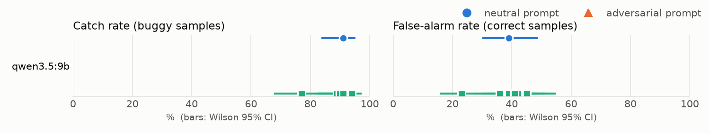
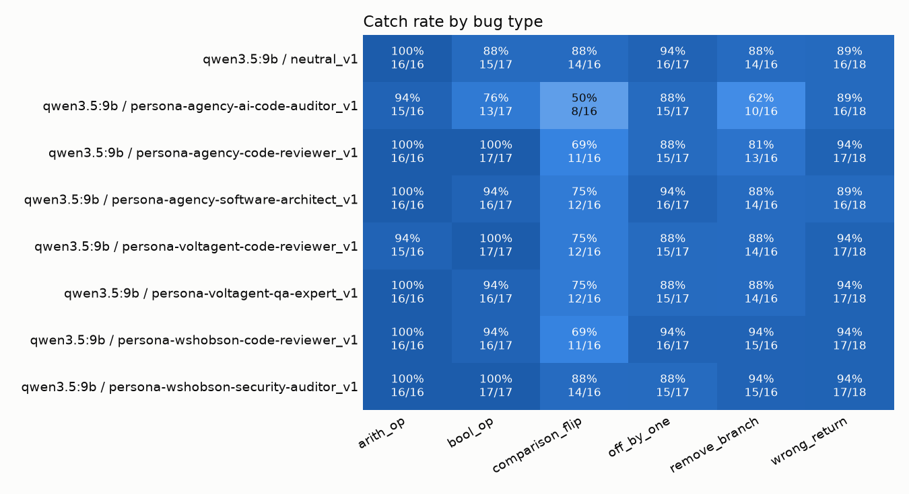
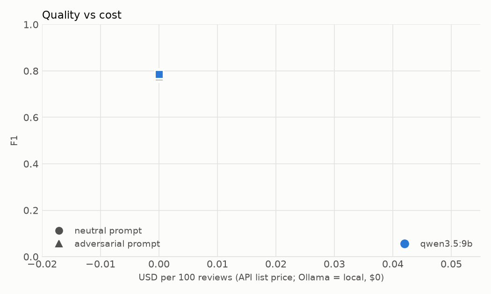

# review-bench report

Generated 2026-11-25 13:42 from 1600 logged calls in: `personas-v1`

Conventions: rates are shown with Wilson 95% CIs. API errors are excluded. PARSE_ERROR counts as "not flagged" and stays in the denominators. Localization = reported line within ±1 of the real bug line, among caught bugs with a known line. Cost = API list-price equivalent (Ollama is local, Claude runs on a subscription, Gemini was billed at list price).

## Headline metrics

| reviewer / prompt | catch rate | localization | false alarm | precision | F1 | parse fail | errors | thinking | mean latency | cost |
|---|---|---|---|---|---|---|---|---|---|---|
| qwen3.5:9b / neutral_v1 | 91.0% [84%–95%] (91/100) | 92.3% [85%–96%] (84/91) | 39.0% [30%–49%] (39/100) | 70.0% [62%–77%] (91/130) | 0.791 | 2.5% [1%–6%] (5/200) | 0 | 0% | 17.3s | $0.00 |
| qwen3.5:9b / persona-agency-ai-code-auditor_v1 | 77.0% [68%–84%] (77/100) | 93.5% [86%–97%] (72/77) | 23.0% [16%–32%] (23/100) | 77.0% [68%–84%] (77/100) | 0.770 | 2.5% [1%–6%] (5/200) | 0 | 0% | 9.4s | $0.00 |
| qwen3.5:9b / persona-agency-code-reviewer_v1 | 89.0% [81%–94%] (89/100) | 88.8% [81%–94%] (79/89) | 36.0% [27%–46%] (36/100) | 71.2% [63%–78%] (89/125) | 0.791 | 2.5% [1%–6%] (5/200) | 0 | 0% | 15.7s | $0.00 |
| qwen3.5:9b / persona-agency-software-architect_v1 | 90.0% [83%–94%] (90/100) | 91.1% [83%–95%] (82/90) | 44.0% [35%–54%] (44/100) | 67.2% [59%–75%] (90/134) | 0.769 | 1.5% [1%–4%] (3/200) | 0 | 0% | 20.8s | $0.00 |
| qwen3.5:9b / persona-voltagent-code-reviewer_v1 | 90.0% [83%–94%] (90/100) | 88.9% [81%–94%] (80/90) | 42.0% [33%–52%] (42/100) | 68.2% [60%–76%] (90/132) | 0.776 | 1.0% [0%–4%] (2/200) | 0 | 0% | 9.9s | $0.00 |
| qwen3.5:9b / persona-voltagent-qa-expert_v1 | 90.0% [83%–94%] (90/100) | 88.9% [81%–94%] (80/90) | 39.0% [30%–49%] (39/100) | 69.8% [61%–77%] (90/129) | 0.786 | 1.5% [1%–4%] (3/200) | 0 | 0% | 16.2s | $0.00 |
| qwen3.5:9b / persona-wshobson-code-reviewer_v1 | 91.0% [84%–95%] (91/100) | 87.9% [80%–93%] (80/91) | 41.0% [32%–51%] (41/100) | 68.9% [61%–76%] (91/132) | 0.784 | 4.0% [2%–8%] (8/200) | 0 | 0% | 15.5s | $0.00 |
| qwen3.5:9b / persona-wshobson-security-auditor_v1 | 94.0% [88%–97%] (94/100) | 89.4% [82%–94%] (84/94) | 45.0% [36%–55%] (45/100) | 67.6% [59%–75%] (94/139) | 0.787 | 1.0% [0%–4%] (2/200) | 0 | 0% | 10.0s | $0.00 |

## Catch rate by bug type

| reviewer / prompt | arith_op | bool_op | comparison_flip | off_by_one | remove_branch | wrong_return |
|---|---|---|---|---|---|---|
| qwen3.5:9b / neutral_v1 | 100.0% [81%–100%] (16/16) | 88.2% [66%–97%] (15/17) | 87.5% [64%–97%] (14/16) | 94.1% [73%–99%] (16/17) | 87.5% [64%–97%] (14/16) | 88.9% [67%–97%] (16/18) |
| qwen3.5:9b / persona-agency-ai-code-auditor_v1 | 93.8% [72%–99%] (15/16) | 76.5% [53%–90%] (13/17) | 50.0% [28%–72%] (8/16) | 88.2% [66%–97%] (15/17) | 62.5% [39%–82%] (10/16) | 88.9% [67%–97%] (16/18) |
| qwen3.5:9b / persona-agency-code-reviewer_v1 | 100.0% [81%–100%] (16/16) | 100.0% [82%–100%] (17/17) | 68.8% [44%–86%] (11/16) | 88.2% [66%–97%] (15/17) | 81.2% [57%–93%] (13/16) | 94.4% [74%–99%] (17/18) |
| qwen3.5:9b / persona-agency-software-architect_v1 | 100.0% [81%–100%] (16/16) | 94.1% [73%–99%] (16/17) | 75.0% [51%–90%] (12/16) | 94.1% [73%–99%] (16/17) | 87.5% [64%–97%] (14/16) | 88.9% [67%–97%] (16/18) |
| qwen3.5:9b / persona-voltagent-code-reviewer_v1 | 93.8% [72%–99%] (15/16) | 100.0% [82%–100%] (17/17) | 75.0% [51%–90%] (12/16) | 88.2% [66%–97%] (15/17) | 87.5% [64%–97%] (14/16) | 94.4% [74%–99%] (17/18) |
| qwen3.5:9b / persona-voltagent-qa-expert_v1 | 100.0% [81%–100%] (16/16) | 94.1% [73%–99%] (16/17) | 75.0% [51%–90%] (12/16) | 88.2% [66%–97%] (15/17) | 87.5% [64%–97%] (14/16) | 94.4% [74%–99%] (17/18) |
| qwen3.5:9b / persona-wshobson-code-reviewer_v1 | 100.0% [81%–100%] (16/16) | 94.1% [73%–99%] (16/17) | 68.8% [44%–86%] (11/16) | 94.1% [73%–99%] (16/17) | 93.8% [72%–99%] (15/16) | 94.4% [74%–99%] (17/18) |
| qwen3.5:9b / persona-wshobson-security-auditor_v1 | 100.0% [81%–100%] (16/16) | 100.0% [82%–100%] (17/17) | 87.5% [64%–97%] (14/16) | 88.2% [66%–97%] (15/17) | 93.8% [72%–99%] (15/16) | 94.4% [74%–99%] (17/18) |

## Paired comparisons (exact McNemar, same samples)

`A only` / `B only` = samples where only A / only B flagged BUG. For *catch*, more is better; for *false alarm*, fewer is better. p-values are Holm-adjusted across all 56 tests in this table.

| A | B | metric | n pairs | A only | B only | p | p (Holm) |
|---|---|---|---|---|---|---|---|
| qwen3.5:9b / neutral_v1 | qwen3.5:9b / persona-agency-ai-code-auditor_v1 | catch | 100 | 15 | 1 | 0.000519 | 0.0259 **\*** |
| qwen3.5:9b / neutral_v1 | qwen3.5:9b / persona-agency-ai-code-auditor_v1 | false alarm | 100 | 20 | 4 | 0.00154 | 0.0695 |
| qwen3.5:9b / neutral_v1 | qwen3.5:9b / persona-agency-code-reviewer_v1 | catch | 100 | 5 | 3 | 0.727 | 1 |
| qwen3.5:9b / neutral_v1 | qwen3.5:9b / persona-agency-code-reviewer_v1 | false alarm | 100 | 11 | 8 | 0.648 | 1 |
| qwen3.5:9b / neutral_v1 | qwen3.5:9b / persona-agency-software-architect_v1 | catch | 100 | 5 | 4 | 1 | 1 |
| qwen3.5:9b / neutral_v1 | qwen3.5:9b / persona-agency-software-architect_v1 | false alarm | 100 | 8 | 13 | 0.383 | 1 |
| qwen3.5:9b / neutral_v1 | qwen3.5:9b / persona-voltagent-code-reviewer_v1 | catch | 100 | 4 | 3 | 1 | 1 |
| qwen3.5:9b / neutral_v1 | qwen3.5:9b / persona-voltagent-code-reviewer_v1 | false alarm | 100 | 5 | 8 | 0.581 | 1 |
| qwen3.5:9b / neutral_v1 | qwen3.5:9b / persona-voltagent-qa-expert_v1 | catch | 100 | 3 | 2 | 1 | 1 |
| qwen3.5:9b / neutral_v1 | qwen3.5:9b / persona-voltagent-qa-expert_v1 | false alarm | 100 | 8 | 8 | 1 | 1 |
| qwen3.5:9b / neutral_v1 | qwen3.5:9b / persona-wshobson-code-reviewer_v1 | catch | 100 | 3 | 3 | 1 | 1 |
| qwen3.5:9b / neutral_v1 | qwen3.5:9b / persona-wshobson-code-reviewer_v1 | false alarm | 100 | 11 | 13 | 0.839 | 1 |
| qwen3.5:9b / neutral_v1 | qwen3.5:9b / persona-wshobson-security-auditor_v1 | catch | 100 | 1 | 4 | 0.375 | 1 |
| qwen3.5:9b / neutral_v1 | qwen3.5:9b / persona-wshobson-security-auditor_v1 | false alarm | 100 | 7 | 13 | 0.263 | 1 |
| qwen3.5:9b / persona-agency-ai-code-auditor_v1 | qwen3.5:9b / persona-agency-code-reviewer_v1 | catch | 100 | 1 | 13 | 0.00183 | 0.0806 |
| qwen3.5:9b / persona-agency-ai-code-auditor_v1 | qwen3.5:9b / persona-agency-code-reviewer_v1 | false alarm | 100 | 3 | 16 | 0.00443 | 0.19 |
| qwen3.5:9b / persona-agency-ai-code-auditor_v1 | qwen3.5:9b / persona-agency-software-architect_v1 | catch | 100 | 1 | 14 | 0.000977 | 0.0469 **\*** |
| qwen3.5:9b / persona-agency-ai-code-auditor_v1 | qwen3.5:9b / persona-agency-software-architect_v1 | false alarm | 100 | 2 | 23 | 1.94e-05 | 0.00105 **\*** |
| qwen3.5:9b / persona-agency-ai-code-auditor_v1 | qwen3.5:9b / persona-voltagent-code-reviewer_v1 | catch | 100 | 1 | 14 | 0.000977 | 0.0469 **\*** |
| qwen3.5:9b / persona-agency-ai-code-auditor_v1 | qwen3.5:9b / persona-voltagent-code-reviewer_v1 | false alarm | 100 | 3 | 22 | 0.000157 | 0.00814 **\*** |
| qwen3.5:9b / persona-agency-ai-code-auditor_v1 | qwen3.5:9b / persona-voltagent-qa-expert_v1 | catch | 100 | 1 | 14 | 0.000977 | 0.0469 **\*** |
| qwen3.5:9b / persona-agency-ai-code-auditor_v1 | qwen3.5:9b / persona-voltagent-qa-expert_v1 | false alarm | 100 | 3 | 19 | 0.000855 | 0.0419 **\*** |
| qwen3.5:9b / persona-agency-ai-code-auditor_v1 | qwen3.5:9b / persona-wshobson-code-reviewer_v1 | catch | 100 | 0 | 14 | 0.000122 | 0.00647 **\*** |
| qwen3.5:9b / persona-agency-ai-code-auditor_v1 | qwen3.5:9b / persona-wshobson-code-reviewer_v1 | false alarm | 100 | 3 | 21 | 0.000277 | 0.0141 **\*** |
| qwen3.5:9b / persona-agency-ai-code-auditor_v1 | qwen3.5:9b / persona-wshobson-security-auditor_v1 | catch | 100 | 0 | 17 | 1.53e-05 | 0.000839 **\*** |
| qwen3.5:9b / persona-agency-ai-code-auditor_v1 | qwen3.5:9b / persona-wshobson-security-auditor_v1 | false alarm | 100 | 2 | 24 | 1.05e-05 | 0.000587 **\*** |
| qwen3.5:9b / persona-agency-code-reviewer_v1 | qwen3.5:9b / persona-agency-software-architect_v1 | catch | 100 | 2 | 3 | 1 | 1 |
| qwen3.5:9b / persona-agency-code-reviewer_v1 | qwen3.5:9b / persona-agency-software-architect_v1 | false alarm | 100 | 4 | 12 | 0.0768 | 1 |
| qwen3.5:9b / persona-agency-code-reviewer_v1 | qwen3.5:9b / persona-voltagent-code-reviewer_v1 | catch | 100 | 1 | 2 | 1 | 1 |
| qwen3.5:9b / persona-agency-code-reviewer_v1 | qwen3.5:9b / persona-voltagent-code-reviewer_v1 | false alarm | 100 | 5 | 11 | 0.21 | 1 |
| qwen3.5:9b / persona-agency-code-reviewer_v1 | qwen3.5:9b / persona-voltagent-qa-expert_v1 | catch | 100 | 1 | 2 | 1 | 1 |
| qwen3.5:9b / persona-agency-code-reviewer_v1 | qwen3.5:9b / persona-voltagent-qa-expert_v1 | false alarm | 100 | 8 | 11 | 0.648 | 1 |
| qwen3.5:9b / persona-agency-code-reviewer_v1 | qwen3.5:9b / persona-wshobson-code-reviewer_v1 | catch | 100 | 2 | 4 | 0.688 | 1 |
| qwen3.5:9b / persona-agency-code-reviewer_v1 | qwen3.5:9b / persona-wshobson-code-reviewer_v1 | false alarm | 100 | 6 | 11 | 0.332 | 1 |
| qwen3.5:9b / persona-agency-code-reviewer_v1 | qwen3.5:9b / persona-wshobson-security-auditor_v1 | catch | 100 | 0 | 5 | 0.0625 | 1 |
| qwen3.5:9b / persona-agency-code-reviewer_v1 | qwen3.5:9b / persona-wshobson-security-auditor_v1 | false alarm | 100 | 4 | 13 | 0.049 | 1 |
| qwen3.5:9b / persona-agency-software-architect_v1 | qwen3.5:9b / persona-voltagent-code-reviewer_v1 | catch | 100 | 3 | 3 | 1 | 1 |
| qwen3.5:9b / persona-agency-software-architect_v1 | qwen3.5:9b / persona-voltagent-code-reviewer_v1 | false alarm | 100 | 10 | 8 | 0.815 | 1 |
| qwen3.5:9b / persona-agency-software-architect_v1 | qwen3.5:9b / persona-voltagent-qa-expert_v1 | catch | 100 | 4 | 4 | 1 | 1 |
| qwen3.5:9b / persona-agency-software-architect_v1 | qwen3.5:9b / persona-voltagent-qa-expert_v1 | false alarm | 100 | 13 | 8 | 0.383 | 1 |
| qwen3.5:9b / persona-agency-software-architect_v1 | qwen3.5:9b / persona-wshobson-code-reviewer_v1 | catch | 100 | 2 | 3 | 1 | 1 |
| qwen3.5:9b / persona-agency-software-architect_v1 | qwen3.5:9b / persona-wshobson-code-reviewer_v1 | false alarm | 100 | 13 | 10 | 0.678 | 1 |
| qwen3.5:9b / persona-agency-software-architect_v1 | qwen3.5:9b / persona-wshobson-security-auditor_v1 | catch | 100 | 1 | 5 | 0.219 | 1 |
| qwen3.5:9b / persona-agency-software-architect_v1 | qwen3.5:9b / persona-wshobson-security-auditor_v1 | false alarm | 100 | 7 | 8 | 1 | 1 |
| qwen3.5:9b / persona-voltagent-code-reviewer_v1 | qwen3.5:9b / persona-voltagent-qa-expert_v1 | catch | 100 | 2 | 2 | 1 | 1 |
| qwen3.5:9b / persona-voltagent-code-reviewer_v1 | qwen3.5:9b / persona-voltagent-qa-expert_v1 | false alarm | 100 | 7 | 4 | 0.549 | 1 |
| qwen3.5:9b / persona-voltagent-code-reviewer_v1 | qwen3.5:9b / persona-wshobson-code-reviewer_v1 | catch | 100 | 2 | 3 | 1 | 1 |
| qwen3.5:9b / persona-voltagent-code-reviewer_v1 | qwen3.5:9b / persona-wshobson-code-reviewer_v1 | false alarm | 100 | 9 | 8 | 1 | 1 |
| qwen3.5:9b / persona-voltagent-code-reviewer_v1 | qwen3.5:9b / persona-wshobson-security-auditor_v1 | catch | 100 | 0 | 4 | 0.125 | 1 |
| qwen3.5:9b / persona-voltagent-code-reviewer_v1 | qwen3.5:9b / persona-wshobson-security-auditor_v1 | false alarm | 100 | 6 | 9 | 0.607 | 1 |
| qwen3.5:9b / persona-voltagent-qa-expert_v1 | qwen3.5:9b / persona-wshobson-code-reviewer_v1 | catch | 100 | 3 | 4 | 1 | 1 |
| qwen3.5:9b / persona-voltagent-qa-expert_v1 | qwen3.5:9b / persona-wshobson-code-reviewer_v1 | false alarm | 100 | 7 | 9 | 0.804 | 1 |
| qwen3.5:9b / persona-voltagent-qa-expert_v1 | qwen3.5:9b / persona-wshobson-security-auditor_v1 | catch | 100 | 0 | 4 | 0.125 | 1 |
| qwen3.5:9b / persona-voltagent-qa-expert_v1 | qwen3.5:9b / persona-wshobson-security-auditor_v1 | false alarm | 100 | 5 | 11 | 0.21 | 1 |
| qwen3.5:9b / persona-wshobson-code-reviewer_v1 | qwen3.5:9b / persona-wshobson-security-auditor_v1 | catch | 100 | 1 | 4 | 0.375 | 1 |
| qwen3.5:9b / persona-wshobson-code-reviewer_v1 | qwen3.5:9b / persona-wshobson-security-auditor_v1 | false alarm | 100 | 4 | 8 | 0.388 | 1 |

\* = significant at 0.05 after Holm adjustment.

## Two-reviewer ensembles

Two reviewers on the same samples and prompt, combined: **AND** = BUG only if both say BUG, **OR** = BUG if either does. Cost is the sum of both. Each ensemble is compared with its better member (higher F1) by exact McNemar; `+`/`-` = ensemble-only / member-only flags. p-values are Holm-adjusted across the 0 tests in this section only.

| ensemble | rule | catch rate | false alarm | F1 | cost | better member (F1) | catch +/- (p Holm) | false alarm +/- (p Holm) |
|---|---|---|---|---|---|---|---|---|

* = significant at 0.05 after Holm adjustment (within this section).
