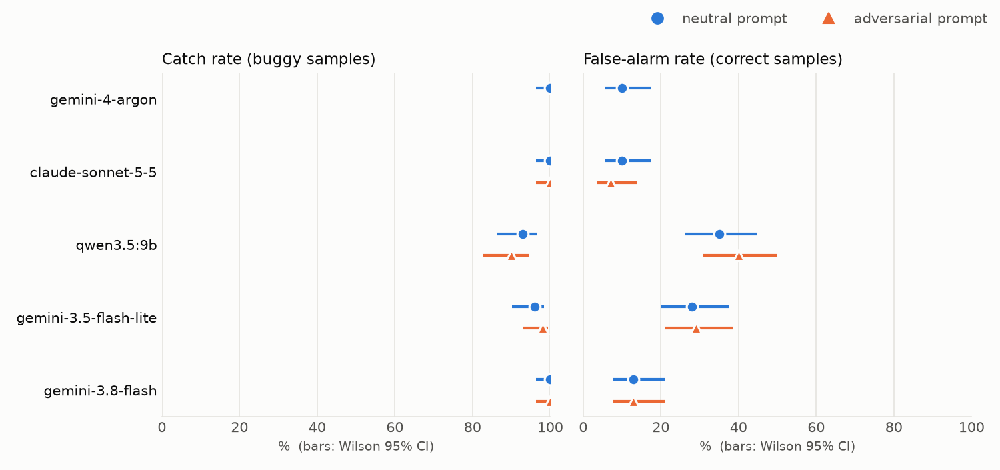
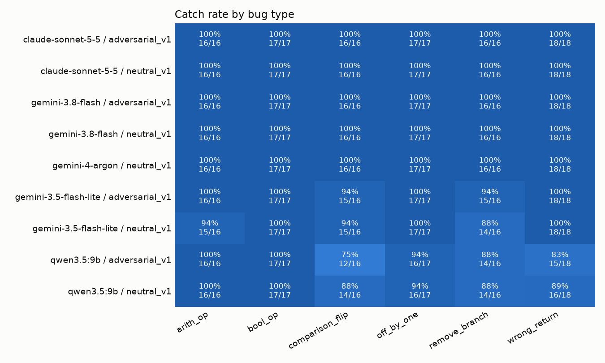
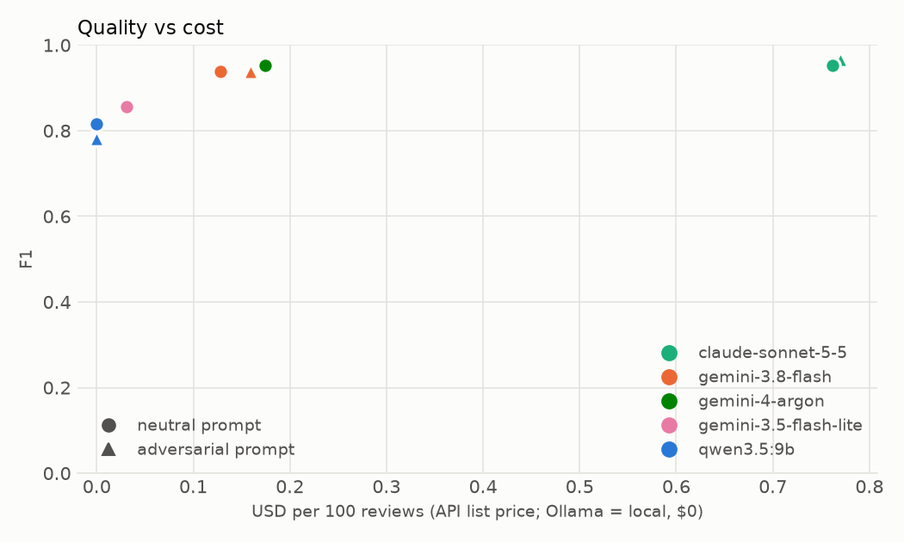

# review-bench report

Generated 2026-11-25 04:38 from 1800 logged calls in: `ollama-full-v1`, `gemini-full-v1`, `claude-full-v1`, `gemini-lite-full-v1`, `gemini-argon-full-v1`

Conventions: rates are shown with Wilson 95% CIs. API errors are excluded. PARSE_ERROR counts as "not flagged" and stays in the denominators. Localization = reported line within ±1 of the real bug line, among caught bugs with a known line. Cost = API list-price equivalent (Ollama is local, Claude runs on a subscription, Gemini was billed at list price).

## Headline metrics

| reviewer / prompt | catch rate | localization | false alarm | precision | F1 | parse fail | errors | thinking | mean latency | cost |
|---|---|---|---|---|---|---|---|---|---|---|
| claude-sonnet-5-5 / adversarial_v1 | 100.0% [96%–100%] (100/100) | 94.0% [88%–97%] (94/100) | 7.0% [3%–14%] (7/100) | 93.5% [87%–97%] (100/107) | 0.966 | 0.0% [0%–2%] (0/200) | 0 | 27% | 6.6s | $1.54 |
| claude-sonnet-5-5 / neutral_v1 | 100.0% [96%–100%] (100/100) | 95.0% [89%–98%] (95/100) | 10.0% [6%–17%] (10/100) | 90.9% [84%–95%] (100/110) | 0.952 | 0.0% [0%–2%] (0/200) | 0 | 20% | 6.4s | $1.52 |
| gemini-3.8-flash / adversarial_v1 | 100.0% [96%–100%] (100/100) | 96.0% [90%–98%] (96/100) | 13.0% [8%–21%] (13/100) | 88.5% [81%–93%] (100/113) | 0.939 | 0.0% [0%–2%] (0/200) | 0 | 82% | 4.5s | $0.32 |
| gemini-3.8-flash / neutral_v1 | 100.0% [96%–100%] (100/100) | 97.0% [92%–99%] (97/100) | 13.0% [8%–21%] (13/100) | 88.5% [81%–93%] (100/113) | 0.939 | 0.0% [0%–2%] (0/200) | 0 | 80% | 3.7s | $0.26 |
| gemini-4-argon / neutral_v1 | 100.0% [96%–100%] (100/100) | 97.0% [92%–99%] (97/100) | 10.0% [6%–17%] (10/100) | 90.9% [84%–95%] (100/110) | 0.952 | 0.0% [0%–2%] (0/200) | 0 | 0% | 7.0s | $0.35 |
| gemini-3.5-flash-lite / adversarial_v1 | 98.0% [93%–99%] (98/100) | 95.9% [90%–98%] (94/98) | 29.0% [21%–39%] (29/100) | 77.2% [69%–84%] (98/127) | 0.863 | 0.0% [0%–2%] (0/200) | 0 | 0% | 0.7s | $0.06 |
| gemini-3.5-flash-lite / neutral_v1 | 96.0% [90%–98%] (96/100) | 95.8% [90%–98%] (92/96) | 28.0% [20%–37%] (28/100) | 77.4% [69%–84%] (96/124) | 0.857 | 0.5% [0%–3%] (1/200) | 0 | 0% | 0.7s | $0.06 |
| qwen3.5:9b / adversarial_v1 | 90.0% [83%–94%] (90/100) | 91.1% [83%–95%] (82/90) | 40.0% [31%–50%] (40/100) | 69.2% [61%–77%] (90/130) | 0.783 | 2.0% [1%–5%] (4/200) | 0 | 0% | 11.9s | $0.00 |
| qwen3.5:9b / neutral_v1 | 93.0% [86%–97%] (93/100) | 91.4% [84%–96%] (85/93) | 35.0% [26%–45%] (35/100) | 72.7% [64%–80%] (93/128) | 0.816 | 2.5% [1%–6%] (5/200) | 0 | 0% | 11.1s | $0.00 |

## Catch rate by bug type

| reviewer / prompt | arith_op | bool_op | comparison_flip | off_by_one | remove_branch | wrong_return |
|---|---|---|---|---|---|---|
| claude-sonnet-5-5 / adversarial_v1 | 100.0% [81%–100%] (16/16) | 100.0% [82%–100%] (17/17) | 100.0% [81%–100%] (16/16) | 100.0% [82%–100%] (17/17) | 100.0% [81%–100%] (16/16) | 100.0% [82%–100%] (18/18) |
| claude-sonnet-5-5 / neutral_v1 | 100.0% [81%–100%] (16/16) | 100.0% [82%–100%] (17/17) | 100.0% [81%–100%] (16/16) | 100.0% [82%–100%] (17/17) | 100.0% [81%–100%] (16/16) | 100.0% [82%–100%] (18/18) |
| gemini-3.8-flash / adversarial_v1 | 100.0% [81%–100%] (16/16) | 100.0% [82%–100%] (17/17) | 100.0% [81%–100%] (16/16) | 100.0% [82%–100%] (17/17) | 100.0% [81%–100%] (16/16) | 100.0% [82%–100%] (18/18) |
| gemini-3.8-flash / neutral_v1 | 100.0% [81%–100%] (16/16) | 100.0% [82%–100%] (17/17) | 100.0% [81%–100%] (16/16) | 100.0% [82%–100%] (17/17) | 100.0% [81%–100%] (16/16) | 100.0% [82%–100%] (18/18) |
| gemini-4-argon / neutral_v1 | 100.0% [81%–100%] (16/16) | 100.0% [82%–100%] (17/17) | 100.0% [81%–100%] (16/16) | 100.0% [82%–100%] (17/17) | 100.0% [81%–100%] (16/16) | 100.0% [82%–100%] (18/18) |
| gemini-3.5-flash-lite / adversarial_v1 | 100.0% [81%–100%] (16/16) | 100.0% [82%–100%] (17/17) | 93.8% [72%–99%] (15/16) | 100.0% [82%–100%] (17/17) | 93.8% [72%–99%] (15/16) | 100.0% [82%–100%] (18/18) |
| gemini-3.5-flash-lite / neutral_v1 | 93.8% [72%–99%] (15/16) | 100.0% [82%–100%] (17/17) | 93.8% [72%–99%] (15/16) | 100.0% [82%–100%] (17/17) | 87.5% [64%–97%] (14/16) | 100.0% [82%–100%] (18/18) |
| qwen3.5:9b / adversarial_v1 | 100.0% [81%–100%] (16/16) | 100.0% [82%–100%] (17/17) | 75.0% [51%–90%] (12/16) | 94.1% [73%–99%] (16/17) | 87.5% [64%–97%] (14/16) | 83.3% [61%–94%] (15/18) |
| qwen3.5:9b / neutral_v1 | 100.0% [81%–100%] (16/16) | 100.0% [82%–100%] (17/17) | 87.5% [64%–97%] (14/16) | 94.1% [73%–99%] (16/17) | 87.5% [64%–97%] (14/16) | 88.9% [67%–97%] (16/18) |

## Paired comparisons (exact McNemar, same samples)

`A only` / `B only` = samples where only A / only B flagged BUG. For *catch*, more is better; for *false alarm*, fewer is better. p-values are Holm-adjusted across all 40 tests in this table.

| A | B | metric | n pairs | A only | B only | p | p (Holm) |
|---|---|---|---|---|---|---|---|
| claude-sonnet-5-5 / adversarial_v1 | claude-sonnet-5-5 / neutral_v1 | catch | 100 | 0 | 0 | 1 | 1 |
| claude-sonnet-5-5 / adversarial_v1 | claude-sonnet-5-5 / neutral_v1 | false alarm | 100 | 0 | 3 | 0.25 | 1 |
| claude-sonnet-5-5 / adversarial_v1 | gemini-3.8-flash / adversarial_v1 | catch | 100 | 0 | 0 | 1 | 1 |
| claude-sonnet-5-5 / adversarial_v1 | gemini-3.8-flash / adversarial_v1 | false alarm | 100 | 2 | 8 | 0.109 | 1 |
| claude-sonnet-5-5 / adversarial_v1 | gemini-3.5-flash-lite / adversarial_v1 | catch | 100 | 2 | 0 | 0.5 | 1 |
| claude-sonnet-5-5 / adversarial_v1 | gemini-3.5-flash-lite / adversarial_v1 | false alarm | 100 | 1 | 23 | 2.98e-06 | 0.000113 **\*** |
| claude-sonnet-5-5 / adversarial_v1 | qwen3.5:9b / adversarial_v1 | catch | 100 | 10 | 0 | 0.00195 | 0.0586 |
| claude-sonnet-5-5 / adversarial_v1 | qwen3.5:9b / adversarial_v1 | false alarm | 100 | 3 | 36 | 3.61e-08 | 1.44e-06 **\*** |
| claude-sonnet-5-5 / neutral_v1 | gemini-3.8-flash / neutral_v1 | catch | 100 | 0 | 0 | 1 | 1 |
| claude-sonnet-5-5 / neutral_v1 | gemini-3.8-flash / neutral_v1 | false alarm | 100 | 3 | 6 | 0.508 | 1 |
| claude-sonnet-5-5 / neutral_v1 | gemini-4-argon / neutral_v1 | catch | 100 | 0 | 0 | 1 | 1 |
| claude-sonnet-5-5 / neutral_v1 | gemini-4-argon / neutral_v1 | false alarm | 100 | 6 | 6 | 1 | 1 |
| claude-sonnet-5-5 / neutral_v1 | gemini-3.5-flash-lite / neutral_v1 | catch | 100 | 4 | 0 | 0.125 | 1 |
| claude-sonnet-5-5 / neutral_v1 | gemini-3.5-flash-lite / neutral_v1 | false alarm | 100 | 2 | 20 | 0.000121 | 0.004 **\*** |
| claude-sonnet-5-5 / neutral_v1 | qwen3.5:9b / neutral_v1 | catch | 100 | 7 | 0 | 0.0156 | 0.438 |
| claude-sonnet-5-5 / neutral_v1 | qwen3.5:9b / neutral_v1 | false alarm | 100 | 3 | 28 | 4.65e-06 | 0.000167 **\*** |
| gemini-3.8-flash / adversarial_v1 | gemini-3.8-flash / neutral_v1 | catch | 100 | 0 | 0 | 1 | 1 |
| gemini-3.8-flash / adversarial_v1 | gemini-3.8-flash / neutral_v1 | false alarm | 100 | 3 | 3 | 1 | 1 |
| gemini-3.8-flash / adversarial_v1 | gemini-3.5-flash-lite / adversarial_v1 | catch | 100 | 2 | 0 | 0.5 | 1 |
| gemini-3.8-flash / adversarial_v1 | gemini-3.5-flash-lite / adversarial_v1 | false alarm | 100 | 2 | 18 | 0.000402 | 0.0129 **\*** |
| gemini-3.8-flash / adversarial_v1 | qwen3.5:9b / adversarial_v1 | catch | 100 | 10 | 0 | 0.00195 | 0.0586 |
| gemini-3.8-flash / adversarial_v1 | qwen3.5:9b / adversarial_v1 | false alarm | 100 | 4 | 31 | 3.47e-06 | 0.000128 **\*** |
| gemini-3.8-flash / neutral_v1 | gemini-4-argon / neutral_v1 | catch | 100 | 0 | 0 | 1 | 1 |
| gemini-3.8-flash / neutral_v1 | gemini-4-argon / neutral_v1 | false alarm | 100 | 5 | 2 | 0.453 | 1 |
| gemini-3.8-flash / neutral_v1 | gemini-3.5-flash-lite / neutral_v1 | catch | 100 | 4 | 0 | 0.125 | 1 |
| gemini-3.8-flash / neutral_v1 | gemini-3.5-flash-lite / neutral_v1 | false alarm | 100 | 3 | 18 | 0.00149 | 0.0462 **\*** |
| gemini-3.8-flash / neutral_v1 | qwen3.5:9b / neutral_v1 | catch | 100 | 7 | 0 | 0.0156 | 0.438 |
| gemini-3.8-flash / neutral_v1 | qwen3.5:9b / neutral_v1 | false alarm | 100 | 4 | 26 | 5.95e-05 | 0.00202 **\*** |
| gemini-4-argon / neutral_v1 | gemini-3.5-flash-lite / neutral_v1 | catch | 100 | 4 | 0 | 0.125 | 1 |
| gemini-4-argon / neutral_v1 | gemini-3.5-flash-lite / neutral_v1 | false alarm | 100 | 1 | 19 | 4.01e-05 | 0.0014 **\*** |
| gemini-4-argon / neutral_v1 | qwen3.5:9b / neutral_v1 | catch | 100 | 7 | 0 | 0.0156 | 0.438 |
| gemini-4-argon / neutral_v1 | qwen3.5:9b / neutral_v1 | false alarm | 100 | 1 | 26 | 4.17e-07 | 1.63e-05 **\*** |
| gemini-3.5-flash-lite / adversarial_v1 | gemini-3.5-flash-lite / neutral_v1 | catch | 100 | 2 | 0 | 0.5 | 1 |
| gemini-3.5-flash-lite / adversarial_v1 | gemini-3.5-flash-lite / neutral_v1 | false alarm | 100 | 3 | 2 | 1 | 1 |
| gemini-3.5-flash-lite / adversarial_v1 | qwen3.5:9b / adversarial_v1 | catch | 100 | 9 | 1 | 0.0215 | 0.537 |
| gemini-3.5-flash-lite / adversarial_v1 | qwen3.5:9b / adversarial_v1 | false alarm | 100 | 6 | 17 | 0.0347 | 0.833 |
| gemini-3.5-flash-lite / neutral_v1 | qwen3.5:9b / neutral_v1 | catch | 100 | 5 | 2 | 0.453 | 1 |
| gemini-3.5-flash-lite / neutral_v1 | qwen3.5:9b / neutral_v1 | false alarm | 100 | 4 | 11 | 0.118 | 1 |
| qwen3.5:9b / adversarial_v1 | qwen3.5:9b / neutral_v1 | catch | 100 | 1 | 4 | 0.375 | 1 |
| qwen3.5:9b / adversarial_v1 | qwen3.5:9b / neutral_v1 | false alarm | 100 | 10 | 5 | 0.302 | 1 |

\* = significant at 0.05 after Holm adjustment.

## Two-reviewer ensembles

Two reviewers on the same samples and prompt, combined: **AND** = BUG only if both say BUG, **OR** = BUG if either does. Cost is the sum of both. Each ensemble is compared with its better member (higher F1) by exact McNemar; `+`/`-` = ensemble-only / member-only flags. p-values are Holm-adjusted across the 64 tests in this section only.

| ensemble | rule | catch rate | false alarm | F1 | cost | better member (F1) | catch +/- (p Holm) | false alarm +/- (p Holm) |
|---|---|---|---|---|---|---|---|---|
| claude-sonnet-5-5 / adversarial_v1 + gemini-3.8-flash | AND | 100.0% [96%–100%] (100/100) | 5.0% [2%–11%] (5/100) | 0.976 | $1.86 | claude-sonnet-5-5 (0.966) | +0/-0 (1) | +0/-2 (1) |
| claude-sonnet-5-5 / adversarial_v1 + gemini-3.8-flash | OR | 100.0% [96%–100%] (100/100) | 15.0% [9%–23%] (15/100) | 0.930 | $1.86 | claude-sonnet-5-5 (0.966) | +0/-0 (1) | +8/-0 (0.383) |
| claude-sonnet-5-5 / adversarial_v1 + gemini-3.5-flash-lite | AND | 98.0% [93%–99%] (98/100) | 6.0% [3%–12%] (6/100) | 0.961 | $1.60 | claude-sonnet-5-5 (0.966) | +0/-2 (1) | +0/-1 (1) |
| claude-sonnet-5-5 / adversarial_v1 + gemini-3.5-flash-lite | OR | 100.0% [96%–100%] (100/100) | 30.0% [22%–40%] (30/100) | 0.870 | $1.60 | claude-sonnet-5-5 (0.966) | +0/-0 (1) | +23/-0 (1.41e-05) * |
| claude-sonnet-5-5 / adversarial_v1 + qwen3.5:9b | AND | 90.0% [83%–94%] (90/100) | 4.0% [2%–10%] (4/100) | 0.928 | $1.54 | claude-sonnet-5-5 (0.966) | +0/-10 (0.102) | +0/-3 (1) |
| claude-sonnet-5-5 / adversarial_v1 + qwen3.5:9b | OR | 100.0% [96%–100%] (100/100) | 43.0% [34%–53%] (43/100) | 0.823 | $1.54 | claude-sonnet-5-5 (0.966) | +0/-0 (1) | +36/-0 (1.86e-09) * |
| claude-sonnet-5-5 / neutral_v1 + gemini-3.8-flash | AND | 100.0% [96%–100%] (100/100) | 7.0% [3%–14%] (7/100) | 0.966 | $1.78 | claude-sonnet-5-5 (0.952) | +0/-0 (1) | +0/-3 (1) |
| claude-sonnet-5-5 / neutral_v1 + gemini-3.8-flash | OR | 100.0% [96%–100%] (100/100) | 16.0% [10%–24%] (16/100) | 0.926 | $1.78 | claude-sonnet-5-5 (0.952) | +0/-0 (1) | +6/-0 (1) |
| claude-sonnet-5-5 / neutral_v1 + gemini-4-argon | AND | 100.0% [96%–100%] (100/100) | 4.0% [2%–10%] (4/100) | 0.980 | $1.87 | claude-sonnet-5-5 (0.952) | +0/-0 (1) | +0/-6 (1) |
| claude-sonnet-5-5 / neutral_v1 + gemini-4-argon | OR | 100.0% [96%–100%] (100/100) | 16.0% [10%–24%] (16/100) | 0.926 | $1.87 | claude-sonnet-5-5 (0.952) | +0/-0 (1) | +6/-0 (1) |
| claude-sonnet-5-5 / neutral_v1 + gemini-3.5-flash-lite | AND | 96.0% [90%–98%] (96/100) | 8.0% [4%–15%] (8/100) | 0.941 | $1.59 | claude-sonnet-5-5 (0.952) | +0/-4 (1) | +0/-2 (1) |
| claude-sonnet-5-5 / neutral_v1 + gemini-3.5-flash-lite | OR | 100.0% [96%–100%] (100/100) | 30.0% [22%–40%] (30/100) | 0.870 | $1.59 | claude-sonnet-5-5 (0.952) | +0/-0 (1) | +20/-0 (0.000111) * |
| claude-sonnet-5-5 / neutral_v1 + qwen3.5:9b | AND | 93.0% [86%–97%] (93/100) | 7.0% [3%–14%] (7/100) | 0.930 | $1.52 | claude-sonnet-5-5 (0.952) | +0/-7 (0.75) | +0/-3 (1) |
| claude-sonnet-5-5 / neutral_v1 + qwen3.5:9b | OR | 100.0% [96%–100%] (100/100) | 38.0% [29%–48%] (38/100) | 0.840 | $1.52 | claude-sonnet-5-5 (0.952) | +0/-0 (1) | +28/-0 (4.62e-07) * |
| gemini-3.8-flash / adversarial_v1 + gemini-3.5-flash-lite | AND | 98.0% [93%–99%] (98/100) | 11.0% [6%–19%] (11/100) | 0.938 | $0.38 | gemini-3.8-flash (0.939) | +0/-2 (1) | +0/-2 (1) |
| gemini-3.8-flash / adversarial_v1 + gemini-3.5-flash-lite | OR | 100.0% [96%–100%] (100/100) | 31.0% [23%–41%] (31/100) | 0.866 | $0.38 | gemini-3.8-flash (0.939) | +0/-0 (1) | +18/-0 (0.000427) * |
| gemini-3.8-flash / adversarial_v1 + qwen3.5:9b | AND | 90.0% [83%–94%] (90/100) | 9.0% [5%–16%] (9/100) | 0.905 | $0.32 | gemini-3.8-flash (0.939) | +0/-10 (0.102) | +0/-4 (1) |
| gemini-3.8-flash / adversarial_v1 + qwen3.5:9b | OR | 100.0% [96%–100%] (100/100) | 44.0% [35%–54%] (44/100) | 0.820 | $0.32 | gemini-3.8-flash (0.939) | +0/-0 (1) | +31/-0 (5.87e-08) * |
| gemini-3.8-flash / neutral_v1 + gemini-4-argon | AND | 100.0% [96%–100%] (100/100) | 8.0% [4%–15%] (8/100) | 0.962 | $0.61 | gemini-4-argon (0.952) | +0/-0 (1) | +0/-2 (1) |
| gemini-3.8-flash / neutral_v1 + gemini-4-argon | OR | 100.0% [96%–100%] (100/100) | 15.0% [9%–23%] (15/100) | 0.930 | $0.61 | gemini-4-argon (0.952) | +0/-0 (1) | +5/-0 (1) |
| gemini-3.8-flash / neutral_v1 + gemini-3.5-flash-lite | AND | 96.0% [90%–98%] (96/100) | 10.0% [6%–17%] (10/100) | 0.932 | $0.32 | gemini-3.8-flash (0.939) | +0/-4 (1) | +0/-3 (1) |
| gemini-3.8-flash / neutral_v1 + gemini-3.5-flash-lite | OR | 100.0% [96%–100%] (100/100) | 31.0% [23%–41%] (31/100) | 0.866 | $0.32 | gemini-3.8-flash (0.939) | +0/-0 (1) | +18/-0 (0.000427) * |
| gemini-3.8-flash / neutral_v1 + qwen3.5:9b | AND | 93.0% [86%–97%] (93/100) | 9.0% [5%–16%] (9/100) | 0.921 | $0.26 | gemini-3.8-flash (0.939) | +0/-7 (0.75) | +0/-4 (1) |
| gemini-3.8-flash / neutral_v1 + qwen3.5:9b | OR | 100.0% [96%–100%] (100/100) | 39.0% [30%–49%] (39/100) | 0.837 | $0.26 | gemini-3.8-flash (0.939) | +0/-0 (1) | +26/-0 (1.82e-06) * |
| gemini-4-argon / neutral_v1 + gemini-3.5-flash-lite | AND | 96.0% [90%–98%] (96/100) | 9.0% [5%–16%] (9/100) | 0.937 | $0.41 | gemini-4-argon (0.952) | +0/-4 (1) | +0/-1 (1) |
| gemini-4-argon / neutral_v1 + gemini-3.5-flash-lite | OR | 100.0% [96%–100%] (100/100) | 29.0% [21%–39%] (29/100) | 0.873 | $0.41 | gemini-4-argon (0.952) | +0/-0 (1) | +19/-0 (0.000217) * |
| gemini-4-argon / neutral_v1 + qwen3.5:9b | AND | 93.0% [86%–97%] (93/100) | 9.0% [5%–16%] (9/100) | 0.921 | $0.35 | gemini-4-argon (0.952) | +0/-7 (0.75) | +0/-1 (1) |
| gemini-4-argon / neutral_v1 + qwen3.5:9b | OR | 100.0% [96%–100%] (100/100) | 36.0% [27%–46%] (36/100) | 0.847 | $0.35 | gemini-4-argon (0.952) | +0/-0 (1) | +26/-0 (1.82e-06) * |
| gemini-3.5-flash-lite / adversarial_v1 + qwen3.5:9b | AND | 89.0% [81%–94%] (89/100) | 23.0% [16%–32%] (23/100) | 0.840 | $0.06 | gemini-3.5-flash-lite (0.863) | +0/-9 (0.195) | +0/-6 (1) |
| gemini-3.5-flash-lite / adversarial_v1 + qwen3.5:9b | OR | 99.0% [95%–100%] (99/100) | 46.0% [37%–56%] (46/100) | 0.808 | $0.06 | gemini-3.5-flash-lite (0.863) | +1/-0 (1) | +17/-0 (0.000824) * |
| gemini-3.5-flash-lite / neutral_v1 + qwen3.5:9b | AND | 91.0% [84%–95%] (91/100) | 24.0% [17%–33%] (24/100) | 0.847 | $0.06 | gemini-3.5-flash-lite (0.857) | +0/-5 (1) | +0/-4 (1) |
| gemini-3.5-flash-lite / neutral_v1 + qwen3.5:9b | OR | 98.0% [93%–99%] (98/100) | 39.0% [30%–49%] (39/100) | 0.827 | $0.06 | gemini-3.5-flash-lite (0.857) | +2/-0 (1) | +11/-0 (0.0518) |

* = significant at 0.05 after Holm adjustment (within this section).
