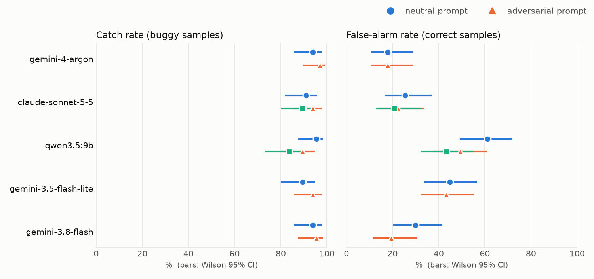
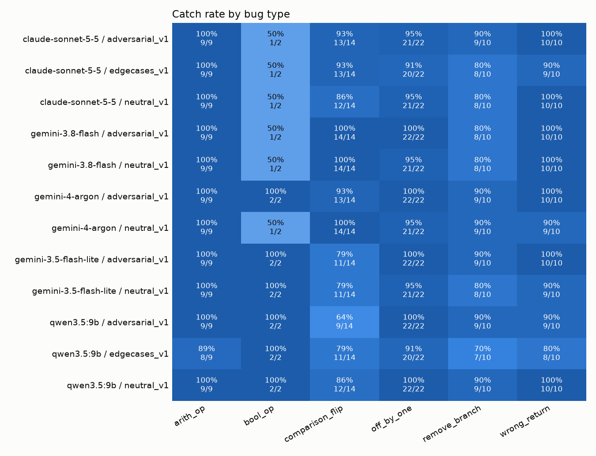
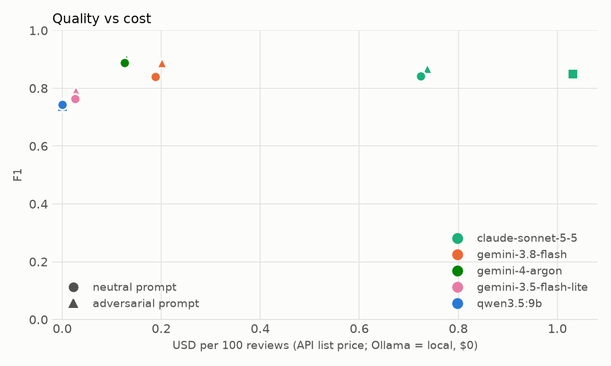

# review-bench report

Generated 2026-11-25 06:50 from 1608 logged calls in: `samples-v2`

Conventions: rates are shown with Wilson 95% CIs. API errors are excluded. PARSE_ERROR counts as "not flagged" and stays in the denominators. Localization = reported line within ±1 of the real bug line, among caught bugs with a known line. Cost = API list-price equivalent (Ollama is local, Claude runs on a subscription, Gemini was billed at list price).

## Headline metrics

| reviewer / prompt | catch rate | localization | false alarm | precision | F1 | parse fail | errors | thinking | mean latency | cost |
|---|---|---|---|---|---|---|---|---|---|---|
| claude-sonnet-5-5 / adversarial_v1 | 94.0% [86%–98%] (63/67) | 93.7% [85%–98%] (59/63) | 22.4% [14%–34%] (15/67) | 80.8% [71%–88%] (63/78) | 0.869 | 0.0% [0%–3%] (0/134) | 0 | 54% | 6.6s | $0.99 |
| claude-sonnet-5-5 / edgecases_v1 | 89.6% [80%–95%] (60/67) | 95.0% [86%–98%] (57/60) | 20.9% [13%–32%] (14/67) | 81.1% [71%–88%] (60/74) | 0.851 | 0.0% [0%–3%] (0/134) | 0 | 49% | 8.3s | $1.38 |
| claude-sonnet-5-5 / neutral_v1 | 91.0% [82%–96%] (61/67) | 93.4% [84%–97%] (57/61) | 25.4% [16%–37%] (17/67) | 78.2% [68%–86%] (61/78) | 0.841 | 0.0% [0%–3%] (0/134) | 0 | 42% | 7.3s | $0.97 |
| gemini-3.8-flash / adversarial_v1 | 95.5% [88%–98%] (64/67) | 98.4% [92%–100%] (63/64) | 19.4% [12%–30%] (13/67) | 83.1% [73%–90%] (64/77) | 0.889 | 0.0% [0%–3%] (0/134) | 0 | 92% | 6.0s | $0.27 |
| gemini-3.8-flash / neutral_v1 | 94.0% [86%–98%] (63/67) | 95.2% [87%–98%] (60/63) | 29.9% [20%–42%] (20/67) | 75.9% [66%–84%] (63/83) | 0.840 | 0.0% [0%–3%] (0/134) | 0 | 93% | 5.2s | $0.25 |
| gemini-4-argon / adversarial_v1 | 97.0% [90%–99%] (65/67) | 96.9% [89%–99%] (63/65) | 17.9% [11%–29%] (12/67) | 84.4% [75%–91%] (65/77) | 0.903 | 0.0% [0%–3%] (0/134) | 0 | 0% | 6.4s | $0.17 |
| gemini-4-argon / neutral_v1 | 94.0% [86%–98%] (63/67) | 96.8% [89%–99%] (61/63) | 17.9% [11%–29%] (12/67) | 84.0% [74%–91%] (63/75) | 0.887 | 0.0% [0%–3%] (0/134) | 0 | 0% | 7.4s | $0.17 |
| gemini-3.5-flash-lite / adversarial_v1 | 94.0% [86%–98%] (63/67) | 90.5% [81%–96%] (57/63) | 43.3% [32%–55%] (29/67) | 68.5% [58%–77%] (63/92) | 0.792 | 0.0% [0%–3%] (0/134) | 0 | 0% | 0.7s | $0.04 |
| gemini-3.5-flash-lite / neutral_v1 | 89.6% [80%–95%] (60/67) | 86.7% [76%–93%] (52/60) | 44.8% [33%–57%] (30/67) | 66.7% [56%–76%] (60/90) | 0.764 | 0.7% [0%–4%] (1/134) | 0 | 0% | 0.7s | $0.04 |
| qwen3.5:9b / adversarial_v1 | 89.6% [80%–95%] (60/67) | 85.0% [74%–92%] (51/60) | 49.3% [38%–61%] (33/67) | 64.5% [54%–73%] (60/93) | 0.750 | 3.7% [2%–8%] (5/134) | 0 | 0% | 10.5s | $0.00 |
| qwen3.5:9b / edgecases_v1 | 83.6% [73%–91%] (56/67) | 82.1% [70%–90%] (46/56) | 43.3% [32%–55%] (29/67) | 65.9% [55%–75%] (56/85) | 0.737 | 3.0% [1%–7%] (4/134) | 0 | 0% | 13.8s | $0.00 |
| qwen3.5:9b / neutral_v1 | 95.5% [88%–98%] (64/67) | 82.8% [72%–90%] (53/64) | 61.2% [49%–72%] (41/67) | 61.0% [51%–70%] (64/105) | 0.744 | 6.0% [3%–11%] (8/134) | 0 | 0% | 9.2s | $0.00 |

## Catch rate by bug type

| reviewer / prompt | arith_op | bool_op | comparison_flip | off_by_one | remove_branch | wrong_return |
|---|---|---|---|---|---|---|
| claude-sonnet-5-5 / adversarial_v1 | 100.0% [70%–100%] (9/9) | 50.0% [9%–91%] (1/2) | 92.9% [69%–99%] (13/14) | 95.5% [78%–99%] (21/22) | 90.0% [60%–98%] (9/10) | 100.0% [72%–100%] (10/10) |
| claude-sonnet-5-5 / edgecases_v1 | 100.0% [70%–100%] (9/9) | 50.0% [9%–91%] (1/2) | 92.9% [69%–99%] (13/14) | 90.9% [72%–97%] (20/22) | 80.0% [49%–94%] (8/10) | 90.0% [60%–98%] (9/10) |
| claude-sonnet-5-5 / neutral_v1 | 100.0% [70%–100%] (9/9) | 50.0% [9%–91%] (1/2) | 85.7% [60%–96%] (12/14) | 95.5% [78%–99%] (21/22) | 80.0% [49%–94%] (8/10) | 100.0% [72%–100%] (10/10) |
| gemini-3.8-flash / adversarial_v1 | 100.0% [70%–100%] (9/9) | 50.0% [9%–91%] (1/2) | 100.0% [78%–100%] (14/14) | 100.0% [85%–100%] (22/22) | 80.0% [49%–94%] (8/10) | 100.0% [72%–100%] (10/10) |
| gemini-3.8-flash / neutral_v1 | 100.0% [70%–100%] (9/9) | 50.0% [9%–91%] (1/2) | 100.0% [78%–100%] (14/14) | 95.5% [78%–99%] (21/22) | 80.0% [49%–94%] (8/10) | 100.0% [72%–100%] (10/10) |
| gemini-4-argon / adversarial_v1 | 100.0% [70%–100%] (9/9) | 100.0% [34%–100%] (2/2) | 92.9% [69%–99%] (13/14) | 100.0% [85%–100%] (22/22) | 90.0% [60%–98%] (9/10) | 100.0% [72%–100%] (10/10) |
| gemini-4-argon / neutral_v1 | 100.0% [70%–100%] (9/9) | 50.0% [9%–91%] (1/2) | 100.0% [78%–100%] (14/14) | 95.5% [78%–99%] (21/22) | 90.0% [60%–98%] (9/10) | 90.0% [60%–98%] (9/10) |
| gemini-3.5-flash-lite / adversarial_v1 | 100.0% [70%–100%] (9/9) | 100.0% [34%–100%] (2/2) | 78.6% [52%–92%] (11/14) | 100.0% [85%–100%] (22/22) | 90.0% [60%–98%] (9/10) | 100.0% [72%–100%] (10/10) |
| gemini-3.5-flash-lite / neutral_v1 | 100.0% [70%–100%] (9/9) | 100.0% [34%–100%] (2/2) | 78.6% [52%–92%] (11/14) | 95.5% [78%–99%] (21/22) | 80.0% [49%–94%] (8/10) | 90.0% [60%–98%] (9/10) |
| qwen3.5:9b / adversarial_v1 | 100.0% [70%–100%] (9/9) | 100.0% [34%–100%] (2/2) | 64.3% [39%–84%] (9/14) | 100.0% [85%–100%] (22/22) | 90.0% [60%–98%] (9/10) | 90.0% [60%–98%] (9/10) |
| qwen3.5:9b / edgecases_v1 | 88.9% [57%–98%] (8/9) | 100.0% [34%–100%] (2/2) | 78.6% [52%–92%] (11/14) | 90.9% [72%–97%] (20/22) | 70.0% [40%–89%] (7/10) | 80.0% [49%–94%] (8/10) |
| qwen3.5:9b / neutral_v1 | 100.0% [70%–100%] (9/9) | 100.0% [34%–100%] (2/2) | 85.7% [60%–96%] (12/14) | 100.0% [85%–100%] (22/22) | 90.0% [60%–98%] (9/10) | 100.0% [72%–100%] (10/10) |

## Paired comparisons (exact McNemar, same samples)

`A only` / `B only` = samples where only A / only B flagged BUG. For *catch*, more is better; for *false alarm*, fewer is better. p-values are Holm-adjusted across all 60 tests in this table.

| A | B | metric | n pairs | A only | B only | p | p (Holm) |
|---|---|---|---|---|---|---|---|
| claude-sonnet-5-5 / adversarial_v1 | claude-sonnet-5-5 / edgecases_v1 | catch | 67 | 3 | 0 | 0.25 | 1 |
| claude-sonnet-5-5 / adversarial_v1 | claude-sonnet-5-5 / edgecases_v1 | false alarm | 67 | 3 | 2 | 1 | 1 |
| claude-sonnet-5-5 / adversarial_v1 | claude-sonnet-5-5 / neutral_v1 | catch | 67 | 2 | 0 | 0.5 | 1 |
| claude-sonnet-5-5 / adversarial_v1 | claude-sonnet-5-5 / neutral_v1 | false alarm | 67 | 1 | 3 | 0.625 | 1 |
| claude-sonnet-5-5 / adversarial_v1 | gemini-3.8-flash / adversarial_v1 | catch | 67 | 2 | 3 | 1 | 1 |
| claude-sonnet-5-5 / adversarial_v1 | gemini-3.8-flash / adversarial_v1 | false alarm | 67 | 4 | 2 | 0.688 | 1 |
| claude-sonnet-5-5 / adversarial_v1 | gemini-4-argon / adversarial_v1 | catch | 67 | 1 | 3 | 0.625 | 1 |
| claude-sonnet-5-5 / adversarial_v1 | gemini-4-argon / adversarial_v1 | false alarm | 67 | 5 | 2 | 0.453 | 1 |
| claude-sonnet-5-5 / adversarial_v1 | gemini-3.5-flash-lite / adversarial_v1 | catch | 67 | 3 | 3 | 1 | 1 |
| claude-sonnet-5-5 / adversarial_v1 | gemini-3.5-flash-lite / adversarial_v1 | false alarm | 67 | 3 | 17 | 0.00258 | 0.129 |
| claude-sonnet-5-5 / adversarial_v1 | qwen3.5:9b / adversarial_v1 | catch | 67 | 6 | 3 | 0.508 | 1 |
| claude-sonnet-5-5 / adversarial_v1 | qwen3.5:9b / adversarial_v1 | false alarm | 67 | 4 | 22 | 0.000534 | 0.0283 **\*** |
| claude-sonnet-5-5 / edgecases_v1 | claude-sonnet-5-5 / neutral_v1 | catch | 67 | 1 | 2 | 1 | 1 |
| claude-sonnet-5-5 / edgecases_v1 | claude-sonnet-5-5 / neutral_v1 | false alarm | 67 | 1 | 4 | 0.375 | 1 |
| claude-sonnet-5-5 / edgecases_v1 | qwen3.5:9b / edgecases_v1 | catch | 67 | 8 | 4 | 0.388 | 1 |
| claude-sonnet-5-5 / edgecases_v1 | qwen3.5:9b / edgecases_v1 | false alarm | 67 | 5 | 20 | 0.00408 | 0.2 |
| claude-sonnet-5-5 / neutral_v1 | gemini-3.8-flash / neutral_v1 | catch | 67 | 1 | 3 | 0.625 | 1 |
| claude-sonnet-5-5 / neutral_v1 | gemini-3.8-flash / neutral_v1 | false alarm | 67 | 4 | 7 | 0.549 | 1 |
| claude-sonnet-5-5 / neutral_v1 | gemini-4-argon / neutral_v1 | catch | 67 | 2 | 4 | 0.688 | 1 |
| claude-sonnet-5-5 / neutral_v1 | gemini-4-argon / neutral_v1 | false alarm | 67 | 6 | 1 | 0.125 | 1 |
| claude-sonnet-5-5 / neutral_v1 | gemini-3.5-flash-lite / neutral_v1 | catch | 67 | 5 | 4 | 1 | 1 |
| claude-sonnet-5-5 / neutral_v1 | gemini-3.5-flash-lite / neutral_v1 | false alarm | 67 | 1 | 14 | 0.000977 | 0.0498 **\*** |
| claude-sonnet-5-5 / neutral_v1 | qwen3.5:9b / neutral_v1 | catch | 67 | 2 | 5 | 0.453 | 1 |
| claude-sonnet-5-5 / neutral_v1 | qwen3.5:9b / neutral_v1 | false alarm | 67 | 1 | 25 | 8.05e-07 | 4.75e-05 **\*** |
| gemini-3.8-flash / adversarial_v1 | gemini-3.8-flash / neutral_v1 | catch | 67 | 1 | 0 | 1 | 1 |
| gemini-3.8-flash / adversarial_v1 | gemini-3.8-flash / neutral_v1 | false alarm | 67 | 0 | 7 | 0.0156 | 0.734 |
| gemini-3.8-flash / adversarial_v1 | gemini-4-argon / adversarial_v1 | catch | 67 | 1 | 2 | 1 | 1 |
| gemini-3.8-flash / adversarial_v1 | gemini-4-argon / adversarial_v1 | false alarm | 67 | 5 | 4 | 1 | 1 |
| gemini-3.8-flash / adversarial_v1 | gemini-3.5-flash-lite / adversarial_v1 | catch | 67 | 4 | 3 | 1 | 1 |
| gemini-3.8-flash / adversarial_v1 | gemini-3.5-flash-lite / adversarial_v1 | false alarm | 67 | 3 | 19 | 0.000855 | 0.0445 **\*** |
| gemini-3.8-flash / adversarial_v1 | qwen3.5:9b / adversarial_v1 | catch | 67 | 7 | 3 | 0.344 | 1 |
| gemini-3.8-flash / adversarial_v1 | qwen3.5:9b / adversarial_v1 | false alarm | 67 | 2 | 22 | 3.59e-05 | 0.00205 **\*** |
| gemini-3.8-flash / neutral_v1 | gemini-4-argon / neutral_v1 | catch | 67 | 1 | 1 | 1 | 1 |
| gemini-3.8-flash / neutral_v1 | gemini-4-argon / neutral_v1 | false alarm | 67 | 9 | 1 | 0.0215 | 0.957 |
| gemini-3.8-flash / neutral_v1 | gemini-3.5-flash-lite / neutral_v1 | catch | 67 | 7 | 4 | 0.549 | 1 |
| gemini-3.8-flash / neutral_v1 | gemini-3.5-flash-lite / neutral_v1 | false alarm | 67 | 3 | 13 | 0.0213 | 0.957 |
| gemini-3.8-flash / neutral_v1 | qwen3.5:9b / neutral_v1 | catch | 67 | 2 | 3 | 1 | 1 |
| gemini-3.8-flash / neutral_v1 | qwen3.5:9b / neutral_v1 | false alarm | 67 | 3 | 24 | 4.92e-05 | 0.00276 **\*** |
| gemini-4-argon / adversarial_v1 | gemini-4-argon / neutral_v1 | catch | 67 | 3 | 1 | 0.625 | 1 |
| gemini-4-argon / adversarial_v1 | gemini-4-argon / neutral_v1 | false alarm | 67 | 2 | 2 | 1 | 1 |
| gemini-4-argon / adversarial_v1 | gemini-3.5-flash-lite / adversarial_v1 | catch | 67 | 4 | 2 | 0.688 | 1 |
| gemini-4-argon / adversarial_v1 | gemini-3.5-flash-lite / adversarial_v1 | false alarm | 67 | 2 | 19 | 0.000221 | 0.0119 **\*** |
| gemini-4-argon / adversarial_v1 | qwen3.5:9b / adversarial_v1 | catch | 67 | 7 | 2 | 0.18 | 1 |
| gemini-4-argon / adversarial_v1 | qwen3.5:9b / adversarial_v1 | false alarm | 67 | 3 | 24 | 4.92e-05 | 0.00276 **\*** |
| gemini-4-argon / neutral_v1 | gemini-3.5-flash-lite / neutral_v1 | catch | 67 | 7 | 4 | 0.549 | 1 |
| gemini-4-argon / neutral_v1 | gemini-3.5-flash-lite / neutral_v1 | false alarm | 67 | 0 | 18 | 7.63e-06 | 0.000443 **\*** |
| gemini-4-argon / neutral_v1 | qwen3.5:9b / neutral_v1 | catch | 67 | 3 | 4 | 1 | 1 |
| gemini-4-argon / neutral_v1 | qwen3.5:9b / neutral_v1 | false alarm | 67 | 1 | 30 | 2.98e-08 | 1.79e-06 **\*** |
| gemini-3.5-flash-lite / adversarial_v1 | gemini-3.5-flash-lite / neutral_v1 | catch | 67 | 4 | 1 | 0.375 | 1 |
| gemini-3.5-flash-lite / adversarial_v1 | gemini-3.5-flash-lite / neutral_v1 | false alarm | 67 | 5 | 6 | 1 | 1 |
| gemini-3.5-flash-lite / adversarial_v1 | qwen3.5:9b / adversarial_v1 | catch | 67 | 6 | 3 | 0.508 | 1 |
| gemini-3.5-flash-lite / adversarial_v1 | qwen3.5:9b / adversarial_v1 | false alarm | 67 | 9 | 13 | 0.523 | 1 |
| gemini-3.5-flash-lite / neutral_v1 | qwen3.5:9b / neutral_v1 | catch | 67 | 3 | 7 | 0.344 | 1 |
| gemini-3.5-flash-lite / neutral_v1 | qwen3.5:9b / neutral_v1 | false alarm | 67 | 4 | 15 | 0.0192 | 0.884 |
| qwen3.5:9b / adversarial_v1 | qwen3.5:9b / edgecases_v1 | catch | 67 | 8 | 4 | 0.388 | 1 |
| qwen3.5:9b / adversarial_v1 | qwen3.5:9b / edgecases_v1 | false alarm | 67 | 12 | 8 | 0.503 | 1 |
| qwen3.5:9b / adversarial_v1 | qwen3.5:9b / neutral_v1 | catch | 67 | 1 | 5 | 0.219 | 1 |
| qwen3.5:9b / adversarial_v1 | qwen3.5:9b / neutral_v1 | false alarm | 67 | 4 | 12 | 0.0768 | 1 |
| qwen3.5:9b / edgecases_v1 | qwen3.5:9b / neutral_v1 | catch | 67 | 2 | 10 | 0.0386 | 1 |
| qwen3.5:9b / edgecases_v1 | qwen3.5:9b / neutral_v1 | false alarm | 67 | 3 | 15 | 0.00754 | 0.362 |

\* = significant at 0.05 after Holm adjustment.

## Two-reviewer ensembles

Two reviewers on the same samples and prompt, combined: **AND** = BUG only if both say BUG, **OR** = BUG if either does. Cost is the sum of both. Each ensemble is compared with its better member (higher F1) by exact McNemar; `+`/`-` = ensemble-only / member-only flags. p-values are Holm-adjusted across the 84 tests in this section only.

| ensemble | rule | catch rate | false alarm | F1 | cost | better member (F1) | catch +/- (p Holm) | false alarm +/- (p Holm) |
|---|---|---|---|---|---|---|---|---|
| claude-sonnet-5-5 / adversarial_v1 + gemini-3.8-flash | AND | 91.0% [82%–96%] (61/67) | 16.4% [9%–27%] (11/67) | 0.878 | $1.26 | gemini-3.8-flash (0.889) | +0/-3 (1) | +0/-2 (1) |
| claude-sonnet-5-5 / adversarial_v1 + gemini-3.8-flash | OR | 98.5% [92%–100%] (66/67) | 25.4% [16%–37%] (17/67) | 0.880 | $1.26 | gemini-3.8-flash (0.889) | +2/-0 (1) | +4/-0 (1) |
| claude-sonnet-5-5 / adversarial_v1 + gemini-4-argon | AND | 92.5% [84%–97%] (62/67) | 14.9% [8%–25%] (10/67) | 0.892 | $1.16 | gemini-4-argon (0.903) | +0/-3 (1) | +0/-2 (1) |
| claude-sonnet-5-5 / adversarial_v1 + gemini-4-argon | OR | 98.5% [92%–100%] (66/67) | 25.4% [16%–37%] (17/67) | 0.880 | $1.16 | gemini-4-argon (0.903) | +1/-0 (1) | +5/-0 (1) |
| claude-sonnet-5-5 / adversarial_v1 + gemini-3.5-flash-lite | AND | 89.6% [80%–95%] (60/67) | 17.9% [11%–29%] (12/67) | 0.863 | $1.03 | claude-sonnet-5-5 (0.869) | +0/-3 (1) | +0/-3 (1) |
| claude-sonnet-5-5 / adversarial_v1 + gemini-3.5-flash-lite | OR | 98.5% [92%–100%] (66/67) | 47.8% [36%–60%] (32/67) | 0.800 | $1.03 | claude-sonnet-5-5 (0.869) | +3/-0 (1) | +17/-0 (0.00113) * |
| claude-sonnet-5-5 / adversarial_v1 + qwen3.5:9b | AND | 85.1% [75%–92%] (57/67) | 16.4% [9%–27%] (11/67) | 0.844 | $0.99 | claude-sonnet-5-5 (0.869) | +0/-6 (1) | +0/-4 (1) |
| claude-sonnet-5-5 / adversarial_v1 + qwen3.5:9b | OR | 98.5% [92%–100%] (66/67) | 55.2% [43%–67%] (37/67) | 0.776 | $0.99 | claude-sonnet-5-5 (0.869) | +3/-0 (1) | +22/-0 (3.81e-05) * |
| claude-sonnet-5-5 / edgecases_v1 + qwen3.5:9b | AND | 77.6% [66%–86%] (52/67) | 13.4% [7%–24%] (9/67) | 0.812 | $1.38 | claude-sonnet-5-5 (0.851) | +0/-8 (0.523) | +0/-5 (1) |
| claude-sonnet-5-5 / edgecases_v1 + qwen3.5:9b | OR | 95.5% [88%–98%] (64/67) | 50.7% [39%–62%] (34/67) | 0.776 | $1.38 | claude-sonnet-5-5 (0.851) | +4/-0 (1) | +20/-0 (0.000149) * |
| claude-sonnet-5-5 / neutral_v1 + gemini-3.8-flash | AND | 89.6% [80%–95%] (60/67) | 19.4% [12%–30%] (13/67) | 0.857 | $1.22 | claude-sonnet-5-5 (0.841) | +0/-1 (1) | +0/-4 (1) |
| claude-sonnet-5-5 / neutral_v1 + gemini-3.8-flash | OR | 95.5% [88%–98%] (64/67) | 35.8% [25%–48%] (24/67) | 0.826 | $1.22 | claude-sonnet-5-5 (0.841) | +3/-0 (1) | +7/-0 (1) |
| claude-sonnet-5-5 / neutral_v1 + gemini-4-argon | AND | 88.1% [78%–94%] (59/67) | 16.4% [9%–27%] (11/67) | 0.861 | $1.14 | gemini-4-argon (0.887) | +0/-4 (1) | +0/-1 (1) |
| claude-sonnet-5-5 / neutral_v1 + gemini-4-argon | OR | 97.0% [90%–99%] (65/67) | 26.9% [18%–39%] (18/67) | 0.867 | $1.14 | gemini-4-argon (0.887) | +2/-0 (1) | +6/-0 (1) |
| claude-sonnet-5-5 / neutral_v1 + gemini-3.5-flash-lite | AND | 83.6% [73%–91%] (56/67) | 23.9% [15%–35%] (16/67) | 0.806 | $1.01 | claude-sonnet-5-5 (0.841) | +0/-5 (1) | +0/-1 (1) |
| claude-sonnet-5-5 / neutral_v1 + gemini-3.5-flash-lite | OR | 97.0% [90%–99%] (65/67) | 46.3% [35%–58%] (31/67) | 0.798 | $1.01 | claude-sonnet-5-5 (0.841) | +4/-0 (1) | +14/-0 (0.00879) * |
| claude-sonnet-5-5 / neutral_v1 + qwen3.5:9b | AND | 88.1% [78%–94%] (59/67) | 23.9% [15%–35%] (16/67) | 0.831 | $0.97 | claude-sonnet-5-5 (0.841) | +0/-2 (1) | +0/-1 (1) |
| claude-sonnet-5-5 / neutral_v1 + qwen3.5:9b | OR | 98.5% [92%–100%] (66/67) | 62.7% [51%–73%] (42/67) | 0.754 | $0.97 | claude-sonnet-5-5 (0.841) | +5/-0 (1) | +25/-0 (4.95e-06) * |
| gemini-3.8-flash / adversarial_v1 + gemini-4-argon | AND | 94.0% [86%–98%] (63/67) | 11.9% [6%–22%] (8/67) | 0.913 | $0.44 | gemini-4-argon (0.903) | +0/-2 (1) | +0/-4 (1) |
| gemini-3.8-flash / adversarial_v1 + gemini-4-argon | OR | 98.5% [92%–100%] (66/67) | 25.4% [16%–37%] (17/67) | 0.880 | $0.44 | gemini-4-argon (0.903) | +1/-0 (1) | +5/-0 (1) |
| gemini-3.8-flash / adversarial_v1 + gemini-3.5-flash-lite | AND | 89.6% [80%–95%] (60/67) | 14.9% [8%–25%] (10/67) | 0.876 | $0.31 | gemini-3.8-flash (0.889) | +0/-4 (1) | +0/-3 (1) |
| gemini-3.8-flash / adversarial_v1 + gemini-3.5-flash-lite | OR | 100.0% [95%–100%] (67/67) | 47.8% [36%–60%] (32/67) | 0.807 | $0.31 | gemini-3.8-flash (0.889) | +3/-0 (1) | +19/-0 (0.000294) * |
| gemini-3.8-flash / adversarial_v1 + qwen3.5:9b | AND | 85.1% [75%–92%] (57/67) | 16.4% [9%–27%] (11/67) | 0.844 | $0.27 | gemini-3.8-flash (0.889) | +0/-7 (1) | +0/-2 (1) |
| gemini-3.8-flash / adversarial_v1 + qwen3.5:9b | OR | 100.0% [95%–100%] (67/67) | 52.2% [40%–64%] (35/67) | 0.793 | $0.27 | gemini-3.8-flash (0.889) | +3/-0 (1) | +22/-0 (3.81e-05) * |
| gemini-3.8-flash / neutral_v1 + gemini-4-argon | AND | 92.5% [84%–97%] (62/67) | 16.4% [9%–27%] (11/67) | 0.886 | $0.42 | gemini-4-argon (0.887) | +0/-1 (1) | +0/-1 (1) |
| gemini-3.8-flash / neutral_v1 + gemini-4-argon | OR | 95.5% [88%–98%] (64/67) | 31.3% [22%–43%] (21/67) | 0.842 | $0.42 | gemini-4-argon (0.887) | +1/-0 (1) | +9/-0 (0.27) |
| gemini-3.8-flash / neutral_v1 + gemini-3.5-flash-lite | AND | 83.6% [73%–91%] (56/67) | 25.4% [16%–37%] (17/67) | 0.800 | $0.29 | gemini-3.8-flash (0.840) | +0/-7 (1) | +0/-3 (1) |
| gemini-3.8-flash / neutral_v1 + gemini-3.5-flash-lite | OR | 100.0% [95%–100%] (67/67) | 49.3% [38%–61%] (33/67) | 0.802 | $0.29 | gemini-3.8-flash (0.840) | +4/-0 (1) | +13/-0 (0.0173) * |
| gemini-3.8-flash / neutral_v1 + qwen3.5:9b | AND | 91.0% [82%–96%] (61/67) | 25.4% [16%–37%] (17/67) | 0.841 | $0.25 | gemini-3.8-flash (0.840) | +0/-2 (1) | +0/-3 (1) |
| gemini-3.8-flash / neutral_v1 + qwen3.5:9b | OR | 98.5% [92%–100%] (66/67) | 65.7% [54%–76%] (44/67) | 0.746 | $0.25 | gemini-3.8-flash (0.840) | +3/-0 (1) | +24/-0 (9.78e-06) * |
| gemini-4-argon / adversarial_v1 + gemini-3.5-flash-lite | AND | 91.0% [82%–96%] (61/67) | 14.9% [8%–25%] (10/67) | 0.884 | $0.21 | gemini-4-argon (0.903) | +0/-4 (1) | +0/-2 (1) |
| gemini-4-argon / adversarial_v1 + gemini-3.5-flash-lite | OR | 100.0% [95%–100%] (67/67) | 46.3% [35%–58%] (31/67) | 0.812 | $0.21 | gemini-4-argon (0.903) | +2/-0 (1) | +19/-0 (0.000294) * |
| gemini-4-argon / adversarial_v1 + qwen3.5:9b | AND | 86.6% [76%–93%] (58/67) | 13.4% [7%–24%] (9/67) | 0.866 | $0.17 | gemini-4-argon (0.903) | +0/-7 (1) | +0/-3 (1) |
| gemini-4-argon / adversarial_v1 + qwen3.5:9b | OR | 100.0% [95%–100%] (67/67) | 53.7% [42%–65%] (36/67) | 0.788 | $0.17 | gemini-4-argon (0.903) | +2/-0 (1) | +24/-0 (9.78e-06) * |
| gemini-4-argon / neutral_v1 + gemini-3.5-flash-lite | AND | 83.6% [73%–91%] (56/67) | 17.9% [11%–29%] (12/67) | 0.830 | $0.20 | gemini-4-argon (0.887) | +0/-7 (1) | +0/-0 (1) |
| gemini-4-argon / neutral_v1 + gemini-3.5-flash-lite | OR | 100.0% [95%–100%] (67/67) | 44.8% [33%–57%] (30/67) | 0.817 | $0.20 | gemini-4-argon (0.887) | +4/-0 (1) | +18/-0 (0.000572) * |
| gemini-4-argon / neutral_v1 + qwen3.5:9b | AND | 89.6% [80%–95%] (60/67) | 16.4% [9%–27%] (11/67) | 0.870 | $0.17 | gemini-4-argon (0.887) | +0/-3 (1) | +0/-1 (1) |
| gemini-4-argon / neutral_v1 + qwen3.5:9b | OR | 100.0% [95%–100%] (67/67) | 62.7% [51%–73%] (42/67) | 0.761 | $0.17 | gemini-4-argon (0.887) | +4/-0 (1) | +30/-0 (1.56e-07) * |
| gemini-3.5-flash-lite / adversarial_v1 + qwen3.5:9b | AND | 85.1% [75%–92%] (57/67) | 29.9% [20%–42%] (20/67) | 0.792 | $0.04 | gemini-3.5-flash-lite (0.792) | +0/-6 (1) | +0/-9 (0.27) |
| gemini-3.5-flash-lite / adversarial_v1 + qwen3.5:9b | OR | 98.5% [92%–100%] (66/67) | 62.7% [51%–73%] (42/67) | 0.754 | $0.04 | gemini-3.5-flash-lite (0.792) | +3/-0 (1) | +13/-0 (0.0173) * |
| gemini-3.5-flash-lite / neutral_v1 + qwen3.5:9b | AND | 85.1% [75%–92%] (57/67) | 38.8% [28%–51%] (26/67) | 0.760 | $0.04 | gemini-3.5-flash-lite (0.764) | +0/-3 (1) | +0/-4 (1) |
| gemini-3.5-flash-lite / neutral_v1 + qwen3.5:9b | OR | 100.0% [95%–100%] (67/67) | 67.2% [55%–77%] (45/67) | 0.749 | $0.04 | gemini-3.5-flash-lite (0.764) | +7/-0 (1) | +15/-0 (0.00446) * |

* = significant at 0.05 after Holm adjustment (within this section).

## Adjudicated view (manual, qualitative)

The labels above come from the tests. Here each labelled-buggy sample is also shown with my manual class. Manual adjudication of the 67 subtle mutants in data/samples_v2.jsonl (see samples_v2_review.md). Judgement, not ground truth; used only for the separate 'adjudicated view' in reports. `B` = reviewer said BUG, `.` = OK, `?` = parse error, blank = no call.

- **arguable**: the docstring does not settle it
- **visible_bug**: the mutant breaks behaviour the task sentence or its example fixes: `BUG` is right
- **out_of_spec**: the mutant differs only on inputs the task does not admit or define: `OK` is defensible

| sample | class | claude-sonnet-5-5 / adversarial_v1 | claude-sonnet-5-5 / edgecases_v1 | claude-sonnet-5-5 / neutral_v1 | gemini-3.8-flash / adversarial_v1 | gemini-3.8-flash / neutral_v1 | gemini-4-argon / adversarial_v1 | gemini-4-argon / neutral_v1 | gemini-3.5-flash-lite / adversarial_v1 | gemini-3.5-flash-lite / neutral_v1 | qwen3.5:9b / adversarial_v1 | qwen3.5:9b / edgecases_v1 | qwen3.5:9b / neutral_v1 |
|---|---|---|---|---|---|---|---|---|---|---|---|---|---|
| Mbpp/137#remove_branch | arguable | B | B | B | . | . | . | . | B | B | B | B | B |
| Mbpp/245#comparison_flip | arguable | B | B | B | B | B | B | B | B | . | B | B | B |
| Mbpp/311#remove_branch | arguable | B | . | . | . | . | B | B | B | B | B | B | ? |
| Mbpp/607#remove_branch | arguable | B | B | B | B | B | B | B | B | B | B | ? | B |
| Mbpp/639#off_by_one | arguable | B | B | B | B | B | B | B | B | B | B | B | B |
| Mbpp/771#bool_op | arguable | . | . | . | . | . | B | . | B | B | B | B | B |
| Mbpp/100#arith_op | visible_bug | B | B | B | B | B | B | B | B | B | B | B | B |
| Mbpp/109#off_by_one | visible_bug | B | B | B | B | B | B | B | B | B | B | B | B |
| Mbpp/113#remove_branch | visible_bug | B | B | B | B | B | B | B | B | B | B | B | B |
| Mbpp/128#comparison_flip | visible_bug | B | B | B | B | B | B | B | . | B | B | ? | B |
| Mbpp/129#remove_branch | visible_bug | B | B | B | B | B | B | B | B | B | B | B | B |
| Mbpp/138#comparison_flip | visible_bug | . | . | . | B | B | . | B | B | B | B | B | B |
| Mbpp/160#arith_op | visible_bug | B | B | B | B | B | B | B | B | B | B | B | B |
| Mbpp/162#wrong_return | visible_bug | B | B | B | B | B | B | B | B | B | B | B | B |
| Mbpp/166#wrong_return | visible_bug | B | B | B | B | B | B | B | B | B | B | B | B |
| Mbpp/167#arith_op | visible_bug | B | B | B | B | B | B | B | B | B | B | . | B |
| Mbpp/20#wrong_return | visible_bug | B | . | B | B | B | B | . | B | B | B | . | B |
| Mbpp/222#off_by_one | visible_bug | B | B | B | B | B | B | B | B | B | B | B | B |
| Mbpp/223#wrong_return | visible_bug | B | B | B | B | B | B | B | B | B | B | B | B |
| Mbpp/239#off_by_one | visible_bug | B | B | B | B | B | B | B | B | B | B | ? | B |
| Mbpp/244#wrong_return | visible_bug | B | B | B | B | B | B | B | B | . | . | . | B |
| Mbpp/247#off_by_one | visible_bug | B | B | B | B | B | B | B | B | B | B | B | B |
| Mbpp/256#off_by_one | visible_bug | B | B | B | B | B | B | B | B | B | B | B | B |
| Mbpp/260#wrong_return | visible_bug | B | B | B | B | B | B | B | B | B | B | B | B |
| Mbpp/264#arith_op | visible_bug | B | B | B | B | B | B | B | B | B | B | B | B |
| Mbpp/290#off_by_one | visible_bug | B | B | B | B | B | B | B | B | B | B | B | B |
| Mbpp/296#off_by_one | visible_bug | B | B | B | B | B | B | B | B | B | B | B | B |
| Mbpp/3#remove_branch | visible_bug | B | B | B | B | B | B | B | B | B | B | B | B |
| Mbpp/306#off_by_one | visible_bug | B | B | B | B | B | B | B | B | B | B | B | B |
| Mbpp/404#wrong_return | visible_bug | B | B | B | B | B | B | B | B | B | B | B | B |
| Mbpp/433#comparison_flip | visible_bug | B | B | B | B | B | B | B | B | B | . | B | B |
| Mbpp/435#remove_branch | visible_bug | . | . | . | B | B | B | B | . | . | . | . | B |
| Mbpp/436#comparison_flip | visible_bug | B | B | B | B | B | B | B | B | B | B | B | B |
| Mbpp/448#remove_branch | visible_bug | B | B | B | B | B | B | B | B | B | B | ? | B |
| Mbpp/453#wrong_return | visible_bug | B | B | B | B | B | B | B | B | B | B | B | B |
| Mbpp/468#arith_op | visible_bug | B | B | B | B | B | B | B | B | B | B | B | B |
| Mbpp/559#off_by_one | visible_bug | B | B | B | B | B | B | B | B | B | B | B | B |
| Mbpp/567#comparison_flip | visible_bug | B | B | B | B | B | B | B | B | B | . | B | B |
| Mbpp/576#comparison_flip | visible_bug | B | B | B | B | B | B | B | B | B | B | B | B |
| Mbpp/577#wrong_return | visible_bug | B | B | B | B | B | B | B | B | B | B | B | B |
| Mbpp/589#remove_branch | visible_bug | B | B | B | B | B | B | B | B | . | B | B | B |
| Mbpp/6#comparison_flip | visible_bug | B | B | . | B | B | B | B | . | . | B | B | B |
| Mbpp/602#arith_op | visible_bug | B | B | B | B | B | B | B | B | B | B | B | B |
| Mbpp/605#comparison_flip | visible_bug | B | B | B | B | B | B | B | B | B | . | B | . |
| Mbpp/620#off_by_one | visible_bug | B | B | B | B | B | B | B | B | B | B | B | B |
| Mbpp/622#off_by_one | visible_bug | B | B | B | B | B | B | B | B | B | B | B | B |
| Mbpp/66#comparison_flip | visible_bug | B | B | B | B | B | B | B | B | B | B | B | B |
| Mbpp/68#off_by_one | visible_bug | B | B | B | B | B | B | B | B | B | B | B | B |
| Mbpp/69#arith_op | visible_bug | B | B | B | B | B | B | B | B | B | B | B | B |
| Mbpp/71#comparison_flip | visible_bug | B | B | B | B | B | B | B | . | . | B | . | B |
| Mbpp/721#arith_op | visible_bug | B | B | B | B | B | B | B | B | B | B | B | B |
| Mbpp/722#off_by_one | visible_bug | B | . | B | B | B | B | B | B | B | B | B | B |
| Mbpp/733#comparison_flip | visible_bug | B | B | B | B | B | B | B | B | B | B | B | B |
| Mbpp/741#off_by_one | visible_bug | B | B | B | B | B | B | B | B | B | B | B | B |
| Mbpp/745#off_by_one | visible_bug | B | B | B | B | B | B | B | B | B | B | B | B |
| Mbpp/751#off_by_one | visible_bug | B | B | B | B | B | B | B | B | . | B | B | B |
| Mbpp/755#comparison_flip | visible_bug | B | B | B | B | B | B | B | B | B | . | . | . |
| Mbpp/757#off_by_one | visible_bug | B | B | B | B | B | B | B | B | B | B | B | B |
| Mbpp/763#off_by_one | visible_bug | B | B | B | B | B | B | B | B | B | B | B | B |
| Mbpp/782#off_by_one | visible_bug | B | B | B | B | B | B | B | B | B | B | B | B |
| Mbpp/784#arith_op | visible_bug | B | B | B | B | B | B | B | B | B | B | B | B |
| Mbpp/790#off_by_one | visible_bug | B | B | B | B | B | B | B | B | B | B | B | B |
| Mbpp/803#remove_branch | visible_bug | B | B | B | B | B | B | B | B | B | B | B | B |
| Mbpp/809#comparison_flip | visible_bug | B | B | B | B | B | B | B | B | B | . | B | B |
| Mbpp/84#bool_op | visible_bug | B | B | B | B | B | B | B | B | B | B | B | B |
| Mbpp/92#wrong_return | visible_bug | B | B | B | B | B | B | B | B | B | B | B | B |
| Mbpp/300#off_by_one | out_of_spec | . | . | . | B | . | B | . | B | B | B | . | B |
