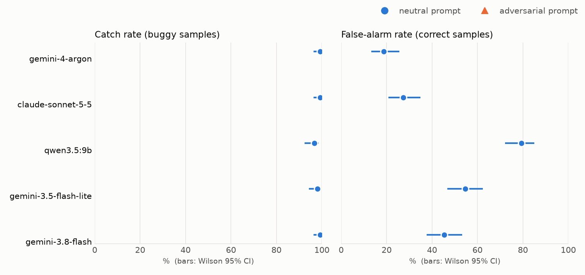
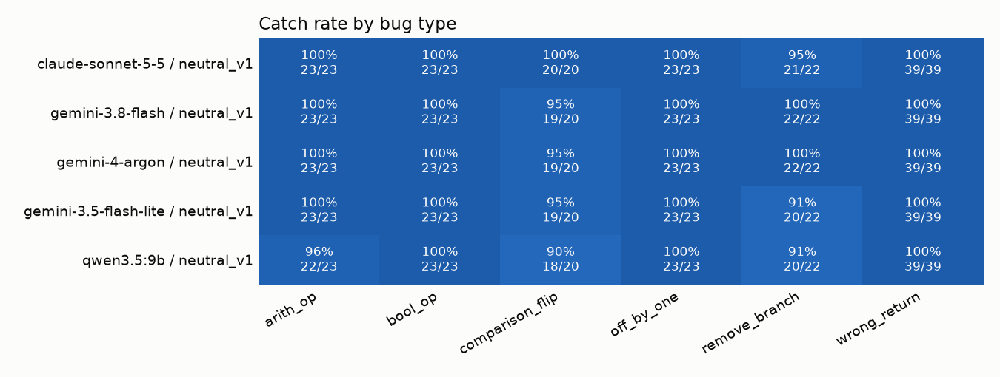
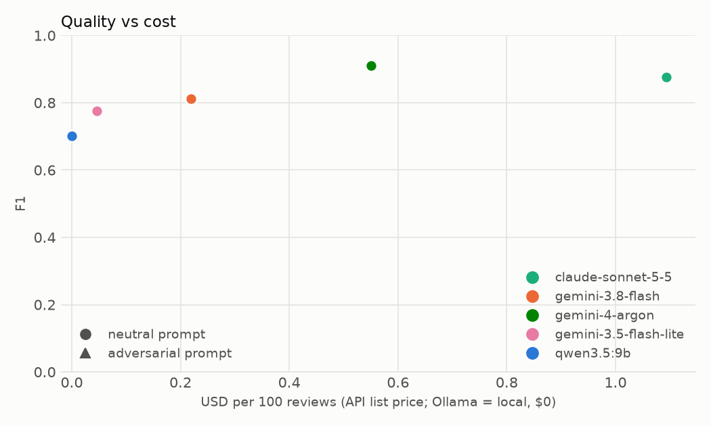

# review-bench report

Generated 2026-11-26 13:29 from 1503 logged calls in: `samples-v3`

Conventions: rates are shown with Wilson 95% CIs. API errors are excluded. PARSE_ERROR counts as "not flagged" and stays in the denominators. Localization = reported line within ±1 of the real bug line, among caught bugs with a known line. Cost = API list-price equivalent (Ollama is local, Claude runs on a subscription, Gemini was billed at list price).

## Headline metrics

| reviewer / prompt | catch rate | localization | false alarm | precision | F1 | parse fail | errors | thinking | mean latency | cost |
|---|---|---|---|---|---|---|---|---|---|---|
| claude-sonnet-5-5 / neutral_v1 | 99.3% [96%–100%] (149/150) | 95.3% [91%–98%] (142/149) | 27.3% [21%–35%] (41/150) | 78.4% [72%–84%] (149/190) | 0.876 | 0.0% [0%–1%] (0/300) | 0 | 35% | 6.1s | $3.28 |
| gemini-3.8-flash / neutral_v1 | 99.3% [96%–100%] (149/150) | 93.3% [88%–96%] (139/149) | 45.3% [38%–53%] (68/150) | 68.7% [62%–74%] (149/217) | 0.812 | 0.3% [0%–2%] (1/300) | 1 | 86% | 4.7s | $0.66 |
| gemini-4-argon / neutral_v1 | 99.3% [96%–100%] (149/150) | 97.3% [93%–99%] (145/149) | 18.7% [13%–26%] (28/150) | 84.2% [78%–89%] (149/177) | 0.911 | 0.0% [0%–1%] (0/300) | 2 | 0% | 6.6s | $1.65 |
| gemini-3.5-flash-lite / neutral_v1 | 98.0% [94%–99%] (147/150) | 94.6% [90%–97%] (139/147) | 54.7% [47%–62%] (82/150) | 64.2% [58%–70%] (147/229) | 0.776 | 0.0% [0%–1%] (0/300) | 0 | 0% | 0.7s | $0.14 |
| qwen3.5:9b / neutral_v1 | 96.7% [92%–99%] (145/150) | 87.6% [81%–92%] (127/145) | 79.3% [72%–85%] (119/150) | 54.9% [49%–61%] (145/264) | 0.700 | 3.3% [2%–6%] (10/300) | 0 | 0% | 12.0s | $0.00 |

## Catch rate by bug type

| reviewer / prompt | arith_op | bool_op | comparison_flip | off_by_one | remove_branch | wrong_return |
|---|---|---|---|---|---|---|
| claude-sonnet-5-5 / neutral_v1 | 100.0% [86%–100%] (23/23) | 100.0% [86%–100%] (23/23) | 100.0% [84%–100%] (20/20) | 100.0% [86%–100%] (23/23) | 95.5% [78%–99%] (21/22) | 100.0% [91%–100%] (39/39) |
| gemini-3.8-flash / neutral_v1 | 100.0% [86%–100%] (23/23) | 100.0% [86%–100%] (23/23) | 95.0% [76%–99%] (19/20) | 100.0% [86%–100%] (23/23) | 100.0% [85%–100%] (22/22) | 100.0% [91%–100%] (39/39) |
| gemini-4-argon / neutral_v1 | 100.0% [86%–100%] (23/23) | 100.0% [86%–100%] (23/23) | 95.0% [76%–99%] (19/20) | 100.0% [86%–100%] (23/23) | 100.0% [85%–100%] (22/22) | 100.0% [91%–100%] (39/39) |
| gemini-3.5-flash-lite / neutral_v1 | 100.0% [86%–100%] (23/23) | 100.0% [86%–100%] (23/23) | 95.0% [76%–99%] (19/20) | 100.0% [86%–100%] (23/23) | 90.9% [72%–97%] (20/22) | 100.0% [91%–100%] (39/39) |
| qwen3.5:9b / neutral_v1 | 95.7% [79%–99%] (22/23) | 100.0% [86%–100%] (23/23) | 90.0% [70%–97%] (18/20) | 100.0% [86%–100%] (23/23) | 90.9% [72%–97%] (20/22) | 100.0% [91%–100%] (39/39) |

## Paired comparisons (exact McNemar, same samples)

`A only` / `B only` = samples where only A / only B flagged BUG. For *catch*, more is better; for *false alarm*, fewer is better. p-values are Holm-adjusted across all 20 tests in this table.

| A | B | metric | n pairs | A only | B only | p | p (Holm) |
|---|---|---|---|---|---|---|---|
| claude-sonnet-5-5 / neutral_v1 | gemini-3.8-flash / neutral_v1 | catch | 150 | 1 | 1 | 1 | 1 |
| claude-sonnet-5-5 / neutral_v1 | gemini-3.8-flash / neutral_v1 | false alarm | 150 | 7 | 34 | 2.53e-05 | 0.000329 **\*** |
| claude-sonnet-5-5 / neutral_v1 | gemini-4-argon / neutral_v1 | catch | 150 | 1 | 1 | 1 | 1 |
| claude-sonnet-5-5 / neutral_v1 | gemini-4-argon / neutral_v1 | false alarm | 150 | 25 | 12 | 0.047 | 0.564 |
| claude-sonnet-5-5 / neutral_v1 | gemini-3.5-flash-lite / neutral_v1 | catch | 150 | 3 | 1 | 0.625 | 1 |
| claude-sonnet-5-5 / neutral_v1 | gemini-3.5-flash-lite / neutral_v1 | false alarm | 150 | 6 | 47 | 5.81e-09 | 8.71e-08 **\*** |
| claude-sonnet-5-5 / neutral_v1 | qwen3.5:9b / neutral_v1 | catch | 150 | 5 | 1 | 0.219 | 1 |
| claude-sonnet-5-5 / neutral_v1 | qwen3.5:9b / neutral_v1 | false alarm | 150 | 4 | 82 | 5.76e-20 | 1.1e-18 **\*** |
| gemini-3.8-flash / neutral_v1 | gemini-4-argon / neutral_v1 | catch | 150 | 0 | 0 | 1 | 1 |
| gemini-3.8-flash / neutral_v1 | gemini-4-argon / neutral_v1 | false alarm | 150 | 42 | 2 | 1.13e-10 | 1.8e-09 **\*** |
| gemini-3.8-flash / neutral_v1 | gemini-3.5-flash-lite / neutral_v1 | catch | 150 | 2 | 0 | 0.5 | 1 |
| gemini-3.8-flash / neutral_v1 | gemini-3.5-flash-lite / neutral_v1 | false alarm | 150 | 17 | 31 | 0.0595 | 0.654 |
| gemini-3.8-flash / neutral_v1 | qwen3.5:9b / neutral_v1 | catch | 150 | 5 | 1 | 0.219 | 1 |
| gemini-3.8-flash / neutral_v1 | qwen3.5:9b / neutral_v1 | false alarm | 150 | 6 | 57 | 1.64e-11 | 2.95e-10 **\*** |
| gemini-4-argon / neutral_v1 | gemini-3.5-flash-lite / neutral_v1 | catch | 150 | 2 | 0 | 0.5 | 1 |
| gemini-4-argon / neutral_v1 | gemini-3.5-flash-lite / neutral_v1 | false alarm | 150 | 8 | 62 | 1.83e-11 | 3.11e-10 **\*** |
| gemini-4-argon / neutral_v1 | qwen3.5:9b / neutral_v1 | catch | 150 | 5 | 1 | 0.219 | 1 |
| gemini-4-argon / neutral_v1 | qwen3.5:9b / neutral_v1 | false alarm | 150 | 2 | 93 | 2.3e-25 | 4.61e-24 **\*** |
| gemini-3.5-flash-lite / neutral_v1 | qwen3.5:9b / neutral_v1 | catch | 150 | 4 | 2 | 0.688 | 1 |
| gemini-3.5-flash-lite / neutral_v1 | qwen3.5:9b / neutral_v1 | false alarm | 150 | 7 | 44 | 1.21e-07 | 1.7e-06 **\*** |

\* = significant at 0.05 after Holm adjustment.

## Two-reviewer ensembles

Two reviewers on the same samples and prompt, combined: **AND** = BUG only if both say BUG, **OR** = BUG if either does. Cost is the sum of both. Each ensemble is compared with its better member (higher F1) by exact McNemar; `+`/`-` = ensemble-only / member-only flags. p-values are Holm-adjusted across the 40 tests in this section only.

| ensemble | rule | catch rate | false alarm | F1 | cost | better member (F1) | catch +/- (p Holm) | false alarm +/- (p Holm) |
|---|---|---|---|---|---|---|---|---|
| claude-sonnet-5-5 / neutral_v1 + gemini-3.8-flash | AND | 98.7% [95%–100%] (148/150) | 22.7% [17%–30%] (34/150) | 0.892 | $3.94 | claude-sonnet-5-5 (0.876) | +0/-1 (1) | +0/-7 (0.422) |
| claude-sonnet-5-5 / neutral_v1 + gemini-3.8-flash | OR | 100.0% [98%–100%] (150/150) | 50.0% [42%–58%] (75/150) | 0.800 | $3.94 | claude-sonnet-5-5 (0.876) | +1/-0 (1) | +34/-0 (3.84e-09) * |
| claude-sonnet-5-5 / neutral_v1 + gemini-4-argon | AND | 98.7% [95%–100%] (148/150) | 10.7% [7%–17%] (16/150) | 0.943 | $4.93 | gemini-4-argon (0.911) | +0/-1 (1) | +0/-12 (0.0142) * |
| claude-sonnet-5-5 / neutral_v1 + gemini-4-argon | OR | 100.0% [98%–100%] (150/150) | 35.3% [28%–43%] (53/150) | 0.850 | $4.93 | gemini-4-argon (0.911) | +1/-0 (1) | +25/-0 (1.85e-06) * |
| claude-sonnet-5-5 / neutral_v1 + gemini-3.5-flash-lite | AND | 97.3% [93%–99%] (146/150) | 23.3% [17%–31%] (35/150) | 0.882 | $3.42 | claude-sonnet-5-5 (0.876) | +0/-3 (1) | +0/-6 (0.781) |
| claude-sonnet-5-5 / neutral_v1 + gemini-3.5-flash-lite | OR | 100.0% [98%–100%] (150/150) | 58.7% [51%–66%] (88/150) | 0.773 | $3.42 | claude-sonnet-5-5 (0.876) | +1/-0 (1) | +47/-0 (5.12e-13) * |
| claude-sonnet-5-5 / neutral_v1 + qwen3.5:9b | AND | 96.0% [92%–98%] (144/150) | 24.7% [18%–32%] (37/150) | 0.870 | $3.28 | claude-sonnet-5-5 (0.876) | +0/-5 (1) | +0/-4 (1) |
| claude-sonnet-5-5 / neutral_v1 + qwen3.5:9b | OR | 100.0% [98%–100%] (150/150) | 82.0% [75%–87%] (123/150) | 0.709 | $3.28 | claude-sonnet-5-5 (0.876) | +1/-0 (1) | +82/-0 (1.61e-23) * |
| gemini-3.8-flash / neutral_v1 + gemini-4-argon | AND | 99.3% [96%–100%] (149/150) | 17.3% [12%–24%] (26/150) | 0.917 | $2.31 | gemini-4-argon (0.911) | +0/-0 (1) | +0/-2 (1) |
| gemini-3.8-flash / neutral_v1 + gemini-4-argon | OR | 99.3% [96%–100%] (149/150) | 46.7% [39%–55%] (70/150) | 0.808 | $2.31 | gemini-4-argon (0.911) | +0/-0 (1) | +42/-0 (1.55e-11) * |
| gemini-3.8-flash / neutral_v1 + gemini-3.5-flash-lite | AND | 98.0% [94%–99%] (147/150) | 34.0% [27%–42%] (51/150) | 0.845 | $0.80 | gemini-3.8-flash (0.812) | +0/-2 (1) | +0/-17 (0.000458) * |
| gemini-3.8-flash / neutral_v1 + gemini-3.5-flash-lite | OR | 99.3% [96%–100%] (149/150) | 66.0% [58%–73%] (99/150) | 0.749 | $0.80 | gemini-3.8-flash (0.812) | +0/-0 (1) | +31/-0 (2.98e-08) * |
| gemini-3.8-flash / neutral_v1 + qwen3.5:9b | AND | 96.0% [92%–98%] (144/150) | 41.3% [34%–49%] (62/150) | 0.809 | $0.66 | gemini-3.8-flash (0.812) | +0/-5 (1) | +0/-6 (0.781) |
| gemini-3.8-flash / neutral_v1 + qwen3.5:9b | OR | 100.0% [98%–100%] (150/150) | 83.3% [77%–88%] (125/150) | 0.706 | $0.66 | gemini-3.8-flash (0.812) | +1/-0 (1) | +57/-0 (5.13e-16) * |
| gemini-4-argon / neutral_v1 + gemini-3.5-flash-lite | AND | 98.0% [94%–99%] (147/150) | 13.3% [9%–20%] (20/150) | 0.927 | $1.79 | gemini-4-argon (0.911) | +0/-2 (1) | +0/-8 (0.219) |
| gemini-4-argon / neutral_v1 + gemini-3.5-flash-lite | OR | 99.3% [96%–100%] (149/150) | 60.0% [52%–67%] (90/150) | 0.766 | $1.79 | gemini-4-argon (0.911) | +0/-0 (1) | +62/-0 (1.65e-17) * |
| gemini-4-argon / neutral_v1 + qwen3.5:9b | AND | 96.0% [92%–98%] (144/150) | 17.3% [12%–24%] (26/150) | 0.900 | $1.65 | gemini-4-argon (0.911) | +0/-5 (1) | +0/-2 (1) |
| gemini-4-argon / neutral_v1 + qwen3.5:9b | OR | 100.0% [98%–100%] (150/150) | 80.7% [74%–86%] (121/150) | 0.713 | $1.65 | gemini-4-argon (0.911) | +1/-0 (1) | +93/-0 (8.08e-27) * |
| gemini-3.5-flash-lite / neutral_v1 + qwen3.5:9b | AND | 95.3% [91%–98%] (143/150) | 50.0% [42%–58%] (75/150) | 0.777 | $0.14 | gemini-3.5-flash-lite (0.776) | +0/-4 (1) | +0/-7 (0.422) |
| gemini-3.5-flash-lite / neutral_v1 + qwen3.5:9b | OR | 99.3% [96%–100%] (149/150) | 84.0% [77%–89%] (126/150) | 0.701 | $0.14 | gemini-3.5-flash-lite (0.776) | +2/-0 (1) | +44/-0 (3.98e-12) * |

* = significant at 0.05 after Holm adjustment (within this section).
